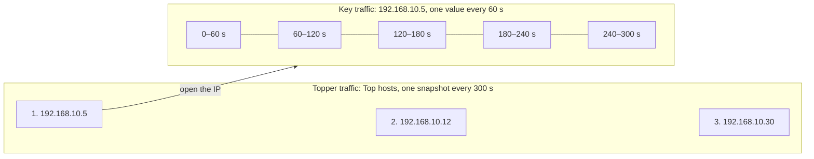
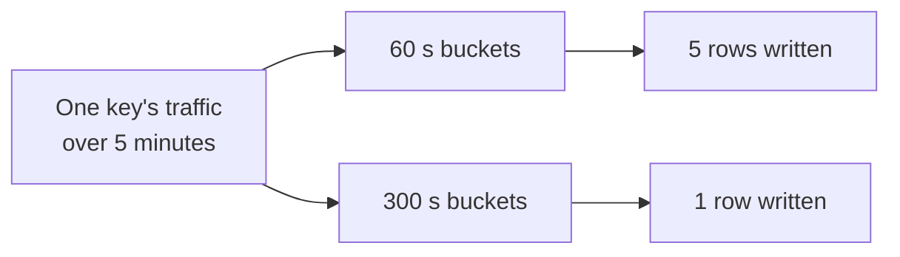
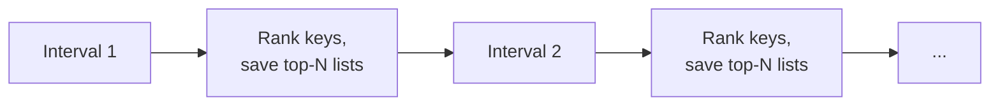
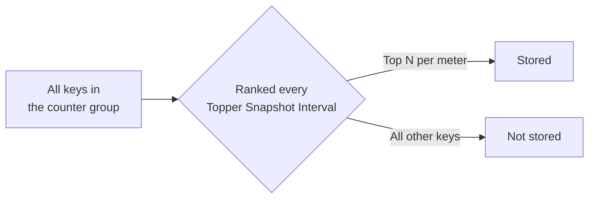
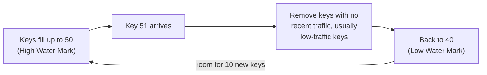
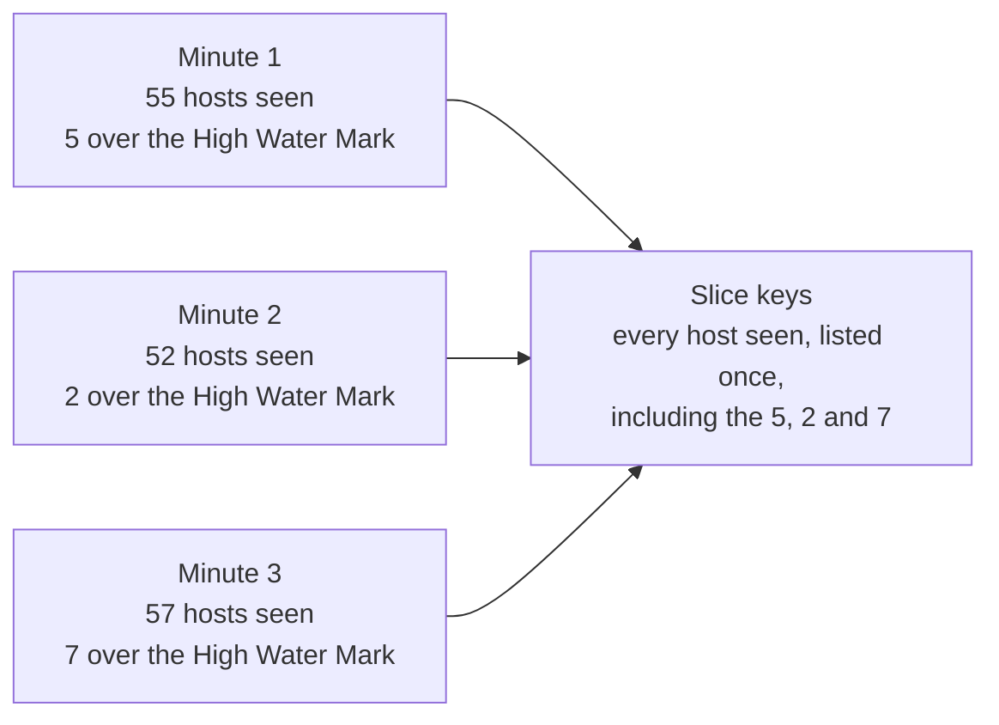
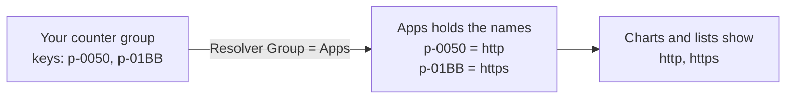
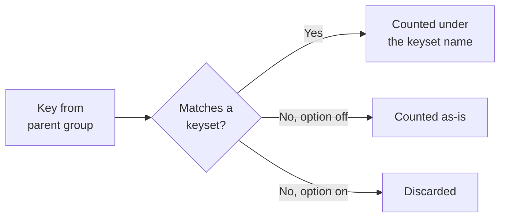
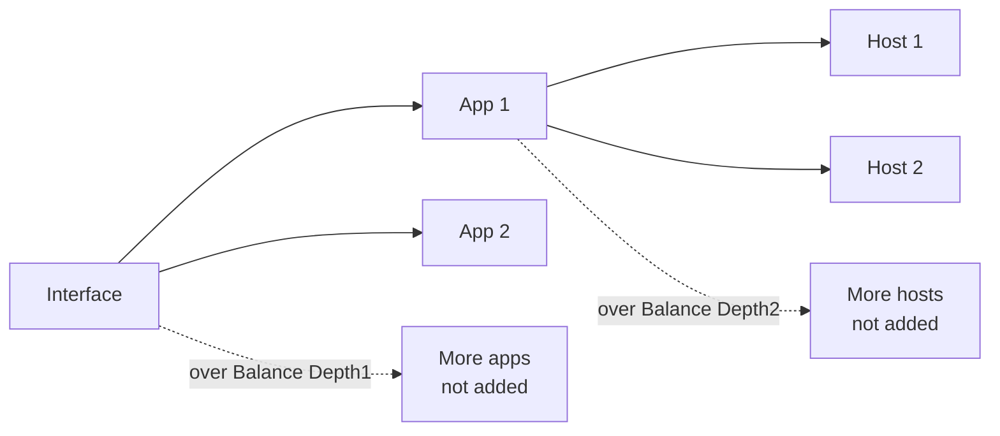

# Tune Counter Groups

Each counter group has settings that control how much detail Trisul stores and how many keys it holds in memory. Tune them when a counter group uses too much disk or memory, or when it doesn't keep the detail you need.

:::info Restart the Probe after every change
The Probe reads these settings only when it starts. A change you save does nothing until you restart the Probe context, for example:

`trisulctl_probe restart context default@probe0`

Make all your changes first, then restart once.
:::

## Key traffic and topper traffic

Every counter group stores two kinds of data. Take the **Hosts** counter group as an example. Each IP address in it is a **key**. If counter groups and keys are new to you, see [Traffic Metering Concepts](/docs/guide/ug/cg/intro).

| | Topper traffic | Key traffic |
| --- | --- | --- |
| What it is | The ranked list of the busiest keys, for example the top hosts by total traffic | The traffic of one key over time, for example the chart of one host's traffic |
| Where you see it | A top-N list on a dashboard | The chart you get when you open one IP from that list |
| How often a value is saved | Once per **Topper Snapshot Interval** (default 300 s) | Once per **Bucket Size** (default 60 s) |

With the default values:

- Every 300 seconds, Trisul ranks the hosts and saves the top-N list. That's one **topper snapshot**.
- Every 60 seconds, Trisul saves one value for each active host. Five of those values make up the chart for the same 5 minutes.

Each setting on this page tunes one of these two kinds of data:

| Setting | Tunes |
| --- | --- |
| Bucket Size | How detailed each key's traffic chart is |
| Topper Snapshot Interval | How often the top-N list is saved |
| Topper Traffic Only | Whether key traffic is kept for every key, or only for keys in the top-N lists |
| High Water Mark / Low Water Mark | How many keys Trisul tracks key traffic for at one time |

## Where to find the settings

| Settings | Navigation |
| --- | --- |
| Bucket size, topper interval, Topper Traffic Only, water marks, slice keys | Context: default &rarr; profile0 &rarr; Counter Groups → click the counter group name |
| Meter only keysets | Context: default &rarr; profile0 &rarr; Custom Counters &rarr; Keysets |
| Balance Depth1, Balance Depth2 | Context: default &rarr; profile0 &rarr; Custom Counters &rarr; Crosskeys |

Log in as `admin` to change them.

## Settings at a glance

| Setting | Available in | What it controls | Change it when |
| --- | --- | --- | --- |
| [Bucket Size Counter Resolution (ms)](#bucket-size) | All counter groups | How often each key's traffic is saved | You want to save disk, or see shorter spikes |
| [Topper Snapshot Interval (Seconds)](#topper-snapshot-interval) | All counter groups | How often the top-N lists are saved | You want top-N history more or less often |
| [Topper Traffic Only](#topper-traffic-only) | All counter groups | Whether traffic is stored for every key or only the toppers | A group has too many keys to store them all |
| [High Water Mark / Low Water Mark](#water-marks) | All counter groups | How many keys Trisul holds in memory | A group uses too much memory, or drops keys you need |
| [Enable Slice Keys](#slice-keys) | All counter groups | Whether Trisul keeps a list of every key it sees, toppers or not | You never look up keys in that group |
| [Resolver Group](#resolver-group) | All counter groups | Which counter group supplies readable names for the keys | Keys show as raw values instead of names |
| [Meter only keysets](#meter-only-keysets) | Keyset counter groups | Whether keys that match no keyset are counted | You only want the keysets you defined |
| [Balance Depth1 / Balance Depth2](#balance-depth) | Cross key counter groups | How many key combinations one parent key can create | One busy key creates too many combinations |

## Bucket Size Counter Resolution (ms) {#bucket-size}

**What it is:** the time resolution of stored meter values. Trisul adds up each key's traffic for one bucket, then writes one value per key at the end of the bucket. The minimum is 1000 ms (1 second).

**Why tune it:** each active key gets one row per bucket. A 60-second bucket writes up to 1,440 rows per key per day. A 300-second bucket writes up to 288.

**How:**

- Raise it to save disk on groups where you only need trends.
- Lower it to see short spikes. Do this only on groups with few keys.
- To set it for all groups at once, use **Advanced Options → Edit bucket size (ms) of all counters**.

## Topper Snapshot Interval (Seconds) {#topper-snapshot-interval}

**What it is:** how often Trisul ranks the keys and saves the top-N lists (toppers) for each meter.

**Why tune it:** each interval saves one set of topper lists. A shorter interval gives finer top-N history and stores more lists.

**How:**

- Raise it if you only look at top-N over longer periods.
- Lower it if you need top-N for shorter periods.
- To set how many keys are ranked per meter, click **Edit Toppers** on the counter group's edit page.
- To set it for all groups at once, use **Advanced Options → Edit topper interval (secs) for all counters**.

## Topper Traffic Only {#topper-traffic-only}

**What it is:** when this option is enabled, only the toppers are stored for this counter group.

**Why tune it:** some groups have a very large number of keys, such as **Hosts** at an ISP, where the keys are every internet address any subscriber visits. Storing detail for all of them uses a lot of disk.

**How:**

- Turn it on for high-cardinality groups where you only need history for the busiest keys.
- Raise the top counts under **Edit Toppers** so the toppers cover the keys you need.

## High Water Mark and Low Water Mark {#water-marks}

**What they are:**

- **High Water Mark:** the maximum number of keys the counter group holds in memory at one time. In the Hosts group, that's the number of IP addresses Trisul is metering right now. Every active key counts, not only the toppers. When one more key arrives after this limit is reached, Trisul removes keys.
- **Low Water Mark:** the number of keys Trisul cuts back to when the High Water Mark is crossed. It removes the keys that haven't sent traffic recently, which are usually the low-traffic keys. Busy keys keep sending traffic, so they stay.

**High Water Mark and top count are different settings.** Readers often mix them up:

| | High Water Mark | Top count |
| --- | --- | --- |
| What it is | The maximum number of keys held in memory | The number of toppers saved in the top-N list |
| In the Hosts group | How many IP addresses Trisul meters at once | How many of the busiest IP addresses appear in the top-N list |
| Where you set it | **Edit Counter Group** page | **Edit Toppers**, separately for each meter |
| Set for | The whole counter group | Each meter, for example Total or Received |
| What it affects | Key traffic: how many keys keep their own traffic | Topper traffic: how many keys are listed as toppers |
| Example | 50,000 | 1,000 |

The two are linked. Trisul picks the toppers only from the keys it holds in memory, so set the High Water Mark well above the largest top count. In the example, Trisul picks the top 1,000 hosts from up to 50,000 in memory.

**Why tune them:** they cap the memory and storage a group can use. Removed keys lose their per-key detail for the current bucket. The group total still counts their traffic.

**How:**

- Raise both if the group drops keys you need.
- Lower both to cap memory on a high-cardinality group.
- The low mark must be below the high mark.

**Choosing the low mark:** after a prune, the group has room for (high − low) new keys before it prunes again. With a high mark of 50:

| Low Water Mark | Room before the next prune |
| --- | --- |
| 40 | 10 new keys, so prunes are less frequent |
| 49 | 1 new key, so it prunes on almost every new key |

Leave a gap that fits how fast new keys arrive in that group.

## Enable Slice Keys {#slice-keys}

**What it is:** when on, Trisul keeps a list of every key seen in this group. It tells you **whether and when a key was seen**. It doesn't hold the key's traffic.

The list includes every key, even the ones Trisul doesn't keep traffic for:

- keys that never made the top-N list, and
- keys the High Water Mark removed from memory.

Each key is listed once. A key that is left out in one minute and becomes a topper in the next still appears only once in the slice keys.

**Example:** the High Water Mark is 50. In the first minute, 55 hosts send traffic. In the second minute, 52. In the third, 57. The extra 5, 2 and 7 hosts are over the limit, so they lose their key traffic. The slice keys still list all of them, and each host only once.

Key traffic is kept separately:

| You want to know | Where it comes from |
| --- | --- |
| Was this IP seen in the traffic, and when? | Slice keys: every key is listed |
| How much traffic did this IP send? | Key traffic: kept for every key that stays in memory. With **Topper Traffic Only** on, only for toppers |

So a host that appeared once and never made the top-N list still shows up in the slice keys. If **Topper Traffic Only** is on, you can confirm the host was seen, but you can't open its traffic chart.

**Why tune it:** the list takes storage.

**How:**

- Leave it on for groups you search during investigations, such as Hosts. It's the only way to confirm that a non-topper key was seen.
- Turn it off on groups where you never look up keys.

## Resolver Group {#resolver-group}

**What it is:** the counter group Trisul uses to turn keys into readable names. Keys are stored as raw values. In the Apps counter group, for example, port 80 is stored as `p-0050` and port 443 as `p-01BB`. Their names, `http` and `https`, are stored with the Apps counter group.

If another counter group already holds the names for the same kind of keys, you select it as the **Resolver Group**. Trisul then shows that group's names instead of the raw keys.

**Why tune it:** without a resolver, a counter group whose keys have no names of its own shows raw values such as `p-0050`.

**How:**

- On the **Edit Counter Group** page, select the counter group that already names these keys from the **Resolver Group** list.
- You don't need it for filtered, keyset, stat based or rule based counter groups. They already use the names from their parent group.

## Meter only keysets {#meter-only-keysets}

**What it is:** a setting on [keyset counter groups](/docs/guide/ag/context/keyset_countergroups).

- **Off (default):** keys that match no keyset are counted as-is in the new group.
- **On:** only keys that match a keyset are metered. Others are discarded.

**Why tune it:** with it off, a keyset group built on a large parent, such as Hosts, also stores every unmatched key.

**How:** turn it on when you only want the keysets you defined.

## Balance Depth1 and Balance Depth2 {#balance-depth}

**What they are:** limits on [cross key counter groups](/docs/guide/ag/context/crosskey_countergroups), which create one key for every combination of their groups.

Take a cross key counter group of **Interfaces × Apps × Hosts**:

| Field | What it limits | In this example |
| --- | --- | --- |
| **Balance Depth1** | For each parent key, how many **CrossKey Group** keys are allowed | How many apps are allowed for each interface |
| **Balance Depth2** | For each parent key + CrossKey Group key, how many **Optional Group 2** keys are allowed | How many hosts are allowed for each app on that interface |

**Why tune them:** one busy interface or app can create thousands of combinations and push useful keys out of memory.

**How:**

- Set **Balance Depth1** to limit the apps per interface.
- Set **Balance Depth2** to limit the hosts per app. Balance Depth2 needs Balance Depth1.
- Keep both values lower than the counter group's [High Water Mark](#water-marks). If the limits are higher, the High Water Mark removes keys before the balance depth limits are ever reached.
- Leave them empty for no limit.

## Apply your changes

1. Click **Update** on each edit form. Make all your changes before you restart.
2. Restart the Probe context, for example `trisulctl_probe restart context default@probe0`.
3. Open the counter group list and check the **Bucket Size (secs)** and **Topper Bucket Size (secs)** columns.

Restart every time you tune again.
