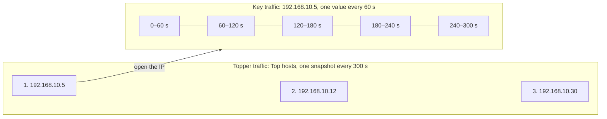
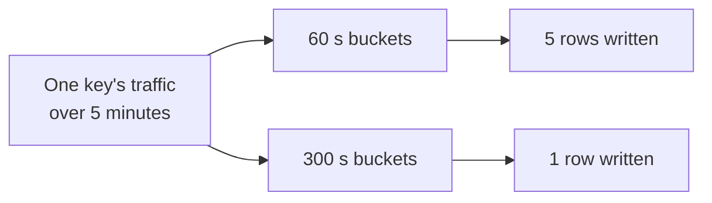
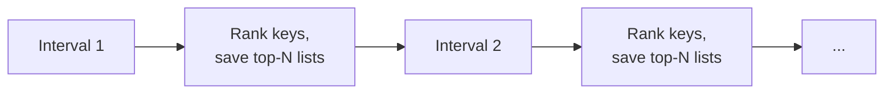
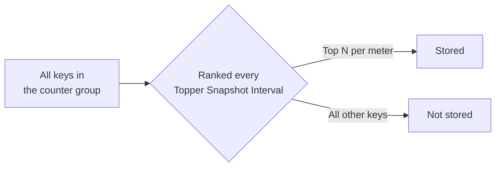
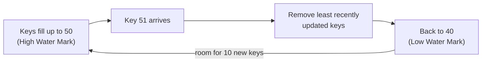
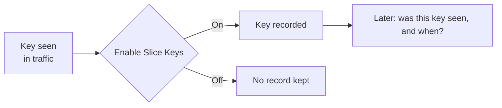
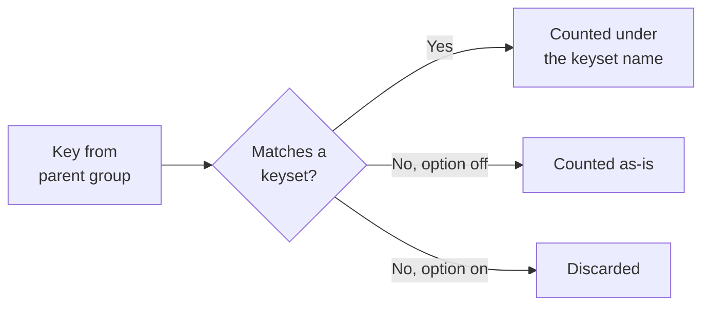
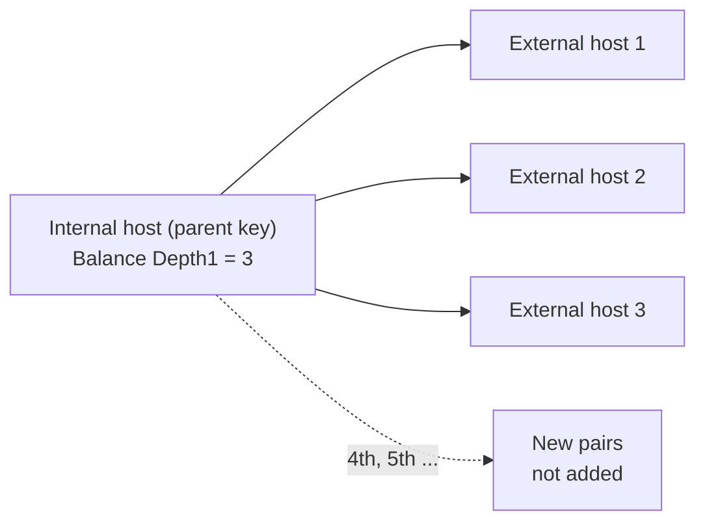

# Tune Counter Groups

Each counter group has settings that control how much detail Trisul stores and how many keys it holds in memory. Tune them when a counter group uses too much disk or memory, or when it doesn't keep the detail you need.

:::info Restart the Probe after every change
The Probe reads these settings only when it starts. A change you save does nothing until you restart the Probe context, for example:

`trisulctl_probe restart context default@probe0`

Make all your changes first, then restart once.
:::

## Key traffic and topper traffic

Every counter group stores two kinds of data. Take the **Hosts** counter group as an example. Each IP address in it is a **key**. If counter groups and keys are new to you, see [Traffic Metering Concepts](/docs/guide/ug/cg/intro).

| | Topper traffic | Key traffic |
| --- | --- | --- |
| What it is | The ranked list of the busiest keys, for example the top hosts by total traffic | The traffic of one key over time, for example the chart of one host's traffic |
| Where you see it | A top-N list on a dashboard | The chart you get when you open one IP from that list |
| How often a value is saved | Once per **Topper Snapshot Interval** (default 300 s) | Once per **Bucket Size** (default 60 s) |

With the default values:

- Every 300 seconds, Trisul ranks the hosts and saves the top-N list. That's one **topper snapshot**.
- Every 60 seconds, Trisul saves one value for each active host. Five of those values make up the chart for the same 5 minutes.

Each setting on this page tunes one of these two kinds of data:

| Setting | Tunes |
| --- | --- |
| Bucket Size | How detailed each key's traffic chart is |
| Topper Snapshot Interval | How often the top-N list is saved |
| Topper Traffic Only | Whether key traffic is kept for every key, or only for keys in the top-N lists |
| High Water Mark / Low Water Mark | How many keys Trisul tracks key traffic for at one time |

## Where to find the settings

| Settings | Navigation |
| --- | --- |
| Bucket size, topper interval, Topper Traffic Only, water marks, slice keys | Context: default &rarr; profile0 &rarr; Counter Groups → click the counter group name |
| Meter only keysets | Context: default &rarr; profile0 &rarr; Custom Counters &rarr; Keysets |
| Balance Depth1, Balance Depth2 | Context: default &rarr; profile0 &rarr; Custom Counters &rarr; Crosskeys |

Log in as `admin` to change them.

## Settings at a glance

| Setting | Applies to | Change it to |
| --- | --- | --- |
| [Bucket Size Counter Resolution (ms)](#bucket-size) | All counter groups | Trade chart detail for disk space |
| [Topper Snapshot Interval (Seconds)](#topper-snapshot-interval) | All counter groups | Control how often top-N lists are saved |
| [Topper Traffic Only](#topper-traffic-only) | All counter groups | Store only the busiest keys |
| [High Water Mark / Low Water Mark](#water-marks) | All counter groups | Cap the number of keys held in memory |
| [Enable Slice Keys](#slice-keys) | All counter groups | Keep or drop the record of every key seen |
| [Meter only keysets](#meter-only-keysets) | Keyset counter groups | Drop keys that match no keyset |
| [Balance Depth1 / Balance Depth2](#balance-depth) | Cross key counter groups | Limit how many key combinations are created |

## Bucket Size Counter Resolution (ms) {#bucket-size}

**What it is:** the time resolution of stored meter values. Trisul adds up each key's traffic for one bucket, then writes one value per key at the end of the bucket. The minimum is 1000 ms (1 second).

**Why tune it:** each active key gets one row per bucket. A 60-second bucket writes up to 1,440 rows per key per day. A 300-second bucket writes up to 288.

**How:**

- Raise it to save disk on groups where you only need trends.
- Lower it to see short spikes. Do this only on groups with few keys.
- To set it for all groups at once, use **Advanced Options → Edit bucket size (ms) of all counters**.

## Topper Snapshot Interval (Seconds) {#topper-snapshot-interval}

**What it is:** how often Trisul ranks the keys and saves the top-N lists (toppers) for each meter.

**Why tune it:** each interval saves one set of topper lists. A shorter interval gives finer top-N history and stores more lists.

**How:**

- Raise it if you only look at top-N over longer periods.
- Lower it if you need top-N for shorter periods.
- To set how many keys are ranked per meter, click **Edit Toppers** on the counter group's edit page.
- To set it for all groups at once, use **Advanced Options → Edit topper interval (secs) for all counters**.

## Topper Traffic Only {#topper-traffic-only}

**What it is:** when this option is enabled, only the toppers are stored for this counter group.

**Why tune it:** some groups have a very large number of keys, such as **Hosts** at an ISP, where the keys are every internet address any subscriber visits. Storing detail for all of them uses a lot of disk.

**How:**

- Turn it on for high-cardinality groups where you only need history for the busiest keys.
- Raise the top counts under **Edit Toppers** so the toppers cover the keys you need.

## High Water Mark and Low Water Mark {#water-marks}

**What they are:**

- **High Water Mark:** the most keys the group tracks in memory.
- **Low Water Mark:** when the count goes over the high water mark, Trisul removes keys until only this many remain. It removes the keys that were updated least recently.

**Why tune them:** they cap the memory and storage a group can use. Removed keys lose their per-key detail for the current bucket. The group total still counts their traffic.

**How:**

- Raise both if the group drops keys you need.
- Lower both to cap memory on a high-cardinality group.
- The low mark must be below the high mark.

**Choosing the low mark:** after a prune, the group has room for (high − low) new keys before it prunes again. With a high mark of 50:

| Low Water Mark | Room before the next prune |
| --- | --- |
| 40 | 10 new keys, so prunes are less frequent |
| 49 | 1 new key, so it prunes on almost every new key |

Leave a gap that fits how fast new keys arrive in that group.

## Enable Slice Keys {#slice-keys}

**What it is:** when on, Trisul keeps a record of every key seen in this group, so you can later find out whether and when a key was seen.

**Why tune it:** the record takes storage.

**How:**

- Leave it on for groups you search during investigations, such as Hosts.
- Turn it off on groups where you never look up keys.

## Meter only keysets {#meter-only-keysets}

**What it is:** a setting on [keyset counter groups](/docs/guide/ag/context/keyset_countergroups).

- **Off (default):** keys that match no keyset are counted as-is in the new group.
- **On:** only keys that match a keyset are metered. Others are discarded.

**Why tune it:** with it off, a keyset group built on a large parent, such as Hosts, also stores every unmatched key.

**How:** turn it on when you only want the keysets you defined.

## Balance Depth1 and Balance Depth2 {#balance-depth}

**What they are:** limits on [cross key counter groups](/docs/guide/ag/context/crosskey_countergroups), which create one key for every combination of their groups.

| Field | Limits |
| --- | --- |
| **Balance Depth1** | For each parent key, how many different **CrossKey Group** keys can be added |
| **Balance Depth2** | For each parent key + CrossKey Group key pair, how many **Optional Group 2** keys can be added |

Example: Internal Hosts × External Hosts, with Balance Depth1 set to 3.

**Why tune them:** one busy parent key, such as a scanner, can create thousands of combinations and push useful keys out of memory.

**How:**

- Set **Balance Depth1** to limit two-group cross keys.
- Also set **Balance Depth2** for three-group cross keys. Balance Depth2 needs Balance Depth1.
- Leave them empty for no limit.

## Apply your changes

1. Click **Update** on each edit form. Make all your changes before you restart.
2. Restart the Probe context, for example `trisulctl_probe restart context default@probe0`.
3. Open the counter group list and check the **Bucket Size (secs)** and **Topper Bucket Size (secs)** columns.

Restart every time you tune again.
