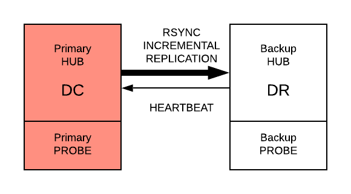

# High Availability

Trisul Network Analytics supports the following high availability options

**HA**

A high availability redundant hub probe setup within the same data centre. The cluster can withstand a single node failure with no loss of data or access

**DR**

setup a disaster recovery node typically in another data center.

import DocCardList from '@theme/DocCardList';

<DocCardList />

## HA

Trisul supports high availability (HA). <!-- TODO(verify): HA architecture to be supplied by the product team (04c-Q03) -->

Contact Trisul Network Analytics for more information. There are multiple options we can suggest.

## DR

In this mode a separate Trisul instance is run in another data center. Trisul's built-in RSYNC-based incremental backup then replicates the data continuously to the DR site.

The following diagram shows the working.

*Figure: DR Setup*

The DR site hubs and probes must be of same sizing (CPU, Memory, IO) as the nodes in the primary DC site.

Contact Trisul Network Analytics for more information. There are multiple options we can suggest.
