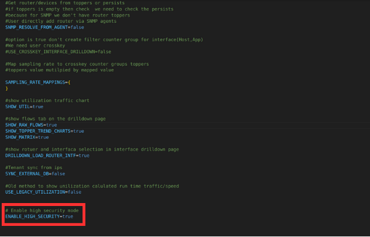

# High Security

## Overview
Trisul's VAPT feature, when enabled in OEM settings, protects your system against various vulnerabilities, including:

- Cross-Site Scripting (XSS)
- SQL injection
- Unexpected errors
- Unprotected credentials

## Functionality
When enabled, Trisul's VAPT feature:

- Detects and blocks XSS attacks, logging the offending code and redirecting users to an error page.
- Neutralizes SQL injection attacks by detecting and blocking suspicious SQL syntax, logging the attempt and redirecting users to a secure error page.
- Conceals sensitive information, such as socket paths and code errors, on error pages to prevent exposure.
- Prevents saving credentials for the login page, adding an extra layer of security.

## Password Requirements

High Security doesn't change the password policy. The password rules, password expiry and account lockout apply to all users whether High Security is on or off. See [Password/Security](/docs/guide/ag/webadmin/web_options#passwordsecurity).

  
*Figure: High Security Enabled*

High Security is off by default (`ENABLE_HIGH_SECURITY=false`). To turn it on, set `ENABLE_HIGH_SECURITY=true` in the [OEM settings file](/docs/guide/ag/context/customize#oemsettingsrb) (`/usr/local/share/webtrisul/config/initializers/oem_settings.rb`), then restart WebTrisul: the `webtrisuld` service, or `webtrisulssld`, depending on your install. See [Start and Stop WebTrisul](/docs/guide/ag/admintasks/startstop#start-and-stop-webtrisul).

