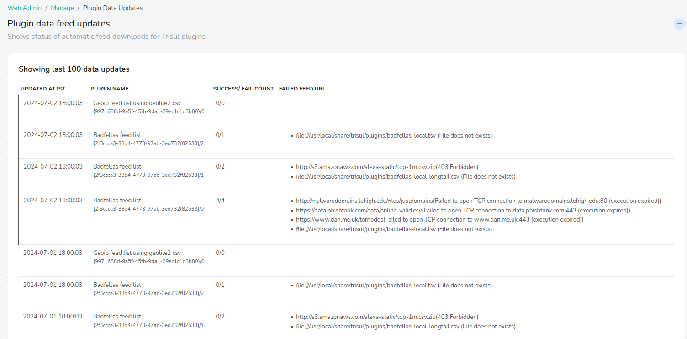

# Plugin Data Updates

Shows the status of automatic feed updates for the Badfellas and Geo plugins.

:::info navigation

:point_right: Log in as `admin` and select Web Admin &rarr; Manage &rarr; Plugin Data Updates

:::

  
*Figure: Plugin Data Feed Updates*

## When a Feed Update Fails

Check whether the feed source is still available online. Feed providers sometimes retire a feed. If the feed is gone, remove it from the plugin's `rules.xml` file, so that Trisul stops downloading it from the next day. See [Removing a Feed](/docs/guide/ref/plugin-config/badfellas#removing-a-feed).
