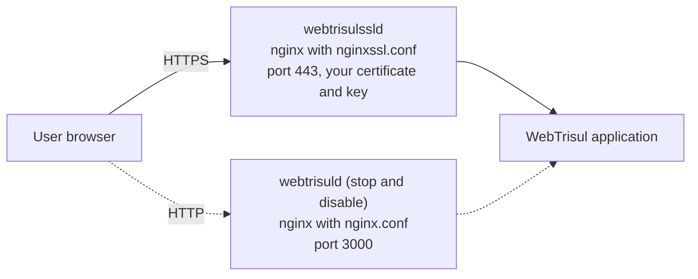

# Serve the Trisul web interface over HTTPS

| Field | Value |
| --- | --- |
| App Note ID | AN-011 |
| Audience | Trisul admins, NOC and network engineers, SOC analysts |
| Applies to | The Trisul hub node that runs WebTrisul |

## Summary

WebTrisul ships with a second web service, `webtrisulssld`, that serves the web interface over HTTPS on port 443. Out of the box it uses a self-signed demo certificate. You install your own certificate and private key, confirm the Web Server settings, then stop the HTTP service `webtrisuld`, start `webtrisulssld`, and make it the service that starts at boot.

## The problem

By default, the Trisul web server listens for plain HTTP on port 3000. Logins, dashboards, reports and alert data then cross the network without encryption.

Trisul has built-in support for HTTPS, but the HTTPS service ships with a self-signed demo certificate and private key. The shipped HTTPS configuration file itself warns that this demo certificate is self signed and expired, and that you must replace it with your organization's own certificate and key. Until you do, browsers show a certificate warning and users cannot verify that they are talking to your Trisul server.

## How it works

WebTrisul has two alternative services. Each one starts the same WebTrisul application behind its own nginx front end:

| Service | nginx configuration file | Listens on |
| --- | --- | --- |
| `webtrisuld` | `/usr/local/share/webtrisul/build/nginx.conf` | Port 3000, plain HTTP |
| `webtrisulssld` | `/usr/local/share/webtrisul/build/nginxssl.conf` | Port 443, HTTPS |



In `nginxssl.conf`, the `ssl_certificate` and `ssl_certificate_key` directives point to `/usr/local/etc/trisul-hub/trisul.ssl.cert` and `/usr/local/etc/trisul-hub/trisul.ssl.key`. The shipped file allows TLS 1.2 and TLS 1.3 only. Both services use the same application backend and the same nginx process ID file, so you run one of them, not both.

The **Web Admin &rarr; Manage &rarr; App Settings &rarr; Web Server** page holds two values that automated tasks use for report scheduling and real-time traffic connectivity: **Web Server Port** and **Web Server Security** (`NONE` or `SSL`). Each time `webtrisulssld` starts, it reads the port from the first `listen` line in `nginxssl.conf` that contains `ssl`, writes it to **Web Server Port**, and sets **Web Server Security** to `SSL`. When the service runs inside an LXC or Incus container, it skips this update and keeps the existing values.

Reference: [Using HTTPS](https://docs.trisul.org/docs/guide/howto/sslforwebtr)

## Prerequisites

- Root or sudo access on the hub node that runs WebTrisul. All commands in this note run as root or with sudo.
- The `admin` login for the web interface.
- Your organization's certificate and the matching private key for the Trisul host name that users will type in the browser.
- If you plan to serve HTTPS on a port other than 443, the port number you want to use.

## Procedure

### Part A: Install your certificate and private key

The HTTPS service reads the certificate and key from these two files:

| Type | Location |
| --- | --- |
| Certificate | `/usr/local/etc/trisul-hub/trisul.ssl.cert` |
| Private key | `/usr/local/etc/trisul-hub/trisul.ssl.key` |

Use option 1 or option 2.

**Option 1: Keep the default file names**

1. Replace `/usr/local/etc/trisul-hub/trisul.ssl.cert` with your certificate, using the same file name.
2. Replace `/usr/local/etc/trisul-hub/trisul.ssl.key` with your private key, using the same file name.

**Option 2: Use your own file names**

1. Open `/usr/local/share/webtrisul/build/nginxssl.conf` in an editor.
2. In the `server` block, set `ssl_certificate` to the path of your certificate file.
3. Set `ssl_certificate_key` to the path of your private key file.
4. Save the file.

The edited lines look like this, where the paths are examples:

```nginx
server {
    listen 443 ssl;
    ...
    ssl_certificate      /home/user1/mynew-ssl.cert;
    ssl_certificate_key  /home/user1/mynew-ssl.key;
    ...
}
```

Keep `ssl` on the `listen` line. The HTTPS service reads its port from that line when it starts. Do not replace it with a separate `ssl on;` line.

**Optional: Serve HTTPS on a port other than 443**

1. In `/usr/local/share/webtrisul/build/nginxssl.conf`, change `443` on the `listen 443 ssl;` line to your port. Keep `ssl` on the line.
2. Save the file.

Check: `nginxssl.conf` has a `listen` line that contains `ssl`, and the `ssl_certificate` and `ssl_certificate_key` lines point to files that exist on the hub node.

### Part B: Set the Web Server settings

:::info navigation
:point_right: Log in as `admin` and go to Web Admin &rarr; Manage &rarr; App Settings &rarr; Web Server
:::

1. Fill in the fields:

| Field Name | Description |
| --- | --- |
| Web Server Port | Enter the HTTPS port: `443`, or the port you set on the `listen` line in Part A. |
| Web Server Security | Select `SSL`. The options are `NONE` and `SSL`. |

2. Click **Save**.

The [source HowTo](https://docs.trisul.org/docs/guide/howto/sslforwebtr#step-2-change-web-server-settings) shows these settings with port `443` and `SSL`.

On a standard install, `webtrisulssld` also writes these two values each time it starts (see How it works). Inside an LXC or Incus container it does not, so this part is required there.

### Part C: Switch to the HTTPS service

1. Stop the HTTP service and start the HTTPS service:

```bash
# stop the HTTP server
systemctl stop webtrisuld

# start the HTTPS (SSL) server
systemctl start webtrisulssld
```

2. Make HTTPS the default web server at startup:

```bash
# disable the HTTP service
systemctl disable webtrisuld

# enable the HTTPS service
systemctl enable webtrisulssld
```

Reference: [Using HTTPS](https://docs.trisul.org/docs/guide/howto/sslforwebtr)

## Verify the result

1. In a browser, open `https://<your Trisul host>`. If you changed the port, open `https://<your Trisul host>:<port>`.
2. Inspect the certificate in the browser. It is your certificate, not the Trisul demo certificate.
3. Log in as `admin`.
4. Go to **Web Admin &rarr; Manage &rarr; App Settings &rarr; Web Server**. **Web Server Port** shows your HTTPS port and **Web Server Security** shows `SSL`.

## Troubleshooting

| Symptom | Cause | Fix |
| --- | --- | --- |
| The HTTPS service does not start and reports `Unable to find SSL port in /usr/local/share/webtrisul/build/nginxssl.conf`. | No `listen` line in `nginxssl.conf` contains `ssl`, for example `listen 443;` followed by a separate `ssl on;` line. | Write the port and `ssl` on one line, for example `listen 443 ssl;`, then start `webtrisulssld` again. |
| The service reports `Running inside an LXC or Incus container, using existing DB parameter`. | Inside an LXC or Incus container, the service does not update **Web Server Port** and **Web Server Security**. | Set both values by hand as in Part B. |
| The browser still warns about the certificate, or shows the Trisul demo certificate. | `nginxssl.conf` still points to the demo certificate and key. | Repeat Part A, then restart the HTTPS service with `systemctl stop webtrisulssld` and `systemctl start webtrisulssld`. |
| The HTTPS page does not load after the switch. | nginx could not start with the HTTPS configuration. | Read the nginx error log at `/usr/local/share/webtrisul/log/nginx.error.log`. |

## Limitations

- Run either `webtrisuld` or `webtrisulssld`, not both. The HTTPS service serves port 443 only. Its shipped configuration has no HTTP listener on port 3000 and no HTTP to HTTPS redirect.
- The shipped HTTPS configuration allows TLS 1.2 and TLS 1.3 only.
- The HTTPS configuration sends a `Strict-Transport-Security` header with `max-age=31536000; preload`.
- This note is based on the docs and the source code. It has not been tested in a lab.

## Related

- [Change the Trisul webserver port](https://docs.trisul.org/docs/guide/howto/change_web_port)
- [Customizing the web server stack](https://docs.trisul.org/docs/guide/howto/nginx-cluster)
- Related app notes: AN-012 (Change the web server port), AN-013 (Customize the web server stack)