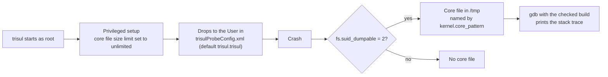

# Capture a core dump when the Trisul Probe crashes

| Field | Value |
| --- | --- |
| App Note ID | AN-014 |
| Audience | Trisul admins, NOC and network engineers |
| Applies to | All product modes |

## Summary

When the Trisul Probe process crashes, a core dump plus a stack trace is what Unleash Networks needs to find the cause. Because `trisul` starts as root and then switches to an unprivileged user, Linux does not write a core file for it by default. You obtain a checked build that keeps its debugging symbols, allow core dumps for setuid programs, set a predictable core file name in `/tmp`, and then read the stack trace with `gdb` after a crash.

## The problem

A crash of the probe stops packet or NetFlow processing for that context, and the probe log alone often does not show why. To fix the cause, Unleash Networks needs the stack at the moment of the crash.

Two things block this on a standard install. First, the `trisul` program in the RPM or DEB package is stripped of debugging symbols, so a stack trace from it is not readable. Second, `trisul` is a setuid program: it starts as root and drops to another user. With the default kernel setting, Linux does not write core files for such programs, so the crash leaves nothing to analyze.

## How it works

At startup, `trisul` runs as root to do its privileged setup. During that setup it raises its own core file size limit to unlimited. It then transfers ownership of its files and drops privileges to the user and group in the `User` parameter of the `App` section of `trisulProbeConfig.xml`. The default is `trisul.trisul`.

When the probe runs as a daemon, its working directory is `/tmp`. If it crashes, the kernel writes the core file there, provided that core dumps are allowed for setuid programs (`fs.suid_dumpable = 2`). The `kernel.core_pattern` setting controls the file name.



Reference: [Trisul Probe Configuration File](https://docs.trisul.org/docs/guide/ref/trisulconfig)

## Prerequisites

- Root access on the probe node. The kernel settings, `/etc/sysctl.conf` and the core file all require root.
- A checked build of `trisul` for your platform, obtained from Unleash Networks (Part A).
- `gdb` installed on the probe node, to read the core file (Part D).

## Procedure

### Part A: Get a checked build

1. Request a checked build from Unleash Networks. You receive a file named `trisul_checked`, built for your platform with all debugging symbols intact.
2. Place `trisul_checked` in `/usr/local/bin`.

The probe start command always launches the program named `trisul` from the directory in the `BinDirectory` parameter (default `/usr/local/bin`). It does not launch `trisul_checked` on its own. Ask Unleash Networks support how they want you to run the checked build on your node.

Reference: [Trisul Probe Configuration File](https://docs.trisul.org/docs/guide/ref/trisulconfig)

### Part B: Allow core dumps for setuid programs

1. Check the current value:

```bash
cat /proc/sys/fs/suid_dumpable
```

2. Set it to `2`:

```bash
echo 2 > /proc/sys/fs/suid_dumpable
```

3. Read the value again. It shows `2`. The source HowTo shows this sequence:

```
[root@localhost ]# cat /proc/sys/fs/suid_dumpable
0
[root@localhost ]# echo 2 > /proc/sys/fs/suid_dumpable
[root@localhost ]#
[root@localhost ]# cat /proc/sys/fs/suid_dumpable
2
```

The `echo` command lasts only until the next reboot. To keep the setting:

4. Add this line to `/etc/sysctl.conf`:

```
fs.suid_dumpable = 2
```

5. Apply the file:

```bash
sysctl -p
```

### Part C: Set the core file name

By default, the core file is written to `/tmp` and is named `core.<PID>`, where `<PID>` is the process ID of the `trisul` process that crashed. To include the program name as well:

1. Add this line to `/etc/sysctl.conf`:

```
kernel.core_pattern=/tmp/core.%e.%p
```

2. Reload the configuration:

```bash
sysctl -p
```

The output lists the settings in the file, including the new pattern. The source HowTo shows:

```
[root@localhost ~]# sysctl -p
net.ipv4.ip_forward = 0
…
kernel.core_pattern = /tmp/core.%e.%p
```

With this pattern, a crash produces a file such as `/tmp/core.trisul.2239`.

### Part D: After a crash, get the stack trace

1. Log in as root. The core file is readable only by root.
2. Locate the core file in `/tmp`.
3. Open it in `gdb` with the checked build. Replace the core file name with yours:

```bash
gdb /usr/local/bin/trisul_checked /tmp/core.trisul.3297
```

4. At the `(gdb)` prompt, print the stack:

```
(gdb) bt
```

5. Send the stack trace to Unleash Networks so they can find and fix the cause of the crash.

Reference: [Make trisul core dump upon crash](https://docs.trisul.org/docs/guide/howto/gencore)

## Verify the result

Before a crash occurs, confirm that the node is ready:

1. `cat /proc/sys/fs/suid_dumpable` prints `2`.
2. `/etc/sysctl.conf` contains `fs.suid_dumpable = 2` and, if you set it, `kernel.core_pattern=/tmp/core.%e.%p`. Running `sysctl -p` lists both settings.
3. The probe log does not contain `Failed to set core file rlimit, no core gen`. Probe logs are the `ns-*.log` files in `/usr/local/var/log/trisul-probe/domain0/probe0/context0`. Replace the domain, probe and context with your own values.

After a crash, a core file exists in `/tmp`, and `bt` in `gdb` prints the stack.

## Troubleshooting

| Symptom | Cause | Fix |
| --- | --- | --- |
| The probe log shows `Unable set infinite RLIMIT for core` followed by `Failed to set core file rlimit, no core gen`. | During startup, `trisul` could not raise its core file size limit to unlimited. Trisul continues to run, but this run does not generate a core file. | Send the log lines to Unleash Networks support. |
| No core file appears in `/tmp` after a crash. | `fs.suid_dumpable` is not `2`, for example because the `echo` setting was lost at reboot. | Repeat Part B, including the `/etc/sysctl.conf` line. |
| `gdb` cannot open the core file. | The core file is readable only by root. | Run `gdb` as root. |

## Limitations

- This note covers the Trisul Probe process `trisul` only.
- The `/tmp` default applies when the probe runs as a daemon (`-demon`), because the daemon's working directory is `/tmp`. The pattern in Part C names the directory explicitly.
- `fs.suid_dumpable` and `kernel.core_pattern` are system-wide kernel settings. They apply to every program on the node, not only to Trisul.
- How to run the checked build in place of the packaged `trisul` is not documented. Follow the instructions from Unleash Networks support.
- This note is based on the docs and the source code. It has not been tested in a lab.

## Related

- [Trisul Probe Configuration File](https://docs.trisul.org/docs/guide/ref/trisulconfig)
- [Log files](https://docs.trisul.org/docs/guide/ag/basictasks/logfiles)