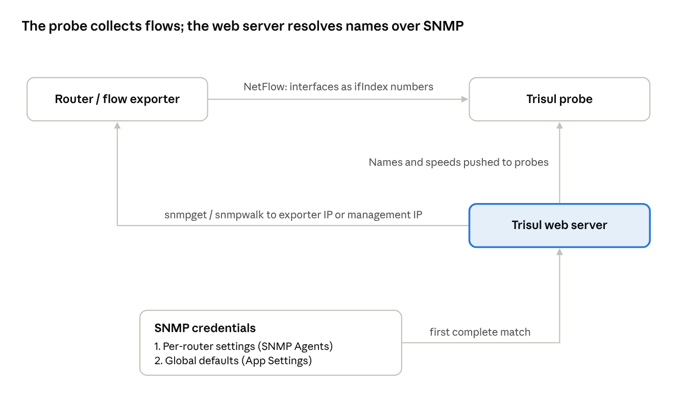
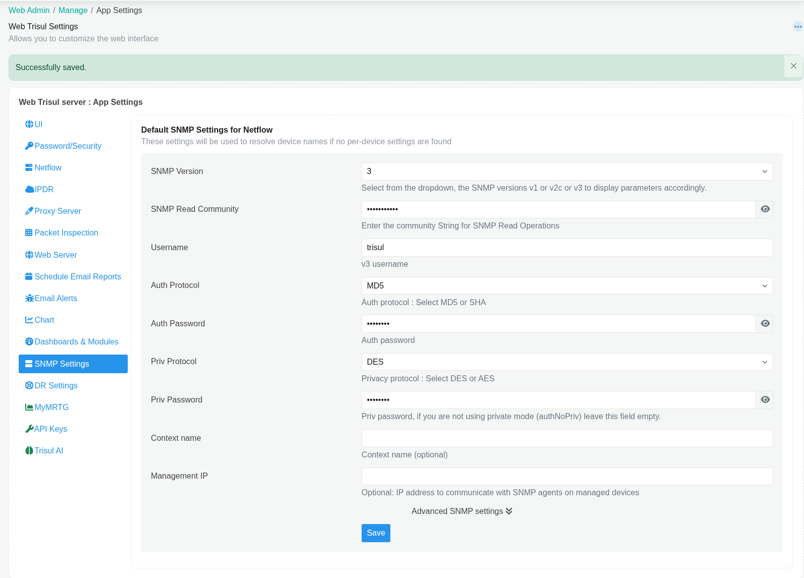
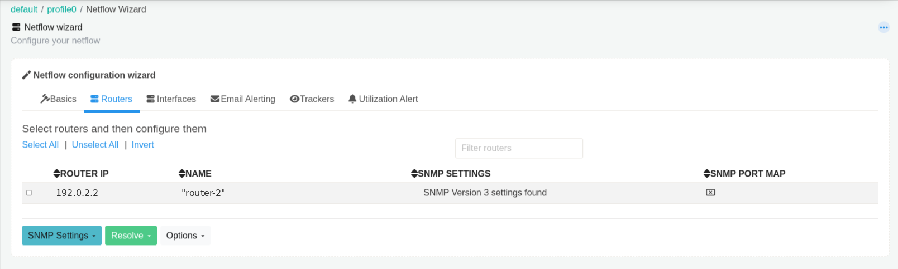
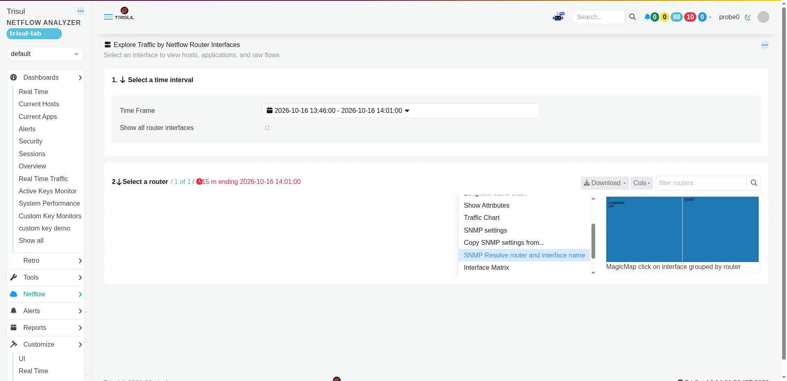
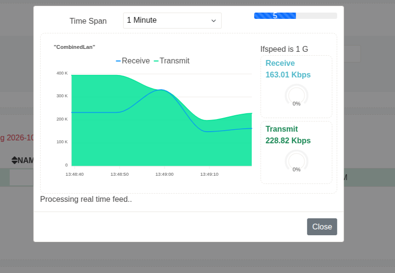
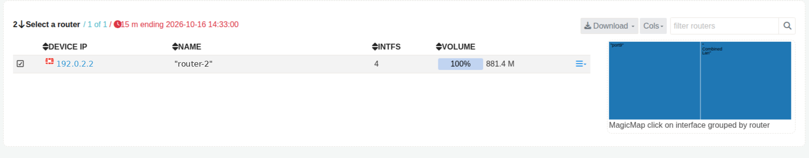

# Resolve router and interface names for NetFlow with SNMP

| Field | Value |
| --- | --- |
| App Note ID | AN-001 |
| Audience | Trisul administrators, NOC and network engineers, ISP operators using NetFlow input |
| Applies to | Trisul NetFlow Analyzer, Trisul ISP Analytics (NetFlow input) |

## Summary

NetFlow records identify interfaces by number only. This note shows how to give Trisul SNMP read access to your flow exporters so that it can resolve router names, interface names, aliases and speeds. It covers global and per-router SNMP settings, bulk and per-device resolve, Live SNMP, a separate management IP, SNMP interface polling apps, and the Huawei NetStream port map. It applies to NetFlow input only.

## The problem

A NetFlow, IPFIX or NetStream exporter reports each interface only as an SNMP ifIndex number. Trisul therefore knows each interface as the exporter IP plus that index. Without SNMP, **NetFlow &rarr; Routers and Interfaces** cannot show which router is which by name, what an interface is called, its description, or its speed.

SNMP fills that gap. Trisul queries each exporter for its system name, interface names, aliases, speeds and IP addresses, and attaches them to the router and interface entries. Reports and dashboards then show meaningful names instead of IPs and index numbers.

Reference: [How to Configure SNMP](https://docs.trisul.org/docs/guide/howto/configuresnmp)

## How it works



*SNMP resolve flow*

The Trisul web server resolves SNMP data by running the net-snmp command-line tools (`snmpget`, `snmpwalk`) against each router. Flow collection and SNMP resolution are separate: the probe receives flows, the web server sends SNMP queries.

**Which credentials are used.** For each router, Trisul first looks for per-router settings (set under **SNMP Agents** or from the router menu). If none are complete, it falls back to the global defaults in **App Settings &rarr; SNMP Settings**.

- Per-router settings are used with version 1 or 2c plus a read community, or version 3 plus a username.
- Global defaults are used only with version 2c plus a community, or version 3 plus a username. A global version 1 setting is not used.

**Which address is queried.** Trisul queries the router's NetFlow exporter IP. If the router has a `snmp.management_ip` attribute, Trisul queries that address instead.

**What is resolved.**

| Data | Standard object | Stored as | Controlled by |
| --- | --- | --- | --- |
| Router name | sysName | Router label | Resolve Router Name |
| Router description | sysDescr | Router attribute | Always |
| Interface name | ifName (IF-MIB ifXTable) | Interface name | Always |
| Interface description | ifAlias | Interface alias | Always |
| Vendor | sysObjectID | Router attribute | Always |
| Interface IP addresses | ipAddrTable | Interface attributes | Always |
| Interface speed | ifHighSpeed, then ifSpeed | Interface speed | Resolve ifSpeed |
| Interface type, VLAN | ifType, Q-BRIDGE-MIB | Interface attributes | Resolve Advanced SNMP |
| Huawei NetStream index map | hwNetStreamIfIndexTable | Interface mapping | Use Huawei SNMP Port Map (Huawei only) |

After a successful resolve, Trisul saves the results on the router and interface entries and pushes the interface data to the probes. With **Auto Resolve SNMP** on (the default), the web server repeats the resolve daily for routers seen in the last 24 hours.

**Live SNMP** is separate from resolve. While its dialog is open, the web server polls the selected interface over SNMP at a fixed interval and streams the results to the browser.

## Prerequisites

- Trisul is receiving NetFlow from the routers you want to resolve. The NetFlow Wizard lists only routers that have sent flows.
- The net-snmp command-line tools are installed on the Trisul web server host (to check, see Verify the result):

```bash
# Ubuntu
sudo apt install snmp
# RHEL / CentOS
sudo yum install net-snmp-utils
```

- Each router answers SNMP read queries from the Trisul web server, at its exporter IP or at a management IP you will set.
- You have the SNMP read credentials for each router: a v1/v2c read community, or a v3 username with auth and privacy settings.
- You can log in to the web UI as `admin` (settings, SNMP Agents, NetFlow Wizard, Apps) and as a user (NetFlow menus).
- For SNMP interface polling apps: the web server can reach github.com, directly or through the proxy in **App Settings**. Otherwise, download the app TAR file and import it offline.

Reference: [Apps](https://docs.trisul.org/docs/guide/ag/webadmin/apps)

## Procedure

The steps follow the source HowTo in order. Step 1 or step 2 is required; the others depend on your network.

### Step 1 – Set the global SNMP defaults

Use this when most routers share one set of credentials. The page is titled **Default SNMP Settings for Netflow**: these settings are used when a router has no settings of its own.

:::info navigation
:point_right: Log in as `admin` and go to Web Admin &rarr; Manage &rarr; App Settings &rarr; SNMP Settings
:::

1. Fill in the fields:

| Field Name | Description |
| --- | --- |
| SNMP Version | Select `2c` or `3`. The global defaults are not used with version `1`; set SNMPv1 devices per router (step 2). |
| SNMP Read Community | For `2c`, enter the read community. |
| Username | For `3`, enter the SNMPv3 username. |
| Auth Protocol | For `3`, select MD5, SHA, SHA-224, SHA-256, SHA-384 or SHA-512. |
| Auth Password | For `3`, enter the auth password. |
| Priv Protocol | For SNMPv3 with privacy, select DES, AES, AES-192, AES-256 or AES-256-C. |
| Priv Password | For SNMPv3 with privacy, enter the priv password. Leave empty for authNoPriv. |
| Context name | Optional. |

2. Click **Save**. The page shows `Successfully saved.`



*Figure 1: Global SNMP settings saved with SNMPv3. With version 3 selected, the SNMP Read Community field can still be visible; Trisul does not use it for v3.*

**Advanced SNMP settings** (expand the link under the form) control what each resolve updates. Defaults:

| Field Name | Default | Effect |
| --- | --- | --- |
| Use Huawei SNMP Port Map | Off | Map NetStream ifIndex to SNMP ifIndex (Huawei only; step 8) |
| Auto Resolve SNMP | On | Resolve names, aliases and speeds daily |
| Resolve ifSpeed | On | Overwrite interface speed from SNMP; turn off to keep speeds you set |
| Resolve Router Name | On | Overwrite router label from sysName; turn off to keep labels you set |
| Resolve Advanced SNMP | On | Resolve interface type and VLAN information |
| Resolve Velocloud vceLinkCapacityBpsGauge | Off | Resolve VeloCloud Tx/Rx link capacity |
| SNMP Command Prefix | Empty | Text placed before every SNMP command |

Reference: [SNMP Settings](https://docs.trisul.org/docs/guide/ag/webadmin/web_options#snmp-settings)

### Step 2 – Set SNMP details for individual routers

Use this for routers with their own credentials, for SNMPv1 devices, or to set a management IP.

:::info navigation
:point_right: Go to Context: default &rarr; profile0 &rarr; SNMP Agents
:::

1. Click **Add new SNMP Agent**.
2. Fill in the fields:

| Field Name | Description |
| --- | --- |
| IP Address | The router IP. To add several routers with the same settings, separate the IPs with commas. |
| SNMP Version | Select `1`, `2c` or `3`, then enter the community or the SNMPv3 fields as in step 1. |
| Management IP | Optional. Enter it if the router answers SNMP on a different address (see step 6). |

3. Click **Add**. The list shows `Successfully added SNMP agents` and the router's IP, label, version and description.

Each row's menu has **Edit SNMP**, **Edit Key**, **Resolve** and **Delete**. **Resolve All** resolves every router in the list.

You can also open a router's settings from **NetFlow &rarr; Routers and Interfaces**: its option menu has **SNMP settings** and **Copy SNMP settings from...**. Until a router is resolved, the **Label** column in the SNMP Agents list shows its IP address.

Reference: [SNMP Agent](https://docs.trisul.org/docs/guide/ag/context/snmp_agent)

### Step 3 – Resolve SNMP for multiple routers

:::info navigation
:point_right: Log in as `admin` and go to Context: default &rarr; profile0 &rarr; NetFlow Wizard &rarr; Routers
:::

1. Check the **SNMP settings** column. Each router shows `SNMP Version <n> settings found`, `Global SNMP settings found` or `SNMP settings not found`.
2. Click **Select All** above the routers list.
3. Click **Resolve &rarr; Resolve router and interfaces**.

Check: the page reports `Successfully resolved SNMP settings for <n> router(s)`. If some routers did not answer, the message adds `and timeout error with <n> routers(s) <IPs>`.

The web UI labels this page **Netflow Wizard**.



*Figure 2: The Routers tab shows the SNMP settings status for each router that has sent flows.*

Reference: [NetFlow Wizard](https://docs.trisul.org/docs/guide/ug/netflow/netflow_wizard)

### Step 4 – Resolve SNMP per device

:::info navigation
:point_right: Log in as a user and go to NetFlow &rarr; Routers and Interfaces
:::

1. Click the option button on the router's row.
2. Select **SNMP Resolve router and interface name**.

The page shows `Please wait, snmp in progress` and reloads when done. If the menu item is greyed out with the tooltip `SNMP settings not found`, add settings for that router first.

The page is titled **Explore Traffic by Netflow Router Interfaces**. When the resolve finishes, it shows `Successfully resolved SNMP settings for 1 router(s)`.



*Figure 3: The router's option menu in Routers and Interfaces.*

### Step 5 – View Live SNMP for an interface

:::info navigation
:point_right: Go to NetFlow &rarr; Routers and Interfaces
:::

1. Click the option button on an interface row.
2. Select **Live SNMP**.

A dialog shows live SNMP data for the interface.

The dialog shows the interface's SNMP speed (for example `Ifspeed is 1 G`), live **Receive** and **Transmit** rates with a utilization gauge for each, and a **Time Span** selector. The status line reads `Processing real time feed..` while polling runs. Click **Close** to close the dialog.



*Figure 4: Live SNMP for a 1 Gbps interface.*

### Step 6 – Set an SNMP management IP

By default Trisul sends SNMP queries to the router's NetFlow exporter IP. Set a management IP when the router answers SNMP on another address.

:::info navigation
:point_right: Open the router's [Key Dashboard](https://docs.trisul.org/docs/guide/ug/ui/key_dashboard)
:::

1. Click **Set Label/Edit &rarr; Assign User Label / Edit attributes**.
2. Under **Attributes**, click **Add attribute**.
3. Fill in the fields:

| Field Name | Description |
| --- | --- |
| Name | `snmp.management_ip` |
| Value | The management IP address, for example `192.0.2.10`. |

4. Click **Update**.
5. Resolve the router again (step 3 or 4).

The **Management IP** field in the router's SNMP settings (step 2) sets the same value and rejects an invalid address.

The attributes list on this page also shows the router's SNMP settings, including SNMPv3 passwords in plain text (`snmp.auth_password`, `snmp.priv_password`). Limit who can edit keys accordingly.

### Step 7 – Install SNMP interface polling apps

:::info navigation
:point_right: Log in as `admin` and go to Web Admin &rarr; Manage &rarr; Apps
:::

1. Install **Meta App for snmp**.

The meta app installs two apps: **SNMP Poller** and **SNMP vs NetFlow**. After a successful install, the Apps page shows Successfully installed a Mata app Meta App for snmp (the UI spells it "Mata").

On the **Apps** page the card is labeled **Meta App for snmp** (type **META APPS**), with the description "Automatically install snmppoller and snmpvsnetflow app".

Reference: [Apps – Types of apps](https://docs.trisul.org/docs/guide/ag/webadmin/apps#types-of-apps)

### Step 8 – Huawei routers: enable the SNMP port map

Huawei NetStream can export ifIndex values that differ from the SNMP ifIndex. The port map uses Huawei's proprietary MIB to map one to the other.

:::info navigation
:point_right: Go to Web Admin &rarr; Manage &rarr; App Settings &rarr; SNMP Settings
:::

1. Click **Advanced SNMP settings**.
2. Select **Use Huawei SNMP Port Map**.
3. Click **Save**.
4. Resolve the Huawei routers again (step 3 or 4).

The map is applied only to routers that identify as Huawei in SNMP. To set it per router instead, select the routers in **NetFlow Wizard &rarr; Routers** and use **Options &rarr; Enable SNMP Port Map** or **Disable SNMP Port Map**. The **SNMP Port Map** column shows the current state. Turning the port map on per router was lab-tested; its effect on Huawei NetStream was not (no Huawei exporter in the lab). Documented procedure for the mapping itself.

## Verify the result

| Where | Expected result |
| --- | --- |
| **Netflow Wizard &rarr; Routers**, **SNMP settings** column | `SNMP Version <n> settings found` or `Global SNMP settings found` for every router you configured |
| Message after a resolve | `Successfully resolved SNMP settings for <n> router(s)` with no timeout list |
| **NetFlow &rarr; Routers and Interfaces** | The router shows its SNMP system name in **NAME**; the interface map shows interface names instead of index numbers |
| Router details in **Routers and Interfaces** | **SNMP** shows `Configured` |
| Router's **Edit key details** page, **Attributes** | `snmp.resolve_status` = `success`, `snmp.resolve_message` = `Successfully resolved SNMP settings` |
| **Context: default &rarr; profile0 &rarr; SNMP Agents** | Each router you added appears with its IP, label and SNMP version |
| **Live SNMP** on an interface | The dialog shows the interface speed and live Receive/Transmit rates, not `SNMP Agents not available for <router>` |
| **Netflow Wizard &rarr; Routers**, **SNMP Port Map** column (Huawei) | Ticked for routers where the port map is enabled |



*Figure 5: A resolved router. NAME shows the SNMP system name and the interface map shows interface names. Values from SNMP keep their double quotes (see Troubleshooting).*

To test the tools, reachability and credentials from the Trisul web server itself, run the same queries Trisul uses. Lab output, masked:

```bash
$ which snmpget snmpwalk
/usr/bin/snmpget
/usr/bin/snmpwalk

# Router name (sysName)
$ snmpget -O n -v 2c -c '<community>' 192.0.2.1 .1.3.6.1.2.1.1.5.0
.1.3.6.1.2.1.1.5.0 = STRING: "router-1"

# Interface names (ifName), excerpt
$ snmpwalk -O n -v 2c -c '<community>' 192.0.2.1 1.3.6.1.2.1.31.1.1.1.1 | head -20
.1.3.6.1.2.1.31.1.1.1.1.1 = STRING: "Virtual-Template0"
.1.3.6.1.2.1.31.1.1.1.1.4 = STRING: "GigabitEthernet0/0/0"
.1.3.6.1.2.1.31.1.1.1.1.7 = STRING: "GigabitEthernet4/0/0"
.1.3.6.1.2.1.31.1.1.1.1.41 = STRING: "Eth-Trunk2"
.1.3.6.1.2.1.31.1.1.1.1.44 = STRING: "Eth-Trunk100.1600"

# Interface speeds in Mbps (ifHighSpeed), excerpt
$ snmpwalk -O n -v 2c -c '<community>' 192.0.2.1 1.3.6.1.2.1.31.1.1.1.15 | head -20
.1.3.6.1.2.1.31.1.1.1.15.1 = Gauge32: 0
.1.3.6.1.2.1.31.1.1.1.15.4 = Gauge32: 1000
.1.3.6.1.2.1.31.1.1.1.15.7 = Gauge32: 10000
.1.3.6.1.2.1.31.1.1.1.15.41 = Gauge32: 0
.1.3.6.1.2.1.31.1.1.1.15.44 = Gauge32: 50000
```

A `STRING:` reply with the router name means Trisul can resolve that router. The last number of each OID is the ifIndex, the same number NetFlow reports. Interfaces that report an ifHighSpeed of `0` (virtual interfaces, some trunks) get their speed from ifSpeed instead.

## Troubleshooting

| Symptom or message | Cause | Fix |
| --- | --- | --- |
| `SNMP tools not installed on this server` | `snmpget` or `snmpwalk` is missing on the web server host | Install `snmp` (Ubuntu) or `net-snmp-utils` (RHEL/CentOS), then resolve again |
| `SNMP settings not configured for device(s) : <router>. Please configure using [SNMP Settings]` | No usable per-router settings, and the global defaults are missing or set to version 1 | Add per-router settings (step 2), or set global version `2c` with a community, or `3` with a username (step 1) |
| `Timeout Error with <n> requests. Check if router <IP> is reachable and SNMP settings such as community/v3 passwords are correct` | No SNMP reply from that address | Check the community or v3 credentials and that the router accepts SNMP from the Trisul web server. If it answers on another address, set `snmp.management_ip` (step 6) |
| Success message ends with `and timeout error with <n> routers(s) <IPs>` | Some routers answered, others did not | Fix the listed routers as in the row above |
| Not sure whether the last resolve of a router worked | – | Open the router's **Edit key details** page and read `snmp.resolve_status` and `snmp.resolve_message` under **Attributes** |
| **SNMP Resolve router and interface name** is greyed out with `SNMP settings not found` | That router has no SNMP settings | Add settings for the router (step 1 or 2) |
| Live SNMP shows `SNMP Agents not available for <router>` | That router has no SNMP settings | Add settings for the router, then reopen Live SNMP |
| `Auth Password can't be empty when using authpriv` | SNMPv3 Priv Password set without an Auth Password | Enter the Auth Password, or clear the Priv Password for authNoPriv |
| `Invalid Management IP` | The management IP is not a valid IP address | Enter a valid IPv4 or IPv6 address |
| `SNMP agent already exists for IP: <IP>` | The router already has SNMP settings | Use **Edit SNMP** on its row in **SNMP Agents** |
| Router and interface names show inside double quotes, for example `"router-1"` | Trisul stores the string exactly as the SNMP tools print it, quotes included | Edit the **Name** on the router's **Edit key details** page, then turn off **Resolve Router Name** so the daily resolve keeps your name |
| Router labels or interface speeds you set by hand change back | The daily resolve overwrites them | Turn off **Resolve Router Name** or **Resolve ifSpeed** in **Advanced SNMP settings** |
| Huawei interface names do not match the interfaces in flows | NetStream ifIndex differs from SNMP ifIndex | Enable **Use Huawei SNMP Port Map** and resolve again (step 8) |

## Limitations

- Applies to NetFlow input only.
- SNMP queries come from the Trisul web server host, not from the probe. Router ACLs must allow that host.
- Global SNMP defaults support only v2c and v3. SNMPv1 devices need per-router settings.
- The daily auto resolve covers routers that sent flows in the last 24 hours.
- The Huawei port map works only for routers that identify as Huawei in SNMP.
- **Meta App for snmp** needs access to github.com, or an offline TAR import.
- The Edit key details page shows SNMPv3 passwords in plain text. Anyone who can edit keys can read them.

## Related

- [SNMP Agent](https://docs.trisul.org/docs/guide/ag/context/snmp_agent)
- [App Settings – SNMP Settings](https://docs.trisul.org/docs/guide/ag/webadmin/web_options#snmp-settings)
- [NetFlow Wizard](https://docs.trisul.org/docs/guide/ug/netflow/netflow_wizard)
- [Key Dashboard](https://docs.trisul.org/docs/guide/ug/ui/key_dashboard)
- [Apps](https://docs.trisul.org/docs/guide/ag/webadmin/apps)
- [Glossary: SNMP](https://docs.trisul.org/glossary/snmp)
- Related app notes: AN-002 (Post-install NetFlow optimization for large enterprises), AN-003 (Optimize Trisul for an ISP deployment)
