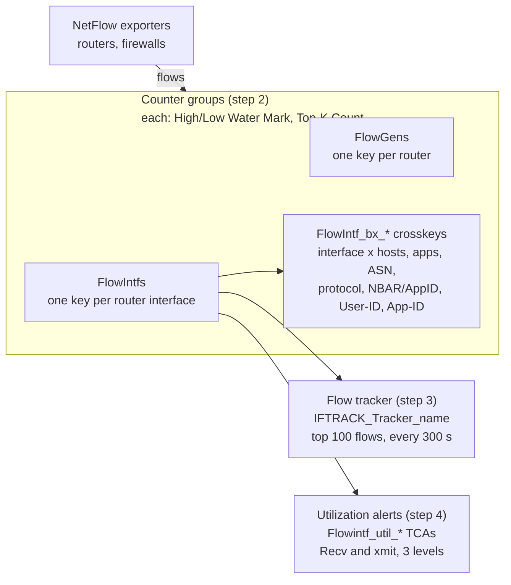
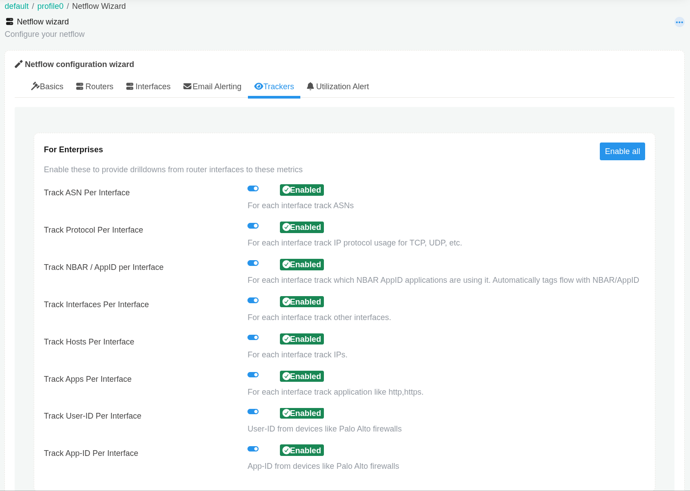
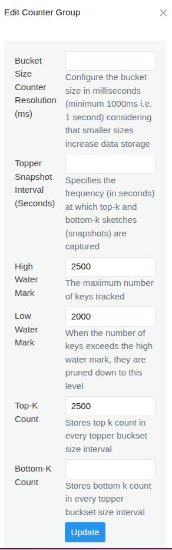
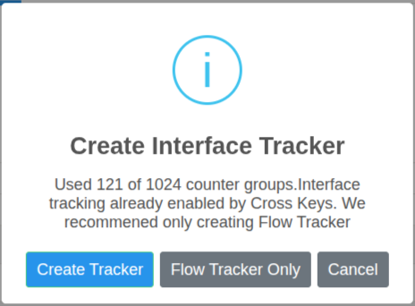
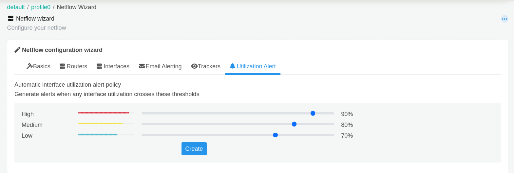

# AN-002 – Scale NetFlow monitoring for large enterprises

Oct 16, 2026 · Santhana M

| Field | Value |
| --- | --- |
| App Note ID | AN-002 |
| Source HowTo | [NetFlow Post Installation Optimization Guide for Large Enterprises](https://docs.trisul.org/docs/guide/howto/netflow_postinstall_guide) |
| Trisul build tested | trisul-probe 8.0.3432, trisul-hub 8.0.3328, webtrisul 8.0.2627 on Ubuntu 24.04.2 LTS, 2026-10-16 |
| Audience | Trisul administrators, NOC and network engineers running Trisul NetFlow Analyzer with many routers and interfaces |
| Status | Pass 2 – lab verified except: Step 2 (filter + Select All), Verify the result (fired utilization alert) |

## Summary

The NetFlow Analyzer product mode sets Trisul up for flow input, but its key limits suit a modest number of routers and interfaces. This note raises the topper and key limits for the router, interface and per-interface crosskey counter groups, adds a flow tracker to each busy interface, and creates interface utilization alerts. It ends by pointing to SNMP name resolution (AN-001).

## The problem

Each Trisul counter group tracks a bounded number of keys. When the number of keys passes the **High Water Mark**, Trisul prunes them down to the **Low Water Mark**. Each topper interval, it stores only the top K keys per meter, where K is the **Top-K Count**.

In a large enterprise the router counter group (`FlowGens`) and the interface counter group (`FlowIntfs`) can hold thousands of keys. The per-interface crosskeys (`FlowIntf_bx_*`) hold the product of interfaces and hosts, apps or other keys, so they grow faster still. If the limits are lower than the real key count, routers, interfaces and per-interface breakdowns drop out of toppers and long-term reports.

Long-term drilldowns built from raw flows also lose accuracy on high-traffic links. A per-interface flow tracker keeps the top flows for each tracked interface.

Reference: [Counter Group Settings](https://docs.trisul.org/docs/guide/ag/context/countergroup_settings)

## How it works



The probe meters every flow into the router counter group `FlowGens` and the interface counter group `FlowIntfs`. Crosskey counter groups named `FlowIntf_bx_*` (and `Interface_bx_Interface`) break each interface down further. The NetFlow Analyzer product mode creates these crosskeys: Hosts, Apps, ASN, Protocol, NBAR/AppID, User-ID and App-ID per interface, plus Interfaces per interface.

**Key limits (step 2).** Each counter group has a **High Water Mark**, a **Low Water Mark** and a **Top-K Count**. The bulk **Edit Counter Group** panel writes the watermarks to every selected counter group. It writes the Top-K Count to every meter of each selected group. The High Water Mark must be greater than the Low Water Mark.

**Interface flow trackers (step 3).** **Flow Tracker Only** creates one flow tracker per selected interface, named `IFTRACK_Tracker_<interface>`. The interface part is the router IP and ifIndex, for example `IFTRACK_Tracker_192.168.10.1_7`. It keeps the top 100 flows of that interface and commits every 300 seconds. **Create Tracker** adds two filtered counter groups per interface (`IFTRACK_Apps_<interface>`, `IFTRACK_Hosts_<interface>`) as well. The per-interface crosskeys already hold that data, so the wizard offers **Flow Tracker Only** when they exist.

**Utilization alerts (step 4).** The **Utilization Alert** tab creates six threshold crossing alerts (TCAs) on `FlowIntfs`: High, Medium and Low, each for the Recv-Util and Xmit-Util meters (percent). Each TCA fires after one interval above its threshold. It clears after one interval below the threshold minus 10 points.

Counter group and tracker changes take effect after you restart the probe context.

Reference: [NetFlow Wizard](https://docs.trisul.org/docs/guide/ug/netflow/netflow_wizard), [Interface Tracking](https://docs.trisul.org/docs/guide/ug/netflow/interface_tracker), [Cross Key Counter Groups](https://docs.trisul.org/docs/guide/ag/context/crosskey_countergroups)

## Prerequisites

- Trisul is installed and you can log in to the web UI as `admin`.
- The probe is receiving NetFlow. The NetFlow Wizard lists only routers and interfaces that have already sent flows; the docs advise waiting 15–20 minutes after flows start before using the **Interfaces** tab.
- You have shell access to the probe node, as root, to run `trisulctl_probe`.
- You have decided the utilization percentages that should raise High, Medium and Low alerts.
- For step 5: SNMP read access from the Trisul web server to your routers (see AN-001).

Reference: [Selecting the Product Mode](https://docs.trisul.org/docs/guide/starthere/setuptrisul/install/selectmode), [trisulctl](https://docs.trisul.org/docs/guide/learntrisul/concepts/trisulctl)

## Procedure

The steps follow the source HowTo in order. Log in as `admin` for steps 1 to 4.

### Step 1 – Select the NetFlow Analyzer product mode

1. Log in to the web UI as `admin`. On first login the **How do you plan to use Trisul?** dialog opens.
2. If it does not open, go to **Web Admin › Manage › App Settings › UI**, select **Show mode selection** and click **Save**. Log in again.
3. Select the **NetFlow Analyzer** card; its radio button is selected. The other cards are **IPDR Compliance**, **Security Monitoring** and **ISP Analytics Suite**.
4. Click **Next**.
5. Select the network interfaces that receive NetFlow.
6. Click **Configure**.

The **Applying mode NetFlow Analyzer -- default** dialog stops and restarts the hub and probe contexts, then shows **Success ! Next steps**. Click **Close**. Lab output:

```text
Stop Hub    Successfully stopped context processes: default@hub0
Stop Probe  Context is already stopped
Start Hub   Successfully started context processes: default@hub0
Start Probe Successfully started context processes: default@probe0
```

The mode sets the probe to `NETFLOW_TAP`, turns off the packet ring and creates all the per-interface crosskey trackers listed in **How it works**.



Reference: [Selecting the Product Mode](https://docs.trisul.org/docs/guide/starthere/setuptrisul/install/selectmode)

### Step 2 – Raise the key limits

Set these values in the bulk **Edit Counter Group** panel. They are the HowTo's values for a large enterprise; size them to your router and interface counts.

| Counter groups | Filter text | High Water Mark | Low Water Mark | Top-K Count |
| --- | --- | --- | --- | --- |
| Routers: `FlowGens` | `FlowGens` | 2500 | 2000 | 2500 |
| Interfaces: `FlowIntfs` | `FlowIntfs` | 10000 | 9000 | 10000 |
| Per-interface crosskeys: the seven `FlowIntf_bx_*` groups (ASN, AppID, Apps, Hosts, NBARAppID, Protocol, UserID) | `FlowIntf_bx` | 50000 | 45000 | 50000 |

Repeat these actions for each row of the table:

1. Go to **Context: default › profile0 › Counter Groups**.
2. Type the filter text in the filter bar at the top right of the list.
3. Select the checkbox of a listed counter group. A menu opens beside it.
4. Click **Select All** in that menu. Only the rows the filter shows are selected; check that they are the groups in the table row.
5. In the same menu, click **Edit**. The **Edit Counter Group** panel opens. The menu hides after about 5 seconds; to reopen it, clear and re-select any selected checkbox.
6. Enter the **High Water Mark**, **Low Water Mark** and **Top-K Count** from the table. Leave the other fields empty; empty fields are not changed.
7. Click **Update**.



Check: a `Successfully updated counter groups` message appears at the top right, and the edited groups show a new last-modified time in the list. The changes take effect when the probe context restarts at the end of step 3.

Reference: [Counter Group Settings – Bulk Edits](https://docs.trisul.org/docs/guide/ag/context/countergroup_settings)

### Step 3 – Create interface flow trackers

1. Go to **Context: default › profile0 › NetFlow Wizard**.
2. Open the **Interfaces** tab.
3. In **Select a Router to display interfaces**, select a router. Its interfaces are listed.
4. Select the interfaces to track, or click **Select All** above the list.
5. Click **Interface Tracking › Enable Interface Tracking**. The **Create Interface Tracker** dialog opens.
6. Click **Flow Tracker Only**.
7. Repeat steps 3 to 6 for each router.



The dialog shows how many of the 1024 counter groups are in use. **Flow Tracker Only** appears only when the `FlowIntf_bx_Hosts` crosskey exists, which step 1 creates. Interfaces that already have a tracker are skipped.

Check: the page shows `Successfully enabled Interface Tracking tracker. Restart Trisul Probe` at the bottom right, and each newly tracked interface shows the eye icon.

Restart the probe context on the probe node, as root:

```bash
trisulctl_probe restart context default@probe0
```

`restart context` runs `stop context` and then `start context`; you can also run those two commands yourself. Replace `probe0` with your probe ID if it differs. Expected output:

```text
stop context default@probe0
   + probe0               stopped Successfully stopped context processes: default@probe0
 start context default@probe0
   + probe0               started Successfully started context processes: default@probe0
```

Reference: [Interface Tracking](https://docs.trisul.org/docs/guide/ug/netflow/interface_tracker), [trisulctl – Start and Stop Contexts](https://docs.trisul.org/docs/guide/learntrisul/concepts/trisulctl)

### Step 4 – Create interface utilization alerts

1. Go to **Context: default › profile0 › NetFlow Wizard**.
2. Open the **Utilization Alert** tab.
3. Set the **High**, **Medium** and **Low** sliders to the utilization percentages that should raise each alert. The defaults are 90, 80 and 70.
4. Click **Create**.



Check: the page reloads on the **Utilization Alert** tab with a `Successfully configured interface utilization alert policy` banner at the top. The sliders keep your saved values.

Restart the probe context as in step 3.

Reference: [NetFlow Wizard – Interface Utilization Alert](https://docs.trisul.org/docs/guide/ug/netflow/netflow_wizard)

### Step 5 – Configure SNMP

Resolve router names, interface names and interface speeds over SNMP. Follow AN-001 or the [How to Configure SNMP](https://docs.trisul.org/docs/guide/howto/configuresnmp) HowTo.

## Verify the result

All checks below were confirmed on the lab server except a fired utilization alert.

| Where | Expected result |
| --- | --- |
| **Context: default › profile0 › Counter Groups**, filter `FlowIntf_bx` | Seven crosskey groups listed as Crosskey and Enabled |
| **Edit Counter Group** for `FlowGens`, `FlowIntfs` or a `FlowIntf_bx_*` group | **High Water Mark** and **Low Water Mark** show the step 2 values |
| **NetFlow Wizard › Trackers** | Each **For Enterprises** tracker shows **Enabled** |
| **NetFlow Wizard › Interfaces**, after selecting a router | Tracked interfaces show an eye icon; untracked ones show a crossed-out eye |
| **Context: default › profile0 › Flow Trackers** | One `IFTRACK_Tracker_<interface>` entry per tracked interface, for example `IFTRACK_Tracker_192.168.10.1_7`, with 300, 100 and Enabled |
| **NetFlow Wizard › Utilization Alert** | Sliders show your High, Medium and Low values |
| **Alerts › Threshold Crossing Alerts** (as `user`) | Interface utilization alerts appear when an interface crosses a threshold. The alert text reads `Router interface Recv utilization has crossed <n> percent` or `Router interface xmit utilization has crossed <n> percent` |

With the default sliders, **Alerts › Threshold Crossing Alerts** lists these six entries (lab output):

| Name | Target | Metric | Priority | Fire when | Clear when |
| --- | --- | --- | --- | --- | --- |
| `Flowintf_util_Recv_high` | 0toZ FlowIntfs | Recv-Util Pct | High | over 90 for 1 intervals | under 80 for 1 intervals |
| `Flowintf_util_xmit_high` | 0toZ FlowIntfs | Xmit-Util Pct | High | over 90 for 1 intervals | under 80 for 1 intervals |
| `Flowintf_util_Recv_medium` | 0toZ FlowIntfs | Recv-Util Pct | Medium | over 80 for 1 intervals | under 70 for 1 intervals |
| `Flowintf_util_xmit_medium` | 0toZ FlowIntfs | Xmit-Util Pct | Medium | over 80 for 1 intervals | under 70 for 1 intervals |
| `Flowintf_util_Recv_low` | 0toZ FlowIntfs | Recv-Util Pct | Low | over 70 for 1 intervals | under 60 for 1 intervals |
| `Flowintf_util_xmit_low` | 0toZ FlowIntfs | Xmit-Util Pct | Low | over 70 for 1 intervals | under 60 for 1 intervals |

`0toZ` means every key in FlowIntfs, so the alerts cover all interfaces. TCAs you created yourself stay in the list unchanged.

Reference: [Threshold Crossing Alerts – View TCAs](https://docs.trisul.org/docs/guide/ug/alerts/tca)

## Troubleshooting

| Symptom or message | Cause | Fix |
| --- | --- | --- |
| `TrackHiWater must be greater than TrackLoWater` | The High Water Mark is not above the Low Water Mark. The panel shows this in red under High Water Mark, and `TrackLoWater must be less than TrackHiWater` under Low Water Mark; nothing is saved | Enter a High Water Mark greater than the Low Water Mark |
| Interfaces tab shows `Unable to get routers and interfaces to configure` | The context has no NetFlow data yet | Check that NetFlow reaches the probe, wait, then reopen the tab |
| `Please select router to get interfaces` | No router selected | Select a router in **Select a Router to display interfaces** |
| `Please select at least one interface to continue` | No interface checkbox selected | Select interfaces or click **Select All** |
| **Create Interface Tracker** dialog has no **Flow Tracker Only** button | The `FlowIntf_bx_Hosts` crosskey does not exist | In **NetFlow Wizard › Trackers**, turn on **Track Hosts Per Interface** (or click **Enable all**), then repeat step 3 |
| `Error Creating interface tracker <message>` | Saving the tracker failed; the message gives the reason | Act on the message, then retry |
| `SNMP tools not installed on this server` on the Routers or Interfaces tab | net-snmp tools are missing on the web server | Install them as in AN-001; names cannot be resolved without them |
| New limits, trackers or alerts have no effect | The probe context has not restarted | Restart the context (step 3) |

## Limitations

- Applies to Trisul NetFlow Analyzer (flow input).
- The limit values in step 2 are the HowTo's figures for a large enterprise, not a sizing rule.
- The tracker dialog counts the counter groups in use against 1024. **Create Tracker** adds two counter groups per interface; **Flow Tracker Only** adds none.
- Interface tracking uses extra disk space. The docs estimate 20–30 MB per interface per day.
- The NetFlow Wizard lists only routers and interfaces that have already sent flows. Repeat step 3 when new routers or interfaces appear.
- With a free license, the wizard lists two routers and the top-100 interface tracking option is not available.
- Lab-tested with one router and four interfaces; the step 2 limit values were not tested at large-enterprise scale.
- A fired utilization alert was not captured in the lab.

## Related

- Source HowTo: [NetFlow Post Installation Optimization Guide for Large Enterprises](https://docs.trisul.org/docs/guide/howto/netflow_postinstall_guide)
- [Product Modes](https://docs.trisul.org/docs/guide/starthere/what_is_trisul/productmodes)
- [Counter Group Settings](https://docs.trisul.org/docs/guide/ag/context/countergroup_settings)
- [NetFlow Wizard](https://docs.trisul.org/docs/guide/ug/netflow/netflow_wizard)
- [Interface Tracking](https://docs.trisul.org/docs/guide/ug/netflow/interface_tracker)
- [Threshold Crossing Alerts](https://docs.trisul.org/docs/guide/ug/alerts/tca)
- [trisulctl](https://docs.trisul.org/docs/guide/learntrisul/concepts/trisulctl)
- Glossary: [Counter groups](https://docs.trisul.org/glossary/counter-groups), [Top-K](https://docs.trisul.org/glossary/top-k), [Flow tracker](https://docs.trisul.org/glossary/flow-tracker), [Interface tracking](https://docs.trisul.org/glossary/interface-tracking)
- Related app notes: AN-001 (Configure SNMP), AN-003 (Optimize Trisul for an ISP deployment), AN-009 (Tune database usage)