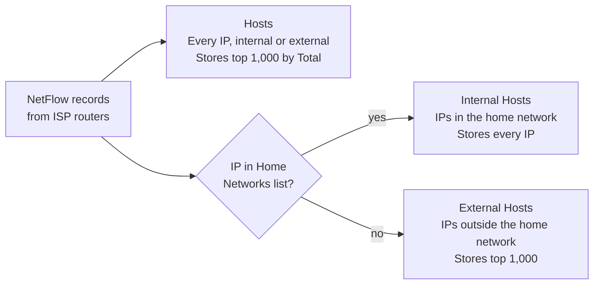

# AN-003 – Control host storage growth in ISP NetFlow deployments

| Field | Value |
| --- | --- |
| App Note ID | AN-003 |
| Source HowTo | [Optimize for an ISP deployment](https://docs.trisul.org/docs/guide/howto/optimize_isp) |
| Trisul build tested | trisul-probe 8.0.3432, trisul-hub 8.0.3328, webtrisul 8.0.2627 on Ubuntu 24.04.2 LTS (lab run 2026-10-19) |
| Audience | ISP operators, NOC engineers, Trisul administrators |
| Status | Pass 2 – lab verified except: Part C enable action, optional bucket size change, Troubleshooting |

## Summary

At a service provider, the Hosts counter group stores traffic for every IP address it sees, and its storage grows with the number of internet IPs your subscribers talk to. This note sets a three-part policy: define the ISP address space as the home network, store Hosts traffic only for the top 1,000 IPs, and enable the Internal Hosts and External Hosts counter groups. All changes take effect after you restart the probe context.

## The problem

NetFlow at a service provider is voluminous. By default, Trisul tracks the usage of every IP address it sees, internal or external, at the bucket resolution of the Hosts counter group. Subscribers talk to a very large number of internet IP addresses, so the hosts traffic storage grows quickly.

Two more issues follow from the default setup:

- Trisul treats only the RFC 1918 private ranges (10.0.0.0/8, 172.16.0.0/12, 192.168.0.0/16) as the home network. An ISP's subscriber ranges are usually public, so Trisul counts them as external.
- Reports that split traffic into internal and external hosts depend on that home network definition.

The fix is a storage policy: keep full detail for your own address space and only the top talkers for the internet side.

## How it works

Trisul meters each IP address in counter groups. A counter group keeps a set of meters (Total, Received, Transmit and others) for every key it sees, and writes them out once per bucket. Three settings control how much of that reaches the database:

- **Home Networks** tells Trisul which IPs belong to your administrative domain. Everything else is external. Out of the box, only the RFC 1918 private ranges are home networks.
- **Topper Traffic Only** makes Trisul store traffic only for the toppers of a counter group: the top N keys per meter, where N is the meter's top count on the **Toppers** page. The Hosts counter group's Total meter has a default top count of 50.
- **Bucket Size Counter Resolution (ms)** sets how often counters are written out. Smaller buckets store more data.

Internal Hosts and External Hosts are built-in counter groups that split hosts by the home network. With the policy in this note, Internal Hosts stores every subscriber IP, while Hosts and External Hosts store only the top 1,000 IPs.



*Figure: ISP host tracking policy · 3 counter groups. Home network IPs are stored in full; the internet side keeps the top 1,000.*

The probe reads these settings when the context starts, so every change in this note needs a context restart.

Reference: [Counter Group Settings](https://docs.trisul.org/docs/guide/ag/context/countergroup_settings), [Home Network Concepts](https://docs.trisul.org/docs/guide/learntrisul/homenetwork_concepts)

## Prerequisites

- Trisul is receiving NetFlow in the context you want to tune (this note uses context `default` and profile `profile0`).
- You can log in to the web UI as `admin`.
- You have the full list of IP ranges that belong to the ISP and its subscribers, as network number and mask or in CIDR format. IPv4 and IPv6 ranges are both accepted.
- You can run `trisulctl_probe` as root (or with `sudo`) on the probe node, and you know the probe ID (this note uses `probe0`).
- Fewer than 1,024 counter groups are enabled. Trisul does not allow more, and step 12 may enable two.

## Procedure

The procedure has four parts. Do them in order and restart the probe context once, at the end.

### Part A – Specify the ISP home network

1. Log in as `admin` and go to **Context: default › profile0 › Home Networks**. The **Home Networks List** shows the configured ranges. Out of the box, it holds the three RFC 1918 ranges.
2. Click **Add** at the top right. The **Create Home Network** page opens.
3. Enter one range in either form:
   - Type the network number in **Network Number or List of subnets in CIDR format**, for example `203.0.113.0`, and the mask in **Network Mask / Prefix length**, for example `255.255.255.0`.
   - Or type the range in CIDR format, for example `198.51.100.0/24`, and leave **Network Mask / Prefix length** empty. The mask box is locked when the entry is in CIDR format.
4. Click **Create**. Trisul returns to the list and shows `Successfully created.`
5. Repeat steps 2–4 for every IP range that belongs to the ISP.

To add many ranges at once, paste them into **Network Number or List of subnets in CIDR format** in CIDR format, one per line or comma separated. IPv6 ranges take their prefix length from the CIDR. If some entries are rejected, Trisul adds the valid ones and shows `Some home networks not added. Please check your inputs`.

Check: the list shows each range you added, with its CIDR and mask, and the **Total** count in the list header goes up by one per range.

Reference: [Home Networks](https://docs.trisul.org/docs/guide/ag/context/home_networks)

### Part B – Cap the Hosts counter group at the top 1,000 IPs

6. Go to **Context: default › profile0 › Counter Groups**. Type `hosts` in the filter box to shorten the list.
7. Click **Hosts**. The **Edit Counter Group** page opens.
8. Select **Topper Traffic Only**.
9. Optional: to change the resolution to 5 minutes, set **Bucket Size Counter Resolution (ms)** to `300000`. The default is `60000` (60 seconds) and the minimum is `1000`.
10. Click **Update**. Trisul returns to the counter group list and shows `Successfully saved`.
11. Open the topper policy for Hosts: click the action button on the **Hosts** row and choose **Toppers**, or click **Edit Toppers** on the Edit Counter Group page. On **Edit Topper Policies for counter group Hosts**, set the **TOP-K COUNT** of meter 0 (**Total**) to `1000`, leave the other rows unchanged, and click **Save**. Trisul returns to the list and shows `Successfully updated Topper Policy.`

Check: reopen the Toppers page for Hosts. The Total row shows `1000`.

To apply one bucket size to every counter group instead of step 9, click **Advanced opts** on the counter group list and set a bucket size for all counter groups.

Reference: [Counter Group Settings](https://docs.trisul.org/docs/guide/ag/context/countergroup_settings)

### Part C – Enable the Internal Hosts and External Hosts counter groups

12. In the counter group list, find **Internal Hosts** and **External Hosts**. If the **Status** column shows **Disabled**, enable them with the action button, or select both check boxes and choose **Enable**. Trisul confirms with `Selected counter group <name> activated successfully` (or `Selected 2 counter group(s) activated successfully.` for a bulk enable). If both already show **Enabled**, go to step 13.
13. Open the topper policy for **External Hosts** (action button › **Toppers**) and set the **TOP-K COUNT** of **Total** to `1000`, as in step 11. Then open **External Hosts** and check that **Topper Traffic Only** is selected; if it is not, select it and click **Update**. The counter group reference lists a default Total count of 50, but a running system may hold another value, so always check it. You can set a higher count, for example `5000`, to keep more external IPs.

Reference: [Internal Hosts](https://docs.trisul.org/docs/guide/counter-groups/internal-hosts), [External Hosts](https://docs.trisul.org/docs/guide/counter-groups/external-hosts)

### Part D – Restart the probe context

14. On the probe node, run as root:

```bash
sudo trisulctl_probe restart context default@probe0
```

Replace `probe0` with your probe ID. The command stops and then starts the context processes on that probe.

Reference: [trisulctl](https://docs.trisul.org/docs/guide/learntrisul/concepts/trisulctl)

## Verify the result

1. The restart reports both halves as successful. Real output from the lab probe (2026-10-19):

```text
$ sudo trisulctl_probe restart context default@probe0
   * found  trisul-probe  /usr/local/etc/trisul-probe/domain0/domain.xml
   * found  trisul-geo    /usr/local/etc/trisul-geo/domain0/domain0.xml
   * connecting to domain0 at ipc:///usr/local/var/lib/trisul-probe/domain0/run/ctl_local_req
stop context default@probe0
   + probe0               stopped Successfully stopped context processes: default@probe0
 start context default@probe0
   + probe0               started Successfully started context processes: default@probe0
Log from default@probe0 context default
```

2. In **Context: default › profile0 › Home Networks**, every ISP range is listed with its CIDR and mask.
3. In **Context: default › profile0 › Counter Groups**, Internal Hosts and External Hosts show **Enabled** in the **Status** column. Both are listed with type **Stat Based**.
4. Open Hosts in the counter group list. **Topper Traffic Only** is selected, and its Toppers page shows `1000` in the Total row. Do the same check for External Hosts.
5. After a full day of data, go to **Context: default › Admin Tasks › DB Status** and compare the per-day storage with the days before the change. Each day is usually stored as two slices, so add the slices with the same date. See [Tuning database usage](https://docs.trisul.org/docs/guide/howto/tuning-storage).

## Troubleshooting

| Symptom | Cause | Fix |
| --- | --- | --- |
| `Error : accessing ipc:///usr/local/var/lib/trisul-probe/domain0/run/ctl_local_req msg=Permission denied`, then `You must connect to a domain first` | `trisulctl_probe` was run as a non-root user, so the context was not restarted | Run the command with `sudo` or as root |
| You cannot type in **Network Mask / Prefix length** | The entry in the top box is in CIDR format, which locks the mask box | Expected: leave the mask empty, the prefix length comes from the CIDR |
| Entry rejected with `subnet mask required`, `invalid mask` or `invalid CIDR` | A plain address without a mask, a malformed mask, or a prefix length outside 0–32 | Add the mask, or write the range in CIDR format |
| `Some home networks not added. Please check your inputs` | Some entries in a bulk paste were invalid | Check the list and add the missing ranges again |
| `You can't Add/Enable more than 1024 counter groups` | 1,024 counter groups are already enabled | Disable counter groups you do not use, then enable Internal Hosts and External Hosts |
| A new bucket size is not kept after you click **Update** | The value is not a whole number of at least 1000 ms. The page can still show `Successfully saved` | Enter a whole number of at least `1000` (5 minutes = `300000`), click **Update**, and reopen the page to confirm |
| Reports do not change after the edits | Counter group and home network changes apply only after a restart | Run step 14 |
| Probe log shows `Enable Bloom while only commit toppers, may miss some keys` | **Topper Traffic Only** and **Enable Slice Keys** are both selected for a counter group | Expected warning: with both on, the key list may miss some keys. Clear **Enable Slice Keys** if you do not need it |

## Limitations

- With **Topper Traffic Only**, Trisul stores traffic only for the toppers. An IP that is not in the top 1,000 has no stored Hosts traffic for that interval, so you cannot chart it later from Hosts.
- The top count is set per meter. This procedure raises only the Total meter; other meters, such as Received and Transmit, keep their own counts.
- A 5-minute bucket stores less data but charts the counter group at 5-minute resolution instead of the finer default.
- The Internal Hosts and External Hosts split is only as accurate as the Home Networks list. Ranges you miss are counted as external.
- In ISP Analytics mode, Trisul can also derive home AS numbers from BGP. That mechanism is separate from the Home Networks list in this note.

## Related

- Source HowTo: [Optimize for an ISP deployment](https://docs.trisul.org/docs/guide/howto/optimize_isp)
- [Home Networks](https://docs.trisul.org/docs/guide/ag/context/home_networks) and [Home Network Concepts](https://docs.trisul.org/docs/guide/learntrisul/homenetwork_concepts)
- [Counter Group Settings](https://docs.trisul.org/docs/guide/ag/context/countergroup_settings)
- Counter group reference: [Hosts](https://docs.trisul.org/docs/guide/counter-groups/hosts), [Internal Hosts](https://docs.trisul.org/docs/guide/counter-groups/internal-hosts), [External Hosts](https://docs.trisul.org/docs/guide/counter-groups/external-hosts)
- [Tuning database usage](https://docs.trisul.org/docs/guide/howto/tuning-storage)
- [trisulctl](https://docs.trisul.org/docs/guide/learntrisul/concepts/trisulctl)
- App notes: AN-002 (NetFlow optimization for large enterprises), AN-004 (subscriber reports for ISPs), AN-009 (tune database usage), AN-010 (resolve disk full errors)