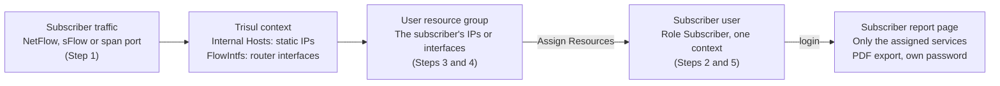

# Give ISP subscribers a login to their own traffic reports

| Field | Value |
| --- | --- |
| App Note ID | AN-004 |
| Audience | ISP and MSP operators, Trisul administrators, NOC engineers who offer per-customer traffic reports |

## Summary

You can give each subscriber a Trisul web login that shows only the traffic of their own services: static IPs or router interfaces. In the current web UI you do this in three parts: create a user with the **Subscriber** role, put the subscriber's IPs or interfaces into a user resource group, and assign that group to the user. The subscriber then logs in, lands on their report page, can export PDFs and can change their own password.

## The problem

An ISP or MSP already monitors all subscriber traffic from one Trisul server. Subscribers want to see their own usage: link traffic, top hosts and applications, and a report they can file. Exporting reports by hand for every customer does not scale, and a normal operator login would show every other customer's traffic.

Trisul solves this with a restricted web role. A **Subscriber** user can investigate only the IPs or interfaces assigned to them and has no admin powers. You can offer this as a value-added reporting service.

Reference: [Offer subscriber reports](https://docs.trisul.org/docs/guide/howto/isp_subscribers), [Roles](https://docs.trisul.org/docs/guide/ag/webadmin/userroles)

## How it works

Trisul meters subscriber traffic into counter groups in a context. A static IP inside the home network becomes a key in `Internal Hosts`; a router interface seen in NetFlow becomes a key in `FlowIntfs`.

A user resource group is a named set of such keys. You assign groups to a user, and the user then sees only those keys. Users with the **Subscriber** role have no admin powers and can investigate only their assigned IPs or interfaces.

At login, a subscriber enters their first allowed context and goes straight to the subscriber report page, unless you set a default dashboard or home page URL for them. The page lists their services and shows the selected service for the selected time.

Reference: [Roles](https://docs.trisul.org/docs/guide/ag/webadmin/userroles), [User Resources](https://docs.trisul.org/docs/guide/ag/admintasks/userresources)

## Prerequisites

- You can log in to the web UI as `admin`.
- The Trisul context that will hold subscriber data is running. Subscribers can log in only to a running context.
- Trisul already sees the subscriber traffic (step 1). The services you assign must already appear as keys:
  - Static IPs: in the `Internal Hosts` counter group. This group holds only hosts inside your home network, so subscriber address ranges must be in the home network.
  - Router interfaces: in the `FlowIntfs` counter group, which holds NetFlow-capable interfaces.
- Optional: SNMP configured for the exporting routers (AN-001). Trisul then labels interfaces with their names and aliases instead of index numbers.
- For each subscriber: a username, an initial password, and the list of their static IPs or router interfaces.

Reference: [User Resources](https://docs.trisul.org/docs/guide/ag/admintasks/userresources), [Internal Hosts](https://docs.trisul.org/docs/guide/counter-groups/internal-hosts), [FlowIntfs](https://docs.trisul.org/docs/guide/counter-groups/flowi-ntfs)

## Procedure

Follow the steps in order. Subscriber services are assigned through a user resource group in the current web UI (steps 3 and 4).

### Step 1 – Make subscriber traffic visible to Trisul

Pick the option that matches how each subscriber connects.

| Subscriber setup | What to do |
| --- | --- |
| Managed switch at the customer premises (dynamic IP) | Have the customer switch export NetFlow or sFlow to the data center where Trisul runs. |
| Unmanaged switch or modem at the customer premises (dynamic IP) | Enable NetFlow or sFlow on your edge routers, or span the uplinks that carry all subscriber traffic. Above a few Gbps you may need an optical tap. |
| Static IPs | Enable flow export on the core routers, or span the uplink. Map each subscriber to their IPs in step 4. |
| DSL or cable, no static IP | Export NetFlow from the DSLAM router, where each service appears as a logical interface. |

Check: the subscriber's IPs appear in `Internal Hosts`, or their interfaces appear in `FlowIntfs`. Keys appear only after Trisul has seen traffic for them.

Reference: [Offer subscriber reports – Network setup](https://docs.trisul.org/docs/guide/howto/isp_subscribers)

### Step 2 – Create the subscriber user

:::info navigation
:point_right: Log in as `admin` and go to Web Admin &rarr; Manage &rarr; Users
:::

1. Click **Create a new user**.
2. Fill in the fields of the **New User** form:

| Field Name | Description |
| --- | --- |
| User Name | The subscriber's login name, no spaces |
| Authentication | Local authentication (or an LDAP domain you configured) |
| Password, Password Again | The initial password you will send to the subscriber |
| Force password change | Select it to make the subscriber change the password on first login |
| Full Name | Optional: the subscriber's name |
| Role | **Subscriber** |
| Allow multiple Login | Selected by default. Clear it if your service allows one session per subscriber; a new login then ends the older session. |
| Default Dashboard, Default Home Page URL | Leave empty. If set, the subscriber lands there instead of the subscriber report page. |
| Allowed Contexts | The context that holds this subscriber's data |

3. Click **Create User**.

Check: the page shows `User Added Successfully` and the user list shows the new user with the role **Subscriber**.

Reference: [Users – Create a New User](https://docs.trisul.org/docs/guide/ag/webadmin/manageusers)

### Step 3 – Create a resource group for the subscriber's services

Select the context you chose in **Allowed Contexts**, for example **Context: default**.

:::info navigation
:point_right: Go to Admin Tasks &rarr; User Resources
:::

1. Click **New Resource Group**.
2. Fill in the fields:

| Field Name | Description |
| --- | --- |
| Name | A short name, for example the subscriber's account name |
| Description | A short description. Required: the group is not saved without it (`Description can't be blank`) |

3. Click **Create**.

Check: the page shows `Successfully created new user resource group. Select Add/Edit Resources to assign devices to the new group`.

A resource group belongs to the context in which you create it.

Reference: [User Resources – Creating a Resource Group](https://docs.trisul.org/docs/guide/ag/admintasks/userresources)

### Step 4 – Add the subscriber's static IPs or interfaces

1. In the resource group list, open the menu against the new group and click **Add/Edit Resources**.
2. Fill in the fields:

| Field Name | Description |
| --- | --- |
| Description of these group of items | A description for this set of items, for example `Static IPs` or `Access interfaces` |
| Counter Group | `Internal Hosts` for static IPs, or `FlowIntfs` for NetFlow interfaces |
| Keys | Click the plus icon, select the subscriber's IPs or interfaces, and click **Select** |

3. Click **Add**.
4. If the subscriber has both static IPs and interfaces, repeat steps 2 to 3 with the other counter group.

Interface keys are router interfaces, in the form router IP and SNMP ifIndex (`192.168.1.1_325`). With SNMP configured, the list shows the router name, interface name and alias.

Check: the page shows `Successfully created new resource group key`, and the keys appear at the bottom of the same page.

Reference: [User Resources – Add Resources to the Group](https://docs.trisul.org/docs/guide/ag/admintasks/userresources)

### Step 5 – Assign the resource group to the user

:::info navigation
:point_right: Go to Web Admin &rarr; Manage &rarr; Users
:::

1. Open the actions menu against the subscriber user.
2. Click **Assign Resources**.
3. Fill in the fields:

| Field Name | Description |
| --- | --- |
| Assign Resources to user | Select the subscriber's resource group |

4. Click **Update**.

Check: the page shows `Successfully updated resources for user`. In the user list, the role reads **Subscriber (1)**, the number of assigned groups, and a lock icon marks the user as restricted. Hover over it to see the assigned groups.

Reference: [User Resources – Assigning Resource Groups to Users](https://docs.trisul.org/docs/guide/ag/admintasks/userresources)

### Step 6 – Send the login details to the subscriber

Send the username and initial password to the subscriber. They can log in on the normal Trisul login page, or on the customer login page at `https://<trisul-server>/portal`.

Reference: [Offer subscriber reports – Subscriber login](https://docs.trisul.org/docs/guide/howto/isp_subscribers)

## Verify the result

Log out, then log in as the subscriber in a private browser window.

| Check | Expected result |
| --- | --- |
| Landing page after login | The subscriber report page, with data for the first service and the current day. No admin or operator menus. |
| Static IP service | Page title **IP Service Report**. **Available services** lists the subscriber's static IPs; selecting another IP reloads the report. |
| Time selection | The report time can be changed from the time selector next to the service list. |
| PDF output | The static IP page offers a **Combined PDF Report** for all of the subscriber's IPs. |
| Own password | Account menu &rarr; **My Account** &rarr; **Change Password** opens the password form. |
| Restriction | Only the services in the assigned resource group are listed. |

These contents are for an interface (NetFlow) service:

- In and out traffic on the subscriber interface
- Top hosts and top applications
- Top transmitting and top receiving hosts
- Conversations
- Top individual flows

Reference: [Offer subscriber reports – Subscriber login](https://docs.trisul.org/docs/guide/howto/isp_subscribers), [Users – Change Own Password](https://docs.trisul.org/docs/guide/ag/webadmin/manageusers#change-own-password)

## Troubleshooting

| Symptom or message | Cause | Fix |
| --- | --- | --- |
| **Assign Resources** shows no resource groups | The group was created in a context the user is not allowed to access | Edit the user and select that context in **Allowed Contexts**, or create the group in an allowed context |
| Error that a list of keys already exists for this counter group, when adding keys | The resource group already has keys from that counter group | Add the extra keys to the existing entry, or create another resource group |
| `You are not allowed to access that context.` at login | The login targets a context outside the user's **Allowed Contexts** | Add the context to **Allowed Contexts** |
| `Account locked. Try again at <time>` | Too many failed logins; the account is locked for the configured duration | Wait until the time shown, or review **Web Admin &rarr; Manage &rarr; App Settings &rarr; Password/Security** |
| `User has been disabled. Please contact the administrator.` | The user is disabled | In **Web Admin &rarr; Manage &rarr; Users**, open the actions menu against the user and click **Enable** |
| `LDAP logged user can't change password.` on **My Account** | The subscriber authenticates through LDAP | Change the password in the LDAP directory |
| Interfaces show as router IP and index only | SNMP names are not resolved | Configure SNMP for the routers (AN-001) |

Reference: [User Resources – Troubleshooting](https://docs.trisul.org/docs/guide/ag/admintasks/userresources#troubleshooting), [Password/Security](https://docs.trisul.org/docs/guide/ag/webadmin/web_options#passwordsecurity)

## Limitations

- The web UI creates subscribers one at a time. Run a script from Unleash Networks to create users in bulk from a text file or provisioning database.
- NetFlow scales better than raw packets. Reports that include security analysis need Trisul to receive raw packets.
- For IPsec or VPN tunnel services, Trisul does not report internal host or application data.
- A resource group belongs to one context. Deleting it deletes its keys and removes it from every user it was assigned to.
- For deeper drilldowns, run a separate Trisul context for the subscriber, as an enhanced reporting package.

Reference: [Offer subscriber reports – FAQ](https://docs.trisul.org/docs/guide/howto/isp_subscribers), [Working With Contexts](https://docs.trisul.org/docs/guide/learntrisul/concepts/contexts)

## Related

- [Users](https://docs.trisul.org/docs/guide/ag/webadmin/manageusers)
- [Roles](https://docs.trisul.org/docs/guide/ag/webadmin/userroles)
- [User Resources](https://docs.trisul.org/docs/guide/ag/admintasks/userresources)
- [Resource Groups for Subscribers](https://docs.trisul.org/docs/prodguide/isp/resourcegroups)
- [Working With Contexts](https://docs.trisul.org/docs/guide/learntrisul/concepts/contexts)
- Glossary: [Context](https://docs.trisul.org/glossary/context), [Subscriber mapping](https://docs.trisul.org/glossary/subscriber-mapping)
- Related app notes: AN-001 (Configure SNMP), AN-003 (Optimize Trisul for an ISP deployment)