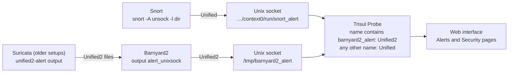

# AN-005 – Get Snort, Barnyard2 and Suricata alerts into Trisul

| Field | Value |
| --- | --- |
| App Note ID | AN-005 |
| Source HowTo | [How to send IDS alerts to Trisul](https://docs.trisul.org/docs/guide/howto/setup_ids_alerts) |
| Audience | Trisul admins, SOC analysts, NOC engineers |
| Applies to | Trisul in packet capture mode |

## Summary

The Trisul Probe listens on a Unix socket for IDS alerts and stores them next to its traffic, flow and packet data. Snort connects with `snort -A unsock` (Unified format); Barnyard2 connects with `output alert_unixsock` (Unified2 format). Suricata connects through the **Suricata via EVE UnixSocket** app. For saved PCAP files, `trisulctl_probe importpcap_ids` runs Trisul and Snort over the same capture.

## The problem

An IDS alert names a signature, two endpoints and a timestamp. To decide whether it matters, an analyst needs the traffic around it: the flow, the hosts involved and the packets. When the IDS and the traffic analytics run as separate tools, that context sits in a different system.

Trisul removes this gap by taking alerts from Snort, Barnyard2 or Suricata directly into the Probe. The alerts are then available in the same **Alerts**, **Security** and **Dashboards** pages as the traffic data. The Probe only receives alerts if the IDS writes to the socket the Probe listens on, and in the format the Probe expects.

## How it works

When the Probe starts, it reads each `UnixSocket` value in the `IDSAlerts` section of `trisulProbeConfig.xml`. It creates a Unix socket at each path, replacing any old file at that path, and logs `IDS Waiting for IDS alerts on <path>`. The IDS then sends each alert to that socket.

The Probe accepts two alert formats. It picks one from the socket name:

| `UnixSocket` value | Format the Probe reads | Sender |
| --- | --- | --- |
| Contains `barnyard2_alert` | Unified2 | Barnyard2 with `output alert_unixsock` |
| Anything else (default `snort_alert`) | Unified | Snort with `-A unsock` |

Snort and Barnyard2 choose the socket file name themselves: `snort_alert` for Snort and `barnyard2_alert` for Barnyard2. You only give them the directory, with the `-l` option. So the `-l` directory must be the directory of the `UnixSocket` path, and the file name in `UnixSocket` must match the sender.

The default socket for the default context is:

```
/usr/local/var/lib/trisul-probe/domain0/probe0/context0/run/snort_alert
```

Each alert must carry its packet. The Probe takes the IP and transport details from that packet. An alert without packet data is logged and dropped.



*The socket name decides which alert format the Probe reads.* Snort writes Unified alerts to `snort_alert`; Barnyard2 forwards Unified2 alerts, including those from older Suricata setups, to `barnyard2_alert`.

Suricata alerts take a separate path: the **Suricata via EVE UnixSocket** app. For custom alert sources, the [Lua Input Filter](https://docs.trisul.org/docs/lua/inputfilter) API can feed alerts through its `step_alert` function. This note does not cover that API.

Reference: [Trisul Probe configuration – IDS Alerts](https://docs.trisul.org/docs/guide/ref/trisulconfig#ids-alerts)

## Prerequisites

- Trisul running in packet capture mode. IDS alerts do not apply to NetFlow mode.
- The IDS (Snort, Barnyard2 or Suricata) installed on the same Probe node, with the rules you want to use. The socket is a local Unix socket, so the IDS cannot send to it from another machine.
- Root or `sudo` access on the Probe node, to edit `trisulProbeConfig.xml` and start the IDS.
- An `admin` login to the Trisul web interface.
- For the Suricata app: internet access from the web server to github.com, or the app TAR file for an offline import.
- For PCAP import with IDS: Snort installed on the Probe node, and uncompressed PCAP files in a single directory.

## Procedure

Pick the part that matches your IDS. Part A is the default setup for Snort. Parts D and E apply to any setup.

### Part A – Connect Snort with `unsock`

Snort sends Unified alerts straight to the default socket. You do not need to change the Trisul configuration.

1. Log in to the web interface as `admin`.
2. Go to **Context: default › Admin Tasks › Start/Stop Tasks**.
3. Start the Probe if its status is not **Up**.
4. In the Probe row, open **More Options › How to start snort?**. Trisul shows a Snort command line built from this context's configuration (see the screenshot in the [source HowTo](https://docs.trisul.org/docs/guide/howto/setup_ids_alerts)).
5. Copy the command and run it in a terminal on the Probe node. For the default context it has this form:

```bash
sudo snort -A unsock -u trisul -g trisul -l /usr/local/var/lib/trisul-probe/domain0/probe0/context0/run -c /etc/snort/snort.conf -i eth0 -D
```

Trisul fills in each value from your setup:

| Option | Value comes from | Default |
| --- | --- | --- |
| `-u` / `-g` | `App` › `User` (user.group the Probe runs as) | `trisul` / `trisul` |
| `-l` | Directory of `IDSAlerts` › `UnixSocket` | `/usr/local/var/lib/trisul-probe/domain0/probe0/context0/run` |
| `-c` | `IDSAlerts` › `SnortConfigFile` | `/etc/snort/snort.conf` |
| `-i` | Adapter of the active capture profile | Your capture interface |

Check: the Probe log shows `IDS Waiting for IDS alerts on` followed by the socket path (see [Verify the result](#verify-the-result)).

### Part B – Connect Barnyard2 (Unified2)

Barnyard2 reads Unified2 files and forwards the alerts with its `alert_unixsock` output. It writes to a socket named `barnyard2_alert`.

1. On the Probe node, open `/usr/local/etc/trisul-probe/domain0/probe0/context0/trisulProbeConfig.xml`.
2. In the `IDSAlerts` section, set `UnixSocket` to `/tmp/barnyard2_alert`:

```xml
<IDSAlerts>
    <Enabled>True</Enabled>
    <UnixSocket>/tmp/barnyard2_alert</UnixSocket>
    <SnortVersion>2.9+</SnortVersion>
    <SnortConfigFile>/etc/snort/snort.conf</SnortConfigFile>
</IDSAlerts>
```

Keep `barnyard2_alert` in the path. The Probe reads Unified2 only when the `UnixSocket` value contains that name.

3. Save the file.
4. Start the Probe from **Context: default › Admin Tasks › Start/Stop Tasks**. If it is already running, stop it and start it again so it reads the new value.
5. Edit `barnyard2.conf` and add the `alert_unixsock` output:

```bash
#
# output alert_fast: stdout
output alert_unixsock
```

6. Run Barnyard2. This example assumes the Unified2 files are in `/tmp/byin`:

```bash
barnyard2 -c barnyard2.conf -l /tmp -o /tmp/byin/unified2.alert.*
```

The `-l /tmp` option makes Barnyard2 send alerts to `/tmp/barnyard2_alert`.

Check: the Probe log shows `IDS Waiting for IDS alerts on /tmp/barnyard2_alert`. In the `online_rxring`, `online_afpacket`, `online_rxring_max` and `online_afpacket_max` run modes, the log also shows `Switching to UNIFIED2 style alerts from barnyard2_alert`.

### Part C – Connect Suricata

**Recommended: the Suricata via EVE UnixSocket app.**

1. Log in as `admin`.
2. Go to **Web Admin › Manage › Apps**.
3. Install **Suricata via EVE UnixSocket**. Without internet access, import the app TAR file with **Import** on the same page.
4. Open the app's **README** and follow its setup steps.
5. If the app is a **LUA Analytics** app, restart the Probes. Dashboard-type apps need no restart.

Reference: [Apps](https://docs.trisul.org/docs/guide/ag/webadmin/apps)

**Older setups: Suricata with Unified2 and Barnyard2.** Use this only where the app is not an option.

1. In `suricata.yaml`, enable Unified2 logging. You can disable all other logging.

```yaml
 - unified2-alert:
     enabled: yes
     filename: unified2.alert
     # Limit in MB.
     limit: 500
```

2. Start Suricata and have it log to `/tmp/byin` (any directory name works):

```bash
suricata -c suricata.yaml -l /tmp/byin -i eth0
```

3. Complete Part B so that Barnyard2 reads the files in `/tmp/byin` and forwards the alerts to Trisul.

### Part D – Change the socket path

The Probe listens at `/usr/local/var/lib/trisul-probe/domain0/probe0/context0/run/snort_alert` by default.

1. Open `trisulProbeConfig.xml` for the context.
2. Set `IDSAlerts` › `UnixSocket` to the new path. Keep the file name `snort_alert` for Snort or `barnyard2_alert` for Barnyard2.
3. To listen on more than one socket, add one `<UnixSocket>` element per path.
4. Stop and start the Probe from **Start/Stop Tasks**.
5. Start the IDS with `-l` set to the directory of the new path.

Reference: [Trisul Probe configuration – IDS Alerts](https://docs.trisul.org/docs/guide/ref/trisulconfig#ids-alerts)

### Part E – Import a PCAP file with IDS alerts

`importpcap_ids` runs two passes over a capture: Trisul builds its analytics first, then Snort runs over the same packets and sends alerts to Trisul.

1. Put the uncompressed PCAP files in one directory. Name them in time order.
2. On the Probe node, run:

```bash
trisulctl_probe importpcap_ids /home/trisul/dumps/MassivePacket.pcap context=mass1
```

Always give `context=`. Without it the command uses the default context. If the context exists, its old data is deleted and its configuration is kept. If it does not exist, the command offers to create it; type `YES` to continue.

3. Wait for the four steps to finish. The command prints `Step 1/4` (PCAP import), `Step 2/4` (Trisul in `idsalertoverlay` mode), `Step 3/4` (Running Snort) and `Step 4/4` (Wrapping up).
4. Log in to the web interface and select the context (`mass1` in this example) to view the results.

Reference: [Import PCAP with IDS](https://docs.trisul.org/docs/guide/ag/basictasks/snort)

## Verify the result

**1. The Probe is listening.** Search the Probe log for the listener line. Logs for the default context are in `/usr/local/var/log/trisul-probe/domain0/probe0/context0`:

```bash
grep "IDS Waiting for IDS alerts on" /usr/local/var/log/trisul-probe/domain0/probe0/context0/ns-*.log
```

Expected: one line per socket, ending with the socket path, for example `IDS Waiting for IDS alerts on /usr/local/var/lib/trisul-probe/domain0/probe0/context0/run/snort_alert`.

**2. The socket exists.** `ls -l` on the socket path lists a file whose type is socket (the permissions start with `s`).

**3. Alerts appear in the web interface.** After the IDS raises an alert, log in and check these pages:

| Menu | What it shows |
| --- | --- |
| **Alerts › IDS** | Alerts from an IDS such as Snort or Suricata, by signature |
| **Dashboards › Real Time Alerts** | Alerts as they arrive |
| **Security › All Alerts** | Query tool for IDS alerts |
| **Dashboards › Security** | IDS alerts with top attackers and victims, alert trends and aggregated alerts |
| **Security › Monthly Summary** | Alerts by priority over a calendar month |

**4. PCAP import.** `importpcap_ids` prints `Step 1/4` to `Step 4/4` and ends each wait with `..++|| done`. Select the import context and open **Alerts › IDS**.

## Troubleshooting

Probe messages appear in the `ns-*.log` files in the context's log directory. `importpcap_ids` messages appear in the terminal.

| Symptom or message | Cause | Fix |
| --- | --- | --- |
| `Unable to bind to unix domain socket :` followed by the system error and path | The Probe cannot create the socket at the `UnixSocket` path | Check that the directory in the path exists and that the Probe can write to it. Correct `UnixSocket` and restart the Probe. |
| `Unix socket path is too long:` followed by the path | The path is longer than the system allows for a Unix socket | Use a shorter path in `UnixSocket` and in the IDS `-l` option. Restart the Probe. |
| `No packet data in Snort Alert, cant derive transport headers` | An alert arrived without its packet. The Probe drops it | The IDS must send the packet with each alert. Alerts without it are not stored. |
| No Barnyard2 alerts, and no `Switching to UNIFIED2 style alerts` line where the run mode logs it | `UnixSocket` does not contain `barnyard2_alert`, so the Probe expects Snort Unified alerts | Set `UnixSocket` to a path ending in `barnyard2_alert` and restart the Probe (Part B). |
| No alerts, and the listener line shows a different directory from the IDS `-l` option | The IDS writes to a socket the Probe does not read | Use the command from **How to start snort?**, or set `-l` to the directory of `UnixSocket`. |
| `ERROR ! domain node hub0 is not up` (importpcap_ids) | The hub is not running | Log in to `trisulctl_hub` and start the domain, then run the command again. |
| `Error: Invalid context  cant find trisulProbeConfig.xml for` followed by the context | The context has no configuration file on this Probe | Check the context name in `context=`. |
| `Usage: importpcap_ids pcap-file <context=ctxname>` | The command line is not in the expected form | Give the PCAP path first, then `context=<name>`. |

## Limitations

- Packet capture mode only.
- The IDS must run on the Probe node. The Unix socket cannot be reached over the network.
- The Probe reads one alert format per context, chosen from the `UnixSocket` value. Unified2 is read only when the value contains `barnyard2_alert`.
- Alerts without packet data are dropped.
- `importpcap_ids` runs Snort in its IDS pass. PCAP files must be uncompressed, in one directory (no nested directories) and named in time order.
- `importpcap_ids` deletes the existing data in the target context before it imports.
- The Lua Input Filter path for custom alert sources is not covered here.

## Related

- Source HowTo: [How to send IDS alerts to Trisul](https://docs.trisul.org/docs/guide/howto/setup_ids_alerts)
- [Trisul Probe configuration – IDS Alerts](https://docs.trisul.org/docs/guide/ref/trisulconfig#ids-alerts)
- [Import PCAP with IDS](https://docs.trisul.org/docs/guide/ag/basictasks/snort)
- [Apps](https://docs.trisul.org/docs/guide/ag/webadmin/apps)
- [Lua Input Filter](https://docs.trisul.org/docs/lua/inputfilter)
- AN-006 – Add custom threat intel feeds to Badfellas
- AN-007 – Offline processing of packet captures