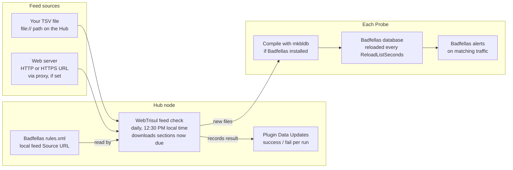

# Add Your Own Threat Intel to Badfellas

| Field | Value |
| --- | --- |
| App Note ID | AN-006 |
| Audience | SOC analysts, Trisul admins, NOC engineers |

## Summary

You can make the Badfellas plugin match traffic against your own indicators: IP addresses, domain names and URLs from your SOC, an ISAC or a partner. You save them as a TAB-separated file on the Hub node (or on a web server), then add that file as a source in the Badfellas feed `rules.xml`. WebTrisul fetches the file during its daily feed check at 12:30 PM and pushes it to every Probe, which compiles it into the Badfellas database. No restart is needed.

## The problem

Badfellas ships with more than a dozen public threat feeds, such as DShield, Feodo Tracker, URLhaus and the TOR node list. These cover common, widely reported threats. They do not cover the indicators that matter most to your organization: IPs seen in your own incidents, phishing domains reported by your users, or lists shared by a sector partner or a commercial provider.

Without a way to load those indicators, an analyst has to search for each one by hand, after the fact. You need Trisul to match your own indicators in live traffic, raise the same Blacklist alerts as the built-in feeds, and keep the list current on every Probe without manual copying.

## How it works

The Hub node keeps the feed configuration and does the downloading; each Probe compiles and uses the result.

1. **Daily check.** WebTrisul on the Hub runs a feed check every day at 12:30 PM, in the Hub server's local time zone.
2. **Due sections.** For the Badfellas `rules.xml`, WebTrisul looks at each `<Update>` section. A section is due when its `<Frequency>` interval has passed since its last download (with a 60-second margin).
3. **Fetch.** For each `<Source>` in a due section, WebTrisul reads the `<URL>`. A `file://` URL is read from the Hub's disk. An HTTP or HTTPS URL is downloaded, through the configured proxy when one is set. The content is saved in the feed directory under the `<Target>` name.
4. **Record.** WebTrisul records the success and failure counts and any failed URLs. **Plugin Data Updates** shows this record.
5. **Distribute.** WebTrisul sends the newly downloaded files to each Probe registered for the Badfellas feed.
6. **Compile.** A Probe with Badfellas installed compiles the files into its Badfellas database with `mkbldb`. A Probe without Badfellas ignores the feed.
7. **Match.** Badfellas reloads its threat intel every `ReloadListSeconds` and flags traffic that matches an indicator.



Only the WebTrisul check on the Hub is scheduled; everything after it runs as soon as new files arrive.

## Prerequisites

- The Badfellas plugin (`trisul-badfellas` package) is installed and the Probe context was restarted after the install. Reference: [Badfellas Plugin – Installation](https://docs.trisul.org/docs/guide/ref/plugin-config/badfellas#installation)
- Badfellas is installed on every Probe that should match your indicators. A Probe without it ignores the feed.
- Root or `sudo` shell access to the Hub node, to create the feed file and edit `rules.xml`.
- Admin login to the Trisul web interface, to check **Plugin Data Updates**.
- For an HTTP or HTTPS source: the Hub node can reach the web server, directly or through the WebTrisul proxy. Reference: [Web Options – Proxy Server](https://docs.trisul.org/docs/guide/ag/webadmin/web_options#proxy-server)
- Your indicators: IP addresses, domain names or URLs, one per line.

## Procedure

### Part A – Prepare the feed file on the Hub node

1. On the Hub node, choose a persistent directory for your feeds, for example `/opt/trisul-feeds`. Do not use `/tmp`: files there are removed at reboot, and the next feed update then fails for this source.
2. Make sure the WebTrisul user can read the directory. By default this user and group is `trisul.trisul`.
3. Create a TAB-separated file in that directory, for example `/opt/trisul-feeds/myfeed_1.tsv`. Each line holds three fields:

   ```text
   FEED_NAME<TAB>INDICATOR<TAB>Description
   ```

   - `FEED_NAME` is a label for your source, for example `MYBADLIST`.
   - `INDICATOR` is an IP address, a domain name or a URL.
   - `Description` is free text that tells the analyst why the indicator is listed.
4. Add your indicators, one per line. Separate the fields with real TAB characters, not spaces. The sample below shows `<TAB>` where each TAB goes:

   ```text
   # FeedName<TAB>Indicator<TAB>Description

   MYBADLIST<TAB>masterkey.com.ua<TAB>Malicious host possibly hosting Palevo
   MYBADLIST<TAB>ms4all.twoplayers.net<TAB>Malicious host possibly hosting Palevo
   MYBADLIST<TAB>94.100.215.170<TAB>Possible scanning
   MYBADLIST<TAB>http://friends-webcam-fun2.blogspot.com/wechat.php<TAB>Phishing host
   ```

### Part B – Connect the file to the Badfellas feed

The Badfellas feed configuration lives on the Hub node. The GUID in the path is the GUID of the Badfellas plugin.

5. Open the Badfellas feed configuration file:

   ```bash
   vi /usr/local/var/lib/trisul-config/domain0/allcontexts/feeds/feed-2F3CCCA3-38D4-4773-97AB-3ED732F82533/rules.xml
   ```
6. Note the structure. The file holds several `<Update>` sections. Each one lists `<Sources>` to download and a `<Run>` block whose `<Frequency>` (in seconds) sets how often that section is refreshed.
7. Scroll to the bottom and locate the last (third) `<Update>` section. This is the local feed section.
8. In its `<Source>` element, set `<URL>` to your file. Change only this line; keep `<Target>` as it is:

   ```xml
   <Update>
     <Sources>
       <Source>
         <URL>file:///opt/trisul-feeds/myfeed_1.tsv</URL>     <!-- change this line only -->
         <Target>badfellas-local-0.tsv</Target>
       </Source>
     </Sources>
     <Output>
       <Filename>AllBadFellas.tch</Filename>
     </Output>
     <Post>
       <Cmd>mkbldb</Cmd>
     </Post>
     <Run>
       <RunAt>0200</RunAt>
       <Frequency>3600</Frequency>
     </Run>
   </Update>
   ```
9. Save the file.

**Check:** the `<URL>` value starts with `file://` followed by the absolute path, so a file in `/opt` reads `file:///opt/...` with three slashes.

### Part C – (Optional) Use a web server or add more feeds

10. To fetch the feed from another server instead of a local file, set `<URL>` to an HTTP or HTTPS address, for example:

    ```xml
    <URL>http://mycompany.com/intelfeeds/myfeed_1.tsv</URL>
    ```

    WebTrisul uses the proxy set in **Web Admin &rarr; Manage &rarr; App Settings &rarr; Proxy Server**, if one is configured.
11. To add more feeds, add one `<Source>` element per file inside the same `<Sources>` block. Give each one its own `<Target>` name that matches `badfellas-local-*.tsv`, for example `badfellas-local-1.tsv`.

### Part D – Wait for the next feed check

12. Do nothing else. You do not need to restart Trisul. WebTrisul checks all feeds once a day at 12:30 PM, Hub server local time. A section is downloaded when its `<Frequency>` interval has passed since its last download. WebTrisul then sends the new files to the Probes.

Reference: [Add custom intel feeds into Badfellas](https://docs.trisul.org/docs/guide/howto/custom_feed_badfellas)

## Verify the result

Check after the next 12:30 PM feed check on the Hub.

:::info navigation
:point_right: Log in as `admin` and go to Web Admin &rarr; Manage &rarr; Plugin Data Updates
:::

The page is titled **Plugin data feed updates**.

1. Find the newest row for **Badfellas Threat feed**. Success looks like this:
   - **Updated at** shows today, after 12:30 PM.
   - **Success/ Fail count** shows `0` after the slash. The number after the slash is the count of failed sources.
   - **Failed feed URL** is empty. If your source failed, its URL is listed there with the reason.

:::info navigation
:point_right: Go to Web Admin &rarr; Manage &rarr; Web Server Logs &rarr; Background Tasks Log
:::

2. Use **Show Search Form** and filter first on your file name, then on `feed`. Look for these messages:
   - `Start downloading file from [file:///opt/trisul-feeds/myfeed_1.tsv]` – WebTrisul read your source.
   - `Sending new feed to <node>` – one line per Probe that receives the feed, for example `probe0`.
   - `Finished all plugin data updates` – the run completed.
3. Watch for Badfellas alerts on traffic that matches one of your indicators. The Probe reloads threat intel every `ReloadListSeconds` (900 seconds in the documented configuration), so matches start after the next reload. Reference: [Badfellas Malware alerts](https://docs.trisul.org/docs/guide/ug/alerts/mw)

Reference: [Plugin Data Updates](https://docs.trisul.org/docs/guide/ag/webadmin/plugin_data_update), [Web Server Logs](https://docs.trisul.org/docs/guide/ag/webadmin/logs#background-tasks-log)

## Troubleshooting

The messages below appear in **Plugin Data Updates** (Failed feed URL column) or in the **Background Tasks Log**, unless noted otherwise.

| Symptom or message | Cause | Fix |
| --- | --- | --- |
| `file:///opt/trisul-feeds/myfeed_1.tsv (File does not exists)` in Failed feed URL; `Skipping file - <url>. File does not exist` in the log | The path in `<URL>` does not exist on the Hub: a typo, a missing third slash, a moved file, or a file kept in `/tmp` and removed at reboot | Correct the path or restore the file to a persistent directory. |
| Your URL followed by an error text in parentheses; `Error downloading from <url>` in the log | WebTrisul could not open or download the source, for example a permission error on a local file or an unreachable web server | Make the file readable by `trisul.trisul`. For HTTP(S), check that the Hub reaches the server and that the proxy settings are correct. |
| `Cannot download from any sources, skipping config <path>` | Every due source in the Badfellas `rules.xml` failed, so nothing is sent to the Probes | Fix the sources listed in Failed feed URL. |
| No new Badfellas row today; `... not due. lastrun = <time>, refresh freq= <n>s` in the log | Less time than `<Frequency>` has passed since that section's last download | Wait for the next daily check, or lower `<Frequency>` for that section. |
| `Feed with guid {2F3CCCA3-38D4-4773-97AB-3ED732F82533} is not supported by plugins on this node.` in a Probe log | Badfellas is not installed on that Probe, so it ignores the feed | Install the Badfellas package on that Probe and restart its context. |

## Limitations

- **Once a day at most.** WebTrisul checks feeds once a day at 12:30 PM. A `<Frequency>` shorter than a day still gives one refresh per day; a longer one skips days. `<RunAt>` does not change the check time.
- **Scheduled refresh only.** This procedure has no step that forces an immediate download. New indicators reach the Probes after the next daily check.
- **Documented indicator types.** The local feed format is documented for IP addresses, domain names and URLs. Badfellas also checks other indicators, such as SSL certificate fingerprints, but the docs do not describe how to add those through a local TSV file.
- **HTTPS sources.** WebTrisul does not verify the server certificate when it downloads an HTTPS feed. Host internal feeds on a server you trust.
- **Probe coverage.** Only Probes with the Badfellas plugin installed use the feed.
- **More control.** For custom intel processing beyond a TSV file, the HowTo points to the [Lua API](https://docs.trisul.org/docs/lua) together with [Trisul Apps](https://docs.trisul.org/docs/guide/ag/webadmin/apps).

## Related

- [Badfellas Plugin](https://docs.trisul.org/docs/guide/ref/plugin-config/badfellas) – feeds, removing a feed, configuration parameters
- [Plugin Data Updates](https://docs.trisul.org/docs/guide/ag/webadmin/plugin_data_update)
- [Web Options – Proxy Server](https://docs.trisul.org/docs/guide/ag/webadmin/web_options#proxy-server)
- [Web Server Logs](https://docs.trisul.org/docs/guide/ag/webadmin/logs)
- Glossary: [Badfellas](https://docs.trisul.org/glossary/badfellas), [Threat intelligence](https://docs.trisul.org/glossary/threat-intelligence), [Indicator of compromise](https://docs.trisul.org/glossary/indicator-of-compromise)
- App notes: AN-005 – Send IDS alerts to Trisul