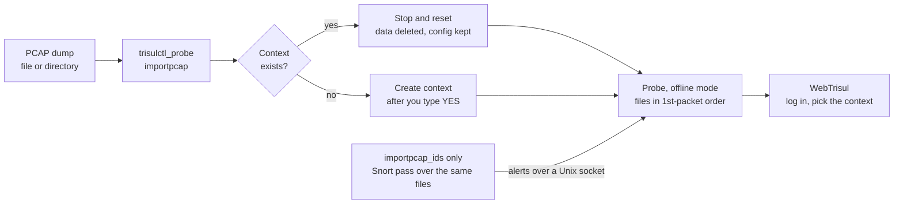

# Analyze PCAP dumps offline in their own Trisul context

| Field | Value |
| --- | --- |
| App Note ID | AN-007 |
| Audience | Trisul admins, SOC analysts, NOC and network engineers |
| Applies to | Trisul in packet capture mode, run on the probe node |

## Summary

Trisul can analyze saved packet capture (PCAP) files and show the results in the same web interface it uses for live traffic. You run `trisulctl_probe importpcap` on the probe node and point it at a file or a directory. The tool imports the capture into a context of your choice, which you can tune and re-run, then delete when you are done. `trisulctl_probe importpcap_ids` does the same and adds Snort alerts from a second pass over the same files.

## The problem

You often receive traffic as PCAP dumps instead of a live feed: captures from an incident, a customer site or a lab. A single dump can be very large, or it can be split across many files whose names do not reflect the capture time. Opening them one at a time in a packet viewer does not give you flows, counters and trends across the whole capture.

If you import the dump into the context that monitors your live network, its data mixes with production data. Each import also replaces the data already in the target context. You need a separate place for each dataset that you can reconfigure, re-import and remove without affecting anything else.

## How it works

A context is a separate instance of Trisul with its own isolated database, configuration and processes. It shares the web server, users and admin framework with the other contexts. Importing each dump into its own context keeps it apart from your live data.

`importpcap` prepares the context and then runs the probe in offline mode over your files:

1. It checks that the domain is running and starts it if needed. It then checks that the hub node `hub0` answers.
2. If the context does not exist, it asks you to confirm and creates it. If the context exists, it stops the context and resets it. A reset deletes the old data but keeps the configuration.
3. It starts the context on the probe in offline mode with your file or directory as input.
4. The probe reads a single file, or walks the directory and its subdirectories. It processes the files in the order of the first packet timestamp in each file, not by file name. Files ending in `.gz`, `.bz2` or `.bzip2` are decompressed as they are read.
5. The tool checks the probe log for errors from this run. If there are none, it shows the log while the import continues.

Because a reset keeps the configuration, you can change the context settings and run the same import again. Each run starts from empty data and applies the new settings to the whole capture.

`importpcap_ids` runs this import first, then starts the context in an IDS alert overlay mode and runs Snort over the same files. Snort sends its alerts to Trisul over a Unix socket, and Trisul merges them with the data from the first pass.



*Every import starts from empty data and keeps the context configuration.* A new context is created after you confirm; an existing one is reset. Either way the probe then imports the files in offline mode, and `importpcap_ids` adds a Snort pass.

Reference: [Import PCAP Dumps](https://docs.trisul.org/docs/guide/ug/caps/pcap_import), [Working With Contexts](https://docs.trisul.org/docs/guide/learntrisul/concepts/contexts)

## Prerequisites

- Trisul in packet capture mode. PCAP import is not available in NetFlow mode.
- Shell access to the probe node that holds the PCAP files. By default the probe runs on the same node as the hub.
- `sudo` rights, unless you run the commands as the `trisul` user.
- PCAP files that the user the probe runs as (`trisul` by default) can read.
- The hub node `hub0` running.
- A context name for the import: letters, digits and underscores, ideally shorter than 12 characters so it displays well in the web interface.
- For `importpcap_ids` only: Snort installed on the probe node with the rules you want to use, and the PCAP files uncompressed, in one directory and named in time order.

## Procedure

The examples import the files in `/home/tim/MyPcap01` into a new context named `mypcap01`. Replace both with your own values.

### Part A – Import the PCAP dump

1. Log in to the probe node that holds the PCAP files.
2. Run `importpcap` with the full path of the file or directory and the target context:

```bash
sudo trisulctl_probe importpcap /home/tim/MyPcap01 context=mypcap01
```

3. Check the inputs the tool prints under `About to import PCAPs with the following inputs`: the PCAP file or directory, the context and the config.
4. Type `YES` at the prompt to confirm. For a new context the prompt reads `Do you want to create a NEW context [mypcap01] ? Enter YES to continue :`. For an existing context, the tool stops the context and resets it, which deletes its old data and keeps its configuration. You are asked to confirm before any data is deleted.

Check: the tool prints `Import started without errors` and then `Now showing the log file as import is in progress`. The import runs in the background. If the tool prints `Import failed, see log message above` instead, see [Troubleshooting](#troubleshooting).

5. Follow the progress of the import from the probe log:

```bash
sudo trisulctl_probe log mypcap01@probe0 log=ns tail
```

As an alternative, load the shell shortcuts for the context and follow the newest `ns` log file:

```bash
sudo -i
source /usr/local/share/trisul-probe/trisbashrc mypcap01
tailf.ns
```

6. Open the web interface at `http://your-host:3000` and select `mypcap01` on the login screen. The charts and analytics show the imported traffic.

The context list on the login screen is disabled for the `admin` user. Log in with a user who is allowed to view the context. To restrict a user to particular contexts, set **Allowed Contexts** for that user under **Web Admin &rarr; Manage Users**.

### Part B – Tune the context and re-run the import

After the first pass, you can change how Trisul analyzes the capture and import it again:

- Add new IP ranges to the [home network](https://docs.trisul.org/glossary/home-network). This is the most common change after a first pass.
- Create custom counter groups based on what you observed, for example a counter group for hosts connecting to one particular IP address.
- Write your own Lua analytics.

To apply the changes, run the Part A import command again with the same context. The tool resets the context, which keeps your new configuration, and re-imports the whole capture.

### Part C – Import the dump with IDS alerts

Use this part when you also want Snort alerts for the same traffic.

1. Put all the PCAP files in one directory, uncompressed and named in time order.
2. Log in to the probe node and run `importpcap_ids` with the full path and the target context:

```bash
sudo trisulctl_probe importpcap_ids /home/trisul/dumps/MassivePacket.pcap context=mass1
```

3. Type `YES` when asked to create the context, or confirm the reset if the context already exists.
4. Wait for the tool to finish. It prints each stage as it runs: `Step 1/4   :   Running the Import PCAP tool`, `Step 2/4   :   Trisul in idsalertoverlay`, `Step 3/4   :   Running Snort` and `Step 4/4   :   Wrapping up`. It waits for the import and for Snort to finish before it moves on.
5. Log in to the web interface and select `mass1` on the login screen.

Reference: [Import PCAP with IDS](https://docs.trisul.org/docs/guide/ag/basictasks/snort)

### Part D – Delete the context when you are done

When you no longer need the imported data, delete the context to free the disk space. Deleting a context permanently removes its data and configuration, for that context only.

1. As root, start the hub CLI:

```bash
trisulctl_hub
```

2. Delete the context and confirm when asked:

```
delete context mypcap01
```

To keep the configuration and remove only the data, use `reset context mypcap01` instead. The `default` context cannot be deleted. A `delete` on it is treated as a reset.

Reference: [CLI tools for domain management](https://docs.trisul.org/docs/guide/learntrisul/concepts/trisulctl)

## Verify the result

An import has worked when the probe log shows every file processed and the context shows the traffic in the web interface.

1. **Context exists.** In `trisulctl_probe`, run `info context mypcap01`. The output lists the context on each node with its state and disk size.
2. **Files processed.** The probe `ns` log shows `Offline : Processing file` followed by the path, once for each file it opens. For a directory, it first shows `Offline : Enumerating  directory contents` followed by the directory path.
3. **Import finished.** A line starting with `Offline : end of input` marks the end of the input files.
4. **Reports.** After you log in and select the context, the dashboards and reports show traffic from the capture.
5. **IDS alerts (Part C).** All four steps ended without an error line, and the context shows the Snort alerts with the traffic. See AN-005 for the IDS alert pages.

## Troubleshooting

Tool messages appear in the terminal. Probe messages appear in the `ns` log of the context (Part A, step 5). When the probe cannot open a file in a directory, it logs the error and moves on to the next file.

| Symptom or message | Cause | Fix |
| --- | --- | --- |
| `Cant find  PCAP file or directory :` followed by the path | The path does not exist | Check the path and give the full path name. |
| `Usage: importpcap pcap-file <context=ctxname> <config=cfgname>` | The command line is not in the expected form, for example a context name in quotes or with other characters | Give the path first, then `context=<name>` without quotes. |
| `ERROR ! domain node hub0 is not up` | The hub node does not answer | Log in to `trisulctl_hub`, start the domain, and run the import again. |
| `Cancelled due to user request` | You typed something other than `YES` at the create prompt | Run the command again and type `YES` in capitals. |
| `Import failed, see log message above` | The probe logged errors during this run | Read the log lines printed above the message and fix the cause. |
| `No inputs, check if SetUid user in config file can read the PCAPS` (log) | The probe found no file it could read at the path | Make the files and directories readable by the user the probe runs as (`trisul` by default). |
| `Unable to open capture directory, cannot continue` (log) | The probe cannot open the directory | Check the directory permissions. |
| `Unrecognized PCAP file format, bad magic number` (log) | The file is not a PCAP or PCAPNG file, or it is compressed without a `.gz`, `.bz2` or `.bzip2` name | Remove the file from the directory, or give a compressed file its correct extension. |
| `Unsupported link type found` followed by a number (log) | The capture uses a link type other than Ethernet, raw IP or Linux cooked capture | Use a capture taken on a supported link type. |
| `Corrupted PCAP file (Code 1)` to `(Code 4)` (log) | The first packet of the file is not valid | Check or recapture the file. |
| `Error: Invalid context  cant find trisulProbeConfig.xml for` followed by the context (Part C) | The context has no configuration on this probe | Check the name in `context=`. |

## Limitations

- Packet capture mode only. Not available in NetFlow mode.
- Each import replaces all data in the target context. If you leave out `context=`, the import replaces the data in the `default` context, after you confirm.
- Supported input: PCAP files in either byte order and PCAPNG files, with Ethernet, raw IP or Linux cooked capture link types. Compressed files are recognized by the `.gz`, `.bz2` and `.bzip2` extensions only.
- `importpcap_ids` runs Snort for its IDS pass. Its input must be uncompressed, in one directory without subdirectories, and named in time order.
- Deleting a context cannot be undone. The `default` context can only be reset, not deleted.

## Related

- [Import PCAP Dumps](https://docs.trisul.org/docs/guide/ug/caps/pcap_import)
- [Import PCAP with IDS](https://docs.trisul.org/docs/guide/ag/basictasks/snort)
- [Working With Contexts](https://docs.trisul.org/docs/guide/learntrisul/concepts/contexts)
- [CLI tools for domain management](https://docs.trisul.org/docs/guide/learntrisul/concepts/trisulctl)
- Glossary: [Context](https://docs.trisul.org/glossary/context), [Home network](https://docs.trisul.org/glossary/home-network)
- AN-005 – Send IDS alerts to Trisul
- AN-010 – Resolve disk full errors