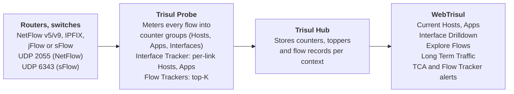

# AN-NF-001: Find the Hosts and Apps Hogging Your WAN Bandwidth

| Field | Value |
| --- | --- |
| App Note ID | AN-NF-001 |
| Product line | Trisul NetFlow Analyzer |
| Version | Trisul Network Analytics 7.0 |
| Data sources | NetFlow v5/v9, IPFIX, sFlow from routers and switches |
| Audience | NOC and network engineers, enterprise network teams |
| Est. setup time | 30 minutes, once flow export is in place |
| Status | SME-verified |

## Summary

A few hosts or applications can saturate a WAN link and degrade service for everyone else. Trisul NetFlow Analyzer meters every flow from your routers into counter groups (Hosts, Apps, Interfaces) and ranks the heaviest keys with toppers. This note shows you how to find the hosts and applications using the most bandwidth on a link, drill down to the flows behind them, and raise a Threshold Crossing Alert when a host crosses a bandwidth limit.

## The problem

WAN and internet links are shared. When one host runs a large backup, a cloud sync, a software update storm or peer-to-peer traffic, it can take most of a link's capacity. Users report slow applications, but interface counters from SNMP only show that the link is busy, not who is using it.

To act, you need three answers fast: which hosts are using the most bandwidth right now, which applications and conversations make up that traffic, and whether this is a one-off spike or a pattern. As the [NetFlow Analyzer use cases](https://trisul.org/trisul-netflow-analyzer-usecases/) put it, "bandwidth hog detection requires analyzing flow records" so you can "continuously rank traffic by volume" and identify top bandwidth users. The goal is to reduce congestion, distribute bandwidth fairly and keep application performance consistent.

## How Trisul approaches it

Trisul does not wait for you to query raw flows. As each flow record arrives, the Probe meters it into **counter groups**: a counter group is a category of things Trisul measures (Hosts, Apps, Interfaces), each **key** is one item in it (an IP, an application, an interface), and each **meter** is what is measured for that key (total, in, out). **Toppers** then rank the highest keys for a metric and time range, which is exactly the list of bandwidth hogs.

Three mechanisms do the work in this note:

- **Network-wide toppers** on the Hosts and Apps counter groups feed the Current Hosts and Current Apps dashboards. Trisul splits hosts into internal and external using your **home network**.
- **Interface Tracker** adds per-interface streams for Hosts, Apps and Protocols, plus a flow tracker stream, on the links you enable. This keeps "top hosts on this WAN link" accurate over weeks, not just over the raw-flow window.
- **Flow Trackers** keep the top-K flows matching a criterion (for example, largest outbound transfers) in a streaming window, so single large transfers are caught even when the host's average rate is low.

The Hub stores the metrics, toppers and flow records per context, and WebTrisul serves the dashboards, drilldowns and alerts you use below.



*Figure: Bandwidth hog detection data flow, router to WebTrisul.* Flows go from your routers to the Probe, which builds ranked counters and tracked flows; the Hub stores them and WebTrisul is where you find and alert on the hogs.

Reference: [Terminology](/docs/guide/learntrisul/terminology) · [Trisul Data Flow](/docs/guide/starthere/what_is_trisul/dataflow) · [Interface Tracking](/docs/guide/ug/netflow/interface_tracker)

## Prerequisites

- Trisul Network Analytics 7.0 installed, with the product mode set to **NetFlow Analyzer**. You can change the mode under **Web Admin › Manage › App Settings › UI**.
- `admin` and `user` logins to the Trisul web interface at `http://<trisul-server>:3000`.
- At least one router or switch exporting NetFlow v5/v9, IPFIX, jFlow or sFlow to the Trisul Probe. Trisul listens on UDP `2055`, `2056`, `2057`, `9500` and `9993` for NetFlow/IPFIX/jFlow, and UDP `6343` for sFlow.
- Flow export configured consistently on each router. Use one of two patterns: enable ingress+egress export on the uplink (WAN) interfaces only, or enable ingress-only export on every interface. Mixing the two (for example, ingress+egress on the uplink plus ingress on LAN interfaces) exports the same traffic twice, and Trisul then shows double the actual usage.
- The Probe running in NetFlow mode: **Context: default › Admin Tasks › Start/Stop Tasks**, with `probe0` set to `NetFlow_TAP` in the **Packets or NetFlow** column.
- Flows arriving for at least 15–20 minutes, so routers and interfaces are discovered before you open the **Interfaces** tab of the NetFlow Wizard.
- Optional: SNMP read access to the routers, so Trisul can resolve router and interface names.

Reference: [Configure NetFlow](/docs/guide/ug/netflow/netflow_setup) · [Quickstart](/docs/guide/starthere/quickstart)

## Configuration

You configure three things: the home network (so Trisul can split internal hosts from external ones), the Probe's flow input, and Interface Tracking on the links you want to watch. All three steps run as `admin`.

### Step 1: Confirm flows are arriving

1. On the Trisul server, check that flow packets reach the expected interface and port:

   ```bash
   sudo tcpdump -i eth0 -nnn "udp port 2055"
   ```

2. If you see no packets within a minute, repeat on the other server interfaces (`eth1`, `eth2`) or on the port your router exports to.
3. Log in as `user` and select **NetFlow › NetFlow Sources**.
4. Confirm that each exporting router appears in the **Flow Sources** chart and that the **Total Volume** chart shows the WAN interface among the top 10 interfaces.

<!-- TODO(screenshot): NetFlow Sources dashboard with the lab router and its WAN interface visible -->

Reference: [Configure NetFlow](/docs/guide/ug/netflow/netflow_setup) · [NetFlow Sources Dashboard](/docs/guide/ug/netflow/sources)

### Step 2: Define your home network

Trisul treats the RFC 1918 private ranges as the home network by default. Add any public ranges your organization owns so that Trisul classifies those hosts as internal.

1. Log in as `admin`.
2. Select **Context: default › profile0 › NetFlow Wizard**.
3. On the **Basics** tab, in **Specify IP ranges in Home Network for calculating External and Internal traffic**, add your ranges. This note uses `192.0.2.0/24` as the sample home network.
4. Click **Create** inside the **Specify IP ranges in Home Network for calculating External and Internal traffic** window. The change applies without a Probe restart.

<!-- TODO(screenshot): NetFlow Wizard › Basics tab with the home network range entered -->

Reference: [NetFlow Configuration Wizard](/docs/guide/ug/netflow/netflow_wizard)

### Step 3: Enable Interface Tracking on the WAN link

Without Interface Tracking, Trisul computes top hosts and apps on an interface from raw flows, which gives In/Out/Total totals only, with no time series. Interface Tracking creates per-interface streams for Apps, Hosts and Protocols plus a flow tracker stream, so per-interface toppers stay accurate over weeks. It is disabled by default.

1. Log in as `admin`.
2. Select **Context: default › profile0 › NetFlow Wizard**.
3. Open the **Interfaces** tab.
4. In **Select a router to display Interfaces**, choose the WAN router.
5. Tick the checkbox for the WAN interface.
6. From the **Interface Tracking** drop-down, select **Enable Interface Tracking**.

To cover many links at once, select **Enable Interface Tracking for Top 100** instead of steps 4–6.

As `user`, you can also toggle tracking per interface from **NetFlow › Routers and Interfaces**: click the **Eye Icon** column, or open the row's context menu and select **Interface Tracker › Enable**.

<!-- TODO(screenshot): NetFlow Wizard › Interfaces tab with the WAN interface selected and the Interface Tracking drop-down open -->

Reference: [Interface Tracking](/docs/guide/ug/netflow/interface_tracker) · [Routers and Interfaces](/docs/guide/ug/netflow/routers_and_interfaces)

### Step 4: Let data accumulate

Tracked metrics start from the moment you enable tracking; they are not back-filled. Wait at least 15 minutes before you start the analysis walkthrough, and a full business day before you set alert thresholds (see Tuning).

## Analysis walkthrough

Work from the network-wide view down to the individual flows. Each stage answers one question: who, on which link, using what, and since when. Log in as `user` for all steps.

### Stage 1: Who is using the most bandwidth right now?

1. Select **Dashboards › Current Hosts**.
2. Set the **Time window** to the period users complained about, and set **Topper count** to 10 or more.
3. Read **Latest Top Internal Hosts - Total** first. The hosts at the top of this list are your candidate bandwidth hogs.
4. Check **Latest Top Internal Hosts - OUT** and **- IN** to see whether the host is mostly uploading (backups, cloud sync) or downloading (updates, streaming).
5. Compare against **Inbound Vs Outbound** to judge how much of the total each top host accounts for.

<!-- TODO(screenshot): Current Hosts dashboard showing Latest Top Internal Hosts - Total with one dominant host -->

Sample output (illustrative, not real data):

| Rank | Internal host | Total | Share of home network traffic |
| --- | --- | --- | --- |
| 1 | 192.0.2.45 | 41.2 GB | 38% |
| 2 | 192.0.2.17 | 6.8 GB | 6% |
| 3 | 192.0.2.102 | 5.1 GB | 5% |

<!-- TODO(data): replace with real Latest Top Internal Hosts output from the lab; confirm whether the module shows volume, rate or both -->

### Stage 2: Which applications make up that traffic?

1. Select **Dashboards › Current Apps**.
2. Read **Current Top Apps - List** and **Apps by volume** to see which applications carry the most traffic.
3. Use **Apps out of network** and **Apps into network** to match the direction you saw in Stage 1.
4. On a suspicious app, open its drilldown menu and select **Top users of app**. If the host from Stage 1 tops this list, you have tied the host to the application.

<!-- TODO(screenshot): Current Apps drilldown menu with "Top users of app" highlighted -->

Reference: [Dashboards](/docs/guide/ug/ui/dashboards)

### Stage 3: Is it saturating the WAN link?

1. Select **NetFlow › Routers and Interfaces**.
2. Select the WAN router in the Router Table.
3. In the Interface Table, check **In Util %** and **Out Util %** for the WAN interface.
4. Open the row's context menu and select **Drilldown**.
5. Click **Show Search Form**, set **Time Frame** to the congestion window and **Top Count** to 10, and submit.
6. Open the **Util** tab to confirm utilization against interface speed.
7. Open **Hosts Track** to see the top hosts sending into (Ingress) and out of (Egress) this interface, with a chart that shows when each spike started.
8. Open **Apps Track** to see top applications on this interface by total, in and out.
9. Open **Conversations** to see the top source IP, destination IP and destination port pairs, in bytes.

<!-- TODO(screenshot): Interface Drilldown › Hosts Track tab with the top host's spike visible -->

Sample output, Conversations tab (illustrative, not real data):

| Source IP | Destination IP | Dest port | Volume |
| --- | --- | --- | --- |
| 192.0.2.45 | 203.0.113.80 | 443 | 38.9 GB |
| 192.0.2.17 | 198.51.100.20 | 443 | 4.2 GB |
| 192.0.2.102 | 203.0.113.15 | 80 | 3.0 GB |

<!-- TODO(data): replace with real Conversations output from the lab -->

Reference: [Routers and Interfaces](/docs/guide/ug/netflow/routers_and_interfaces) · [Interface Drilldown](/docs/guide/ug/netflow/drilldown)

### Stage 4: What are the exact flows?

1. Select **Tools › Explore Flows**.
2. Choose the congestion window in the **Time Selector**.
3. In **Search query**, enter the host, for example `ip=192.0.2.45`.
4. Review **Top Conversations** and **Top 100 Matching Flows**, which are ranked by volume.
5. Check **Duration** and **Start Time** to tell a single long transfer from many short ones.
6. On a flow row, click **Options** and select **In this conversation** to list every flow between the two endpoints.

To reach the same view from the interface, open the Interface Table row's context menu and select **Explore Flows**.

<!-- TODO(screenshot): Explore Flows results for the top host, Top 100 Matching Flows table -->

Reference: [Explore Flows](/docs/guide/ug/tools/explore_flows)

### Stage 5: Is this a one-off or a pattern?

1. Select **Tools › Long Term Traffic**.
2. Set **CounterGroup** to `Hosts`, choose the **Total** meter, and set **Item** to the host IP.
3. Set **Surface Type** to `LINETABLE` to get MAX/MIN/AVG under the chart.
4. Set **Time Frame** to the last 7 days, set **Business Hour** to your working hours, and click **Analyze**.
5. A spike that repeats at the same hour each day points to a scheduled job (backup, sync, update window). A single spike points to an ad-hoc transfer.

For the WAN interface, the Interface Table context menu also offers **Long term traffic chart**, which shows a default 7-day view of IN/OUT traffic.

<!-- TODO(screenshot): Long Term Traffic for the top host over 7 days, LINETABLE view -->

Reference: [Long Term Traffic](/docs/guide/ug/tools/analyze_item)

## Alerting & automation

Set up two kinds of alerts: a Threshold Crossing Alert (TCA) that fires when any internal host sustains a high rate, and a Flow Tracker Alert that fires on a single very large transfer. A TCA fires once when the value crosses the Hi Water Mark, and clears when it falls below the Lo Water Mark.

### Alert 1: Any internal host above a sustained rate (TCA)

1. Log in as `user`.
2. Select **Alerts › Threshold Crossing Alerts › Configure › New Threshold Crossing Alert**.
3. Fill in the form with the values below, then click **Create**.

| Field | Sample value | Why |
| --- | --- | --- |
| Name of the alert | `Host over 50Mbps` | Shown in the UI and reports |
| Target counter group | `Hosts` | Watch individual IPs |
| Keys | `192.0.2.0 ~ 192.0.2.255` | Fires if any IP in the range crosses the threshold |
| Target Metric | `Total` | Combined in + out |
| Hi Water Mark | `50Mbps` | Example only; set from your baseline |
| Hi Water Sustained Intervals | `5` | Ignores short bursts |
| Lo Water Mark | `25Mbps` | Clears when the host settles |
| Lo Water Sustained Intervals | `2` | Avoids flapping |
| TCA Message | `Internal host above 50Mbps for 5 intervals; check Hosts Track on the WAN link` | Appears in UI modules and email |

With a 60-second interval, `5` sustained intervals means the host must stay above the mark for about 5 minutes.

To alert on the link itself rather than a host, log in as `admin`, select **Context: default › profile0 › NetFlow Wizard › Interfaces**, and select the WAN interface. Open the **Configure TCA** drop-down and select **Create TCA** (the other option, **Delete TCA**, removes an interface TCA). Set **Meter** to `in`, `out` or `Total`. In NetFlow mode, when Interface Tracking is enabled on that interface, TCA alert emails include its top applications, hosts and conversations, so the email already names the likely hog.

<!-- TODO(screenshot): New Threshold Crossing Alert form filled with the sample values -->

Reference: [Threshold Crossing Alerts](/docs/guide/ug/alerts/tca)

### Alert 2: Any single flow above a volume (Flow Tracker Alert)

Flow Trackers keep the top-K flows that match a criterion over a streaming window. The built-in **Transferred-Out** tracker ranks the largest transfers from the home network to external hosts; **Transferred-In** does the reverse.

1. Log in as `user`.
2. Select **Alerts › Flow Tracking › Configure**.
3. Click **Create a New Flow Tracker Alert**.
4. Set **Alert Name** to `Upload over 1G`.
5. Set **Select a Flow Tracker** to `Transferred-Out`.
6. Set **Threshold Value (Bytes or Seconds)** to `1G`.
7. Set **Priority** to `2` (MEDIUM).
8. Set **Alert Message** to `Single flow uploaded more than 1 GB`.
9. Click **Create**.

Repeat with `Transferred-In` for large downloads. Both trackers are available in NetFlow mode.

Reference: [Flow Tracker](/docs/guide/ug/flow/tracker) · [Flow Tracker Alerts](/docs/guide/ug/alerts/ft)

### Deliver alerts by email

1. Log in as `admin`.
2. Select **Context: default › profile0 › NetFlow Wizard › Email Alerting**.
3. Complete **Email Account settings** with your outgoing SMTP account.
4. Add recipients under **Configure Email Alerts Recipients**.
5. Confirm that the alert service is running (**Start/Stop**) and that **Alerts go to syslog** and **Syslog readable** are satisfied. Trisul emails only alert types that go to syslog.

You can also schedule hourly or daily TCA reports, which send one consolidated email and send nothing when no TCA fired.

Reference: [NetFlow Configuration Wizard](/docs/guide/ug/netflow/netflow_wizard)

### Triage a fired alert

1. Select **Alerts › Threshold Crossing Alerts**.
2. Click the number in the **Count** column for `Host over 50Mbps`.
3. Read **Current Value** to see how far the host exceeded the mark.
4. Select **Traffic Chart** to see the host's traffic against the Hi and Lo Water Marks around the alert time.
5. Select **Drilldown**, then continue from Stage 3 of the analysis walkthrough.

## Tuning & limitations

- **Set thresholds from a baseline, not a guess.** Run Stage 5 (Long Term Traffic, `LINETABLE`) on your top hosts for a week. Set the Hi Water Mark above the normal MAX for business hours, and the Lo Water Mark near the AVG.
- **Use sustained intervals to cut noise.** A higher **Hi Water Sustained Intervals** value ignores short bursts such as a single large download; a lower value catches hogs sooner.
- **Exclude known heavy hosts.** Backup servers and update caches will trip a range TCA every night. In the **Keys** field, use the plus icon to select all keys and then deselect specific ones, or split the range into several TCAs. A key you deselect inside a `~` range is excluded from the TCA.
- **Enable Interface Tracking only where it pays.** It costs about 20–30 MB per interface per day of disk plus some CPU. Low-traffic interfaces are usually analyzed accurately enough from raw flows. Prefer **Enable Interface Tracking for Top 100** over enabling every interface.
- **Interface Tracking is not retroactive.** Hosts Track and Apps Track have data only from the time you enabled tracking.
- **Doubled volumes mean mixed export.** If a host or interface shows about twice the traffic you expect, check the router's export configuration. Use ingress+egress on uplinks only, or ingress-only everywhere, never both (see Prerequisites).
- **Sampled flows are scaled automatically.** If routers export sampled NetFlow or sFlow, Trisul 7.0 scales the byte and packet counts by the sampling rate, so volumes and thresholds reflect actual traffic.
- **Flow export timeouts delay detection.** A long transfer is reported only when the router exports the flow record (active timeout). Trisul has no recommended value; set the router's active timeout to suit how quickly you need long-running hogs to appear. A shorter timeout shows them sooner but increases the flow record rate.
- **Explore Flows retrieval cap.** Explore Flows retrieves up to **Max Flows** (default 10K). Narrow the time window or add filters on busy links.
- **Long Term Traffic day limit.** Beyond the limit in **WebTrisul Options › Charts › Long Term Chart Day Limit**, you get one aggregated chart instead of one chart per day.
- **Flow Tracker windows.** Custom trackers default to a 300-second **Snapshot Window** and a **Snapshot Count** of 100 top flows per window. Volume-based trackers cannot be combined with IP or port filters.
- **IP is not a user.** NetFlow identifies hosts by IP. With DHCP or NAT, map IPs to users through DHCP logs or an identity source; see the Palo Alto User-ID blog in Next steps.

## Next steps

- **Use case:** [Bandwidth Hog Detection Using NetFlow](https://trisul.org/trisul-netflow-analyzer-usecases/) and the related "Application Bandwidth Monitoring" and "Network Capacity Planning Using NetFlow" use cases on the same page.
- **Docs:** [Interface Tracking](/docs/guide/ug/netflow/interface_tracker) · [Interface Drilldown](/docs/guide/ug/netflow/drilldown) · [Threshold Crossing Alerts](/docs/guide/ug/alerts/tca) · [Flow Tracker](/docs/guide/ug/flow/tracker) · [NetFlow Analyzer Guide](/docs/prodguide/nf/)
- **Related blogs:** [Pinpoint user based traffic usage by Trisul NetFlow Analyzer and Palo Alto User ID](https://trisul.org/blog/trisul-nta-integrated-with-palo-alto/) · [Top Reasons to Choose Trisul NetFlow Analyzer for Advanced Bandwidth Monitoring](https://trisul.org/blog/top-reasons-to-choose-trisul-netflow-analyzer-for-advanced-bandwidth-monitoring/) · [NetFlow vs sFlow](https://trisul.org/blog/netflow-vs-sflow/) · [Trisul Network Analytics 7.0 Update](https://trisul.org/blog/trisul-network-analytics-7-0-update-faster-ipdr-better-ipv6-support-and-smarter-integrations/)
- **Try it:** [Download Trisul](https://www.trisul.org/download/) and point one router's NetFlow export at it to find your own top bandwidth users.
