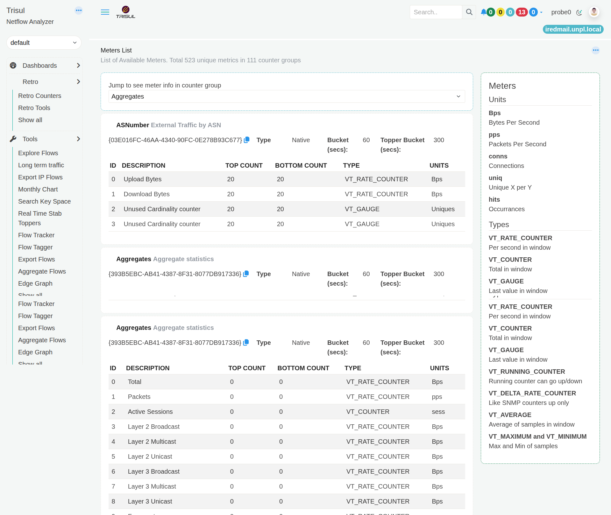

# Counter Groups Reference

A **counter group** is Trisul's basic unit of measurement. It keeps one time series per **key**, for example one per IP address, port, country or router interface. Each key holds several **meters**, such as bytes, packets or connections.

This page explains the concepts shared by every group and lists every group with its layer, what it measures and what its keys look like. Each group's own page gives exact key formats, special keys and the full meter table, all checked against the source code.

## Concepts

| Term | Meaning |
|---|---|
| Counter group | A named, GUID-identified collection of keys. Example: **Hosts** `{4CD742B1-C1CA-4708-BE78-0FCA2EB01A86}`. |
| Key | The thing being counted, stored in a fixed machine format such as `C0.A8.01.02`. The UI shows a readable **label** (`192.168.1.2`, or a resolved name) when one is known. |
| Meter | One numeric series inside a key, identified by a meter ID (0, 1, 2 …). Meter 0 is usually the total bytes. |
| Bucket | The time resolution of stored values. 60 s for most groups. |
| Topper | Top-N (and bottom-N) key lists per meter, computed every topper interval (300 s by default). **Top**/**Bottom** in a meter table is how many keys are kept. |
| Native or Lua | Groups are built in C++ inside the probe or its plugins (Geo, Badfellas), or written in Lua by the probe or a Trisul App. They behave the same once registered. |

### Layers used in this reference

| Layer | Keys come from |
|---|---|
| L2 Link | Ethernet frames: MAC addresses, VLAN IDs, MPLS labels, EtherTypes |
| L3 Network | IP addresses, IP protocols, ICMP, geo lookups on IP addresses |
| L4 Transport | TCP or UDP ports and TCP behavior |
| L7 Application | Application payload: HTTP, TLS, DNS, SSH, HSRP |
| Flow Record | Fields of NetFlow, IPFIX or sFlow records that packets do not carry: exporter, ifIndex, AS, next hop, VRF, vendor App-ID |
| Alerts | IDS, threat-intel and MITRE alerts |
| External Data | SNMP polling, ping, firewall syslog |
| Derived | Another counter group, through a filter, statval, ruleset or crosskey |
| System | The probe itself |

**Input** on each page says which feed fills the group: `Packets` (packet capture), `Flows` (NetFlow, IPFIX or sFlow), `Alerts`, `SNMP`, `Syslog` or `Internal`.

## Key formats {#key-formats}

Keys are stored as compact strings. These formats recur across groups:

| What | Key format | Example key | Readable |
|---|---|---|---|
| IPv4 address | Dotted uppercase hex, 2 digits per octet | `C0.A8.01.02` | 192.168.1.2 |
| IPv6 address | 32 uppercase hex digits, no separators | `20010DB8000000000000000000000001` | 2001:db8::1 |
| MAC address | Colon-separated hex | `00:00:0C:12:34:56` | `Cisco System:12:34:56` (vendor from the OUI database) |
| Port (Apps) | `p-` + 4 hex digits | `p-01BB` | 443, label `https` |
| IP protocol | 2 hex digits | `06` | TCP |
| EtherType | 4 hex digits | `86DD` | IPv6 |
| VLAN ID | 4 hex digits | `0064` | VLAN 100 |
| ICMP type and code | 4 hex digits, type then code | `0303` | Port Unreachable |
| Router interface | Exporter IPv4 in hex + `_` + ifIndex as 8 hex digits | `C0.A8.01.01_00000003` | `192.168.1.1_3` |
| AS number | Decimal string, no `AS` prefix | `15169` | GOOGLE |
| Country | ISO 3166 2-letter code | `IN` | India |
| Prefix | CIDR string | `203.0.113.0/24` | as is |
| Names (HTTP host, TLS org, user, App-ID…) | The text as seen on the wire or in the record | `www.example.com` | as is |

:::tip For tools and AI agents
Always query with the stored key format, not the readable label. To query host 10.1.1.5 in **Hosts**, use the key `0A.01.01.05`.
:::

## Special keys {#special-key-sysgroup_total}

### SYS:GROUP_TOTALS

Every counter group has the key `SYS:GROUP_TOTALS`. The stream engine (`stengine/XCounterGroup.cpp`) applies every update made to any key in the group to this key as well, including updates for keys that a crosskey group refused to track. Use it for "all of this group" questions, and to work out the **Others** share in top-N charts.

How a meter totals depends on its type:

| Meter type | Value in `SYS:GROUP_TOTALS` |
|---|---|
| `VT_RATE_COUNTER`, `VT_COUNTER`, `VT_RUNNING_COUNTER` | Sum over all keys |
| `VT_GAUGE`, `VT_DELTA_RATE_COUNTER` | Last value written by any key, not a sum |
| `VT_MAX` / `VT_MIN` | Maximum or minimum across all keys |
| `VT_AVERAGE` | Average of every sample written to any key |

:::caution Double counting
The totals are a sum of updates, not of traffic. When one packet or flow updates two keys (source and destination host, input and output interface), the totals are about **2× the link traffic**. Each group page says whether this applies. For network-wide traffic use **Aggregates**, key `TOTALBW`.
:::

### Other special keys

Some groups use reserved keys for unknown values or for traffic that does not fit the normal key. Examples: `UNTG` (untagged frames in VLANStats), `XY` (country not found), `XX` (ASN or prefix not found), `0` (flow record without AS), `00.00.00.00` (missing next hop), `FF:FF:FF:FF:FF:FF` (broadcast MAC), `TOTALBW` and `DIR_*` in Aggregates. Each group's page lists its special keys under **Keys → Special keys**.

## Meter types {#meter-types}

| Type | What is stored per bucket | Typical units |
|---|---|---|
| `VT_RATE_COUNTER` | Sum of values in the bucket ÷ bucket seconds | Bps, pps |
| `VT_COUNTER` | Sum of values in the bucket | hits, conns, alerts |
| `VT_RUNNING_COUNTER` | Running value carried across buckets (increments and decrements) | active flows |
| `VT_GAUGE` | Last value written in the bucket | queue depth, ms |
| `VT_DELTA_RATE_COUNTER` | Change in a cumulative value (such as an SNMP octet counter) ÷ bucket seconds | Bps |
| `VT_AVERAGE` | Mean of the values written in the bucket | ms |
| `VT_MAX` / `VT_MIN` | Largest or smallest value written | |

Every group also has two **Unused Cardinality counter** meters at the end of its table. The plugin framework adds them. They are filled only when you configure [cardinality counting](/docs/guide/ag/context/cardinality_countergroups).

## Derived counter groups {#derived}

You can define new groups that take their data from an existing **parent** group. They inherit the parent's meter list and key format.

| Kind | How keys get in | Built-in examples |
|---|---|---|
| [Statval](/docs/guide/ag/context/statbased_countergroups) | A parent update is copied when a chosen meter is above a value | [Internal Hosts](/docs/guide/counter-groups/internal-hosts), [External Hosts](/docs/guide/counter-groups/external-hosts) |
| [Filter](/docs/guide/ag/context/filtered_countergroups) | A parent update is copied when another group's key (such as a port) appears in the same packet or flow | [Web Hosts](/docs/guide/counter-groups/web-hosts), [Email Hosts](/docs/guide/counter-groups/email-hosts), [SSH Hosts](/docs/guide/counter-groups/ssh-hosts), [Unusual Traffic Hosts](/docs/guide/counter-groups/unusual-traffic-hosts), and the Interface Tracker groups (Hosts, Apps or NetworkLayerStats filtered by a FlowIntfs key) |
| [Ruleset](/docs/guide/ag/context/rulebased_countergroups) | Matching updates are renamed to a target key | [Unleash Apps](/docs/guide/counter-groups/unleash-apps) |
| [Keyset](/docs/guide/ag/context/keyset_countergroups) | Only keys in listed ranges are kept or grouped | none ship by default |
| [Crosskey](/docs/guide/ag/context/crosskey_countergroups) | Key is the combination of two or three groups' keys, e.g. AS × router interface | Flow-ASN × FlowIntfs, BGP-Peer AS × FlowGens |

## Catalog: built-in counter groups {#common-groups}

These 63 groups ship with Trisul Probe and its Geo and Badfellas plugins. Groups marked ² are off by default or exist only when configured.

### L2 Link

Ethernet frames: MAC addresses, VLANs, MPLS labels, EtherTypes.

| Group | Measures | Key | Input | GUID |
|---|---|---|---|---|
| [Aggregates](/docs/guide/counter-groups/aggregates) | Network totals, L2/L3 broadcast/multicast/unicast, home-net direction | Fixed names (TOTALBW, DIR_*, ipfrag, SG GUID) | Packets, Flows | `{393B5EBC-AB41-4387-8F31-8077DB917336}` |
| [Dir Mac](/docs/guide/counter-groups/dir-mac) | Bytes per directed source-to-destination MAC pair | MAC pair "src -&gt;dst" | Packets, Flows | `{79F60A94-44BD-4C55-891A-77823D59161B}` |
| [LinkLayerStats](/docs/guide/counter-groups/link-layer-stats) | Bytes and packets per EtherType | EtherType (4 hex) | Packets, Flows | `{9F5AD3A9-C74D-46D8-A8A8-DCDD773730BA}` |
| [Mac](/docs/guide/counter-groups/mac) | Bytes transmitted/received per Ethernet MAC | MAC address | Packets, Flows | `{4B09BD22-3B99-40FC-8215-94A430EA0A35}` |
| [MPLSStats](/docs/guide/counter-groups/mpls-stats) | Bytes per top-of-stack MPLS label | MPLS label (5 hex) | Packets | `{6C312435-80C1-401F-AEDD-090FF4F46212}` |
| [VLANStats](/docs/guide/counter-groups/vlanstats) | Bytes per 802.1Q VLAN, untagged as UNTG | VLAN ID (4 hex) | Packets, Flows | `{0EC72E9E-3AD2-43FD-8173-74693EEA08D0}` |

### L3 Network

IP addresses, IP protocols, ICMP, and geo or organization lookups on IP addresses.

| Group | Measures | Key | Input | GUID |
|---|---|---|---|---|
| [ASNumber](/docs/guide/counter-groups/asnumber) | Home↔external traffic by GeoLite2 ASN of external IP | AS number (decimal string) | Packets, Flows | `{03E016FC-46AA-4340-90FC-0E278B93C677}` |
| [City](/docs/guide/counter-groups/city) ² | Home↔external traffic by GeoLite2 city (off by default) | GeoNames city ID | Packets, Flows | `{6D201FA3-6F8B-4F83-73F7-CB0B8A66EA2E}` |
| [Country](/docs/guide/counter-groups/country) | Home↔external traffic by GeoLite2 country of external IP | ISO country code (2 letters) | Packets, Flows | `{00990011-44BD-4C55-891A-77823D59161B}` |
| [Hosts](/docs/guide/counter-groups/hosts) | Per-IPv4 traffic, connections, TCP flags, alerts, flow records | IPv4 address | Packets, Flows | `{4CD742B1-C1CA-4708-BE78-0FCA2EB01A86}` |
| [HostsIPv6](/docs/guide/counter-groups/hostsIPv6) | Per-IPv6 traffic, connections and flow records | IPv6 address | Packets, Flows | `{9807E97A-6CD2-442F-BB18-8C104C8EB204}` |
| [ICMP Types](/docs/guide/counter-groups/icmp-types) | IPv4 ICMP bytes and packets per type/code | ICMP type+code (4 hex) | Packets | `{FA6466E2-EA6A-4E75-8F39-ADE7708C6F46}` |
| [NetworkLayerStats](/docs/guide/counter-groups/networklayerstats) | Bytes, packets, active/total flows per IP protocol | IP protocol (2 hex) | Packets, Flows | `{E89BCD56-30AD-40F5-B1C8-8B7683F440BD}` |
| [Organization](/docs/guide/counter-groups/organization) | **Deprecated.** Remote-office traffic and whitelist violations per organization | Org code (text) | Packets | `{3A597F63-29C0-44AF-A7EF-641897D68693}` |
| [Prefix](/docs/guide/counter-groups/prefix) ² | Home↔external traffic by GeoLite2 ASN-block prefix (off by default) | IPv4 CIDR (dotted decimal) | Packets, Flows | `{2838D2E8-EABC-4050-90C4-8AE2589AAB25}` |
| [Remote Office](/docs/guide/counter-groups/remote-office) | **Deprecated.** Remote-office traffic and whitelist violations per branch | &lt;org&gt;_&lt;branch&gt; (text) | Packets | `{664D68BF-5544-43CE-A895-50F2E179EA5A}` |

### L4 Transport

Ports and TCP behavior.

| Group | Measures | Key | Input | GUID |
|---|---|---|---|---|
| [Apps](/docs/guide/counter-groups/apps) | Bytes, home-net direction, connections per server port | Port key p-XXXX or protocol name | Packets, Flows | `{C51B48D4-7876-479E-B0D9-BD9EFF03CE2E}` |

### L7 Application

Values parsed from application payloads: HTTP headers, TLS handshakes, DNS, SSH, HSRP.

| Group | Measures | Key | Input | GUID |
|---|---|---|---|---|
| [HTTP Content Types](/docs/guide/counter-groups/http-content-types) | Content-Type headers (hits) and following flow bytes | MIME type string | Packets | `{C0C9757F-2005-4CC5-BB96-D72F607E6188}` |
| [HTTP Hosts](/docs/guide/counter-groups/http-hosts) | Flow bytes after Host header seen, keyed by raw Host value | HTTP Host header string | Packets | `{D2AAD7C6-E129-4366-A2AD-A8CB9AA4C2F4}` |
| [HTTP Methods](/docs/guide/counter-groups/http-methods) | HTTP request lines per method (GET/POST/PUT/DELETE/TRACE/OPTIONS/HEAD) | HTTP method string | Packets | `{2A6957EB-4992-46CD-8E49-BE32318669D3}` |
| [HTTP Status Codes](/docs/guide/counter-groups/http-status-codes) | HTTP responses per status code | HTTP status code string | Packets | `{25E80A84-C175-4C01-977C-1411F5D10B56}` |
| [Long Fat Tail Hosts](/docs/guide/counter-groups/long-fat-tail-hosts) | HTTP flows to ranked domains below top FatTailRank | Domain suffix | Packets | `{27870892-5B20-4555-8BA2-2742F3DD0F04}` |
| [Long Thin Tail Hosts](/docs/guide/counter-groups/long-thin-tail-hosts) | HTTP flows to hosts absent from popularity ranking | HTTP Host header | Packets | `{BF2C028A-CDDE-4074-8AF5-A007582D820E}` |
| [TLS CAs](/docs/guide/counter-groups/tls-ca) | CA certs in server chain: Root CA / Inter CA hits | CA organization name | Packets | `{15856A98-7F87-46D7-84D2-18DD549F8A6F}` |
| [TLS Ciphers](/docs/guide/counter-groups/tls-ciphers) | ServerHello selected cipher suite: hits and flow bytes | Cipher suite ID, 4 hex digits | Packets | `{5B64A573-623F-4F5B-8865-78C62BF466A7}` |
| [TLS Orgs](/docs/guide/counter-groups/tls-orgs) | Server cert O= field: hits and flow bytes | Certificate organization name | Packets | `{432D7552-0363-4640-9CC5-23E4CA8410EA}` |

### Flow Record

Fields taken straight from NetFlow, IPFIX or sFlow records: exporters, interfaces, AS numbers, next hops, prefixes, TOS, VRF, vendor App/User IDs.

| Group | Measures | Key | Input | GUID |
|---|---|---|---|---|
| [App-ID](/docs/guide/counter-groups/app-id) | Traffic per Palo Alto App-ID | App-ID string | Flows | `{9021F5D3-FEFB-401B-99EC-EF2ACD088578}` |
| [BGP-ASPATH](/docs/guide/counter-groups/bgp-aspathbgp) ² | NetFlow bytes by RIB AS path of each endpoint | AS path (ASNs joined by /) | Flows | `{47F48ED1-C3E1-4CEE-E3FA-E768558BC07E}` |
| [BGP-Origin AS](/docs/guide/counter-groups/bgp-orgin-as) ² | NetFlow bytes by origin AS (last AS in RIB path) | AS number (decimal string) | Flows | `{3950AB76-3C3A-40EE-5C94-80A87EE28D53}` |
| [BGP-Peer AS](/docs/guide/counter-groups/bgp-peer-as) ² | NetFlow bytes by peer AS (first AS in RIB path) | AS number (decimal string) | Flows | `{A643654F-2BA3-4832-4FF1-43EBDDE6E655}` |
| [BGP-Prefix External](/docs/guide/counter-groups/bgp-prefix-external) ² | NetFlow bytes by matched BGP RIB prefix | IPv4 CIDR (dotted decimal) | Flows | `{C26520C4-DB9D-49EC-5D8B-35AD39951E36}` |
| [Flow-APPID-NBAR](/docs/guide/counter-groups/flow-appid-nbar) | Traffic per NBAR/RFC 6759 application ID | engine:selector | Flows | `{322AFE57-BA50-47B1-BE5C-EBC05BCC186B}` |
| [Flow-ASN](/docs/guide/counter-groups/flow-asn) | Upstream/downstream traffic per SRC_AS/DST_AS | AS number (decimal) | Flows | `{120A3124-E2BB-47BD-6C64-71BBB861C428}` |
| [Flow-BGP-NextHop](/docs/guide/counter-groups/flow-bgp-nexthop) | Traffic per BGP next hop | IPv4 address (hex) | Flows | `{FC61EC07-BED0-4734-C64C-F5932FD8B943}` |
| [Flow-IP-NextHop](/docs/guide/counter-groups/flow-ip-nextHop) | Traffic per IP next hop | IPv4 address (hex) | Flows | `{79693CA3-ED3C-43B3-E12A-A3F64B125E4F}` |
| [Flow-Link-ASN](/docs/guide/counter-groups/flow-link-asn) ² | Traffic per AS per router interface | AS\router_ifIndex | Flows | `{1D86CAB7-B4C4-433E-BCB9-C779A4244D70}` |
| [Flow-Prefix](/docs/guide/counter-groups/flow-prefix) | Traffic per source/destination prefix from router masks | IPv4 CIDR string | Flows | `{2BE2A3B6-613D-4216-0737-3684E824EA33}` |
| [Flow-Prefix-v6](/docs/guide/counter-groups/flow-prefix-v6) | Traffic per IPv6 prefix from router masks | IPv6 CIDR string | Flows | `{467AE21F-F2B7-4509-EA69-514CF2352D36}` |
| [Flow-TOS](/docs/guide/counter-groups/flow-tos) | Bytes and flows per DSCP code point | DSCP (2 hex digits) | Flows | `{965DDD07-F715-48D5-636B-A15106C9B502}` |
| [Flow-VRF](/docs/guide/counter-groups/flow-vrf) | Traffic per ingress VRF ID | VRF:&lt;id&gt; | Flows | `{7FAB8F84-C580-424B-2BA4-B2546D2DB15A}` |
| [FlowGens](/docs/guide/counter-groups/flowgens) | Flow traffic, record counts and export volume per exporter | Exporter IPv4 (hex) | Flows | `{2314BB8E-2BCC-4B86-8AA2-677E5554C0FE}` |
| [FlowIntfs](/docs/guide/counter-groups/flowi-ntfs) | Receive/transmit/flows and utilization per router interface | Exporter IPv4 + ifIndex (hex) | Flows | `{C0B04CA7-95FA-44EF-8475-3835F3314761}` |
| [User-ID](/docs/guide/counter-groups/user-id) | Traffic per firewall-reported user | User name string | Flows | `{86A8880D-F4B2-4E49-A4FA-718880CAA976}` |

### Alerts

Counts of IDS, threat-intel and MITRE-tagged alerts.

| Group | Measures | Key | Input | GUID |
|---|---|---|---|---|
| [Alert Classes](/docs/guide/counter-groups/alert-classes) | IDS alerts per classification | Classification string (cid-N) | Alerts | `{20BC4345-37F0-44D0-ABFF-3BED97363CB1}` |
| [Alert Priorities](/docs/guide/counter-groups/alert-priorities) | IDS alerts per priority | sn- + priority number | Alerts | `{9EFAFDD0-6CBB-4C04-8B13-2C8E0A9D3F85}` |
| [Alert Signatures](/docs/guide/counter-groups/alert-signatures) | IDS alerts per signature ID | Signature ID string (sid-N) | Alerts | `{A0FA9464-B496-4A20-A9AB-4D2D09AFF902}` |
| [Blacklist](/docs/guide/counter-groups/blacklist) | Badfellas indicator matches counted per feed category | Intel source/category string | Packets, Flows | `{6255BD85-2DCB-49E7-AF1F-1267AAF4DCA1}` |
| [MITRE Subtechnique](/docs/guide/counter-groups/mitre-subtechnique) | Alerts tagged with sub-technique ID (Txxxx.yyy) | MITRE ATT&CK sub-technique ID | Alerts | `{A2B72E5D-9E80-4796-23A9-618ABCEE1D57}` |
| [MITRE Tactic](/docs/guide/counter-groups/mitre-tactic) | Alerts tagged with tactic ID (TA00xx) | MITRE ATT&CK tactic ID | Alerts | `{70703134-26E7-4A41-7A29-46DFC85C3778}` |
| [MITRE Technique](/docs/guide/counter-groups/mitre-technique-counts-of-technique-used) | Alerts tagged with technique ID (Txxxx) | MITRE ATT&CK technique ID | Alerts | `{DC0296AA-61F2-413D-C8F3-97538F9C5418}` |

### Derived

Built from another group: statval, filter, ruleset or crosskey groups, plus groups re-keyed from another group's toppers.

| Group | Measures | Key | Input | GUID |
|---|---|---|---|---|
| [Base Domains](/docs/guide/counter-groups/base-domain) | External host bytes mapped to DNS name queried | DNS question name or rule name | Packets | `{74FE9532-EDEB-421E-BD92-B5C62E7F2346}` |
| [Email Hosts](/docs/guide/counter-groups/email-hosts) ² | Hosts with traffic on SMTP/POP/IMAP ports | IPv4 address | Packets, Flows | `{22D4082E-B8BA-40D0-A287-1F524DF8DA7B}` |
| [External Hosts](/docs/guide/counter-groups/external-hosts) | Hosts keys outside the home network | IPv4 address | Packets, Flows | `{00AA77BB-0063-11A5-8380-FEBDBABBDBEA}` |
| [External Hosts v6](/docs/guide/counter-groups/external-hosts-v6) ² | HostsIPv6 keys outside the home network (only if configured) | IPv6 address | Packets, Flows | `{9DC000A5-E122-4BDC-BC56-D3594A00BB53}` |
| [Internal Hosts](/docs/guide/counter-groups/internal-hosts) | Hosts keys inside the home network | IPv4 address | Packets, Flows | `{889900CC-0063-11A5-8380-FEBDBABBDBEA}` |
| [Internal Hosts v6](/docs/guide/counter-groups/internal-hosts-v6) ² | HostsIPv6 keys inside the home network (only if configured) | IPv6 address | Packets, Flows | `{0BDE3B47-B465-43DD-9275-45829D9A9748}` |
| [SSH Hosts](/docs/guide/counter-groups/ssh-hosts) ² | Hosts with traffic on port 22 | IPv4 address | Packets, Flows | `{439002E4-3758-4E88-9438-8034FE1616AF}` |
| [Unleash Apps](/docs/guide/counter-groups/unleash-apps) ² | Demo ruleset: rule-matched Apps traffic under a target key | Rule target name or Apps key | Packets, Flows | `{FF889910-9293-AAA5-0028-883991889884}` |
| [Unusual Traffic Hosts](/docs/guide/counter-groups/unusual-traffic-hosts) ² | Hosts with traffic outside web/mail/FTP/SSH ports | IPv4 address | Packets, Flows | `{AE3A1449-5663-41A5-A028-FDE61DBB7EFA}` |
| [Web Hosts](/docs/guide/counter-groups/web-hosts) ² | Hosts with traffic on ports 80/443 | IPv4 address | Packets, Flows | `{EEF95297-0C8D-4673-AD6B-F4BD2345FD69}` |

### System

The probe monitoring itself.

| Group | Measures | Key | Input | GUID |
|---|---|---|---|---|
| [Meta Counter Group](/docs/guide/counter-groups/meta-counter-group) | Per-group key counts, new keys, flush time | Counter group GUID | Internal | `{4D88CC23-2883-4DEA-A313-A23B60FE8BDA}` |
| [Meta Session Group](/docs/guide/counter-groups/meta-session-group) | Flow cache size, new/expired/terminated/flushed flows | Session group GUID | Internal | `{594606BD-EEB2-4E0B-BAC4-84B7057088C8}` |
| [Perf-Stats](/docs/guide/counter-groups/perf-stats) | Probe flush time, CPU, memory, capture drops, PCAP write rate | Component (engine-N, inputfilter-N) | Internal | `{0D39F2A7-2627-49D5-9DCF-707E6F1C0571}` |

## Catalog: counter groups added by Trisul Apps {#app-groups}

These 40 groups appear only after you install the named app from **Trisul Apps**. Their pages note bugs found in the app code that affect the numbers.

| Group | App | Layer | Measures | Key | GUID |
|---|---|---|---|---|---|
| [App Category](/docs/guide/counter-groups/fortigate-app-category) ² | fortigate-connector | External Data | Flow bytes per FortiGate app category | FortiGate appcat name | `{2DE5A613-BC31-4C73-1EAA-B527FDD40E7D}` |
| [DHCP Hostnames](/docs/guide/counter-groups/dhcp-hostnames) | fortigate-connector | Derived | Internal Hosts traffic intended to be keyed by DHCP hostname | IPv4 address | `{A8D34B1F-E0E5-458D-012A-0A31B0746D41}` |
| [External Syslog IP](/docs/guide/counter-groups/external-syslog-ip) | fortigate-connector | External Data | External IPs seen in firewall syslog (not populated) | IPv4 address | `{459BACD7-8F16-428F-2882-9DED4801C46D}` |
| [HSRP Hits](/docs/guide/counter-groups/hsrp-groups) | hsrp | L7 Application | Last HSRP Hello state (Active/Standby) per VIP/MAC | virtual IPv4\|MAC | `{0A79F27A-4741-40E8-DAF1-32F8ADB2653E}` |
| [HSRP Routers](/docs/guide/counter-groups/hsrp-routers) | hsrp | L7 Application | Routers sending HSRP Hellos | IPv4 address (dotted decimal) | `{47FB78D7-76F6-4AF0-D45A-7D9BA6E83762}` |
| [Proxy External](/docs/guide/counter-groups/http-connect) | http-proxy | L7 Application | Proxied HTTP/CONNECT flow bytes by real destination | Shortened hostname | `{55F98CC1-646E-4DE6-AD79-6B896211F178}` |
| [Exchange MAC](/docs/guide/counter-groups/multicast-mac) ² | IGMP_multicast | L2 Link | Bytes of IPv4 UDP packets per src/dst IP and dst MAC | IPv4\IPv4\dest MAC | `{095E0C56-D17F-4634-A0B8-E000B4E85140}` |
| [Exchange XFlow](/docs/guide/counter-groups/exchange-xflow) | IGMP_multicast | L4 Transport | TCP client/server/port bytes and multicast UDP bytes | IPv4\IPv4\port[\mcast IP] | `{942AB99F-7A65-4B2E-6F6C-A3050F0F7B35}` |
| [IP X Multicast](/docs/guide/counter-groups/ip-x-multicast) | IGMP_multicast | Derived | Member×group crosskey: IGMP heartbeats and group traffic | member IPv4 + multicast IPv4 | `{074E78B6-E032-4B22-B085-12A2E72E1BB7}` |
| [Multicast Hosts](/docs/guide/counter-groups/mcast-hosts) | IGMP_multicast | L3 Network | Hosts traffic of multicast groups that have IGMPv2 members | IPv4 multicast address | `{2792D434-496E-40C9-5E2D-73B60623A631}` |
| [Multicast Members](/docs/guide/counter-groups/multicast-members) | IGMP_multicast | L3 Network | Group traffic charged to each IGMPv2 member host | IPv4 address (member) | `{51177E0A-7535-46B7-1477-9F0E0E0F9808}` |
| [IP-MAC-PAIR](/docs/guide/counter-groups/ip-mac) | ip-mac-mapper | L2 Link | Bytes per IP+MAC pair | IPv4_MAC | `{4D6F1A1C-B8B5-4635-AFF8-20BE2A306020}` |
| [IP2Loc ASN](/docs/guide/counter-groups/ip2loc-asn) | ip2location | L3 Network | Flow bytes/flows by IP2Location ASN of external IP | AS number | `{EF44F11F-B90B-4B24-A9F5-86482C51D125}` |
| [IP2Loc City](/docs/guide/counter-groups/ip2loc-city) | ip2location | L3 Network | Flow bytes/flows by IP2Location city of external IP | CC_City string | `{E85FEB77-942C-411D-DF12-5DFCFCF2B932}` |
| [IP2Loc Country](/docs/guide/counter-groups/ip2loc-country) | ip2location | L3 Network | Flow bytes/flows by IP2Location country of external IP | Country code | `{F962527D-985D-42FD-91D5-DA39F4D2A222}` |
| [IP2Loc Proxy](/docs/guide/counter-groups/ip2loc-proxy) | ip2location | L3 Network | Flow bytes/flows to known proxy/VPN/TOR IPs by type | IP2Proxy type code | `{2DCA13EB-0EB3-46F6-CAA2-9989EA904051}` |
| [IP2Loc State](/docs/guide/counter-groups/ip2loc-state) | ip2location | L3 Network | Flow bytes/flows by IP2Location region of external IP | CC_Region string | `{5C28445E-19E3-499E-E14D-E4CC7128B62B}` |
| [OTT Apps](/docs/guide/counter-groups/ott-apps) | ott | Derived | External Hosts traffic mapped to OTT app via Passive DNS | App name | `{0D5FFF94-BDA1-4BDB-A13D-A5AED7D6A96C}` |
| [OTT XKey](/docs/guide/counter-groups/ott-xkey) | ott | Derived | Defined but not updated by current code | (none) | `{113091EA-CF82-46E0-DE38-9A8C42DD0279}` |
| [PING Latency](/docs/guide/counter-groups/ping-latency) | pingmon | External Data | ICMP ping latency per target | IP address (dotted decimal) | `{4DF11F00-B726-4260-5F83-0D9891197B45}` |
| [Protocol Tree](/docs/guide/counter-groups/protocol-tree) | protocol-tree | L3 Network | Bytes and frames per EtherType/IP-proto/port path | ethertype/proto/port path | `{2CF4DCFF-77E5-45E9-AA03-8D827CE0813C}` |
| [Prune-PCAP](/docs/guide/counter-groups/prune-pcap) | prune-encrypted-pcap | System | New flows excluded from PCAP storage per keyword | matched regex keyword | `{1E92FD61-5129-499D-0A12-883E9FC1C00C}` |
| [File Extraction](/docs/guide/counter-groups/file-extraction) | save_binaries | System | Extracted files: events, bytes, file types | event name or libmagic type | `{282E13BE-9691-4B61-F0A3-21CB90792478}` |
| [ShiftX Metrics](/docs/guide/counter-groups/shiftx-metrics) | shiftx | Derived | Top-K rank-shift scores of a monitored group | &lt;CounterGUID&gt;-&lt;meter&gt; | `{22B6E494-382B-47D5-D914-591CF8572343}` |
| [SNI](/docs/guide/counter-groups/sni) | sni-tls | L7 Application | Port-443 flow bytes and flows per ClientHello SNI | SNI hostname | `{38497403-23FB-4206-65C2-0AD5C419DD53}` |
| [SNMP-Interface](/docs/guide/counter-groups/snmp-interface) ² | snmppoll | External Data | SNMP in/out octet rates and utilization per interface | Agent IPv4 + ifIndex (hex) | `{9781DB2C-F78A-4F7F-A7E8-2B1A9A7BE71A}` |
| [FlowIntf_bx_QOS](/docs/guide/counter-groups/flowintf-bx-qos) | snmpqospoll | External Data | CBQOS stats per interface and class | router_ifindex\classid | `{D3F7A892-4E1B-4C6D-8A5F-2E1C9B7D4A63}` |
| [QoS-Class](/docs/guide/counter-groups/qos-class) | snmpqospoll | External Data | Label store for CBQOS class-map names (no counters) | CBQOS class ID | `{116888A7-23B4-4873-5691-E6E0806CCB11}` |
| [QOS-Traffic](/docs/guide/counter-groups/qos-traffic) | snmpqospoll | External Data | CBQOS pre/post-policy, drop, queue stats per class | CBQOS class ID | `{1AB9F248-1E49-4245-571A-55BCDA658843}` |
| [Proxied Servers](/docs/guide/counter-groups/proxied-servers) | squid-proxy | L7 Application | Tunnel bytes and hits per HTTP CONNECT target | CONNECT host:port | `{B7571E87-F794-4BF6-A57A-EEA8A90F0324}` |
| [SSH Endpoints](/docs/guide/counter-groups/ssh-endpoints) | ssh-alert | L7 Application | Successful SSH logins per client/server software banner | SSH version banner | `{E6A387F4-5B51-4C8B-86FD-DE6258D3F214}` |
| [TCP Analyzer](/docs/guide/counter-groups/tcp-analyzer) | tcp-analyzer | L4 Transport | Per-host TCP setup RTT, retransmissions, timeouts | IP address (v4/v6) | `{E45623ED-744C-4053-1401-84C72EE49D3B}` |
| [TCP Analyzer Apps](/docs/guide/counter-groups/tcp-analyzer-apps) | tcp-analyzer | L4 Transport | Per-server-port TCP setup RTT, retransmissions, timeouts | port p-XXXX | `{24DBD78F-CBB6-4383-7A78-B2C734FC480F}` |
| [TLS Public Key Algo](/docs/guide/counter-groups/tls-pk-algo) | tls-metrics-pack | L7 Application | Certificates per public key algorithm or EC curve | Algorithm name | `{88F603AE-4519-4E3D-E1C8-D1882E398724}` |
| [TLS Sig Algo](/docs/guide/counter-groups/tls-sig-algo) | tls-metrics-pack | L7 Application | Certificates per signature algorithm | Algorithm name | `{C90640F6-ACD1-4BE5-92FF-A417DC6A987A}` |
| [TLS Versions](/docs/guide/counter-groups/tls-versions) | tls-metrics-pack | L7 Application | Port-443 flows and bytes per negotiated TLS version | Decimal TLS version | `{44DBB4E0-B79F-4FB5-A437-3CFEDFB7B65E}` |
| [JA3 FINGERPRINT](/docs/guide/counter-groups/ja3-hash) | tls-print | L7 Application | ClientHello JA3 and ServerHello JA3S hits per hash | MD5 hex (uppercase) | `{E8D5E68F-B320-49F3-C83D-66751C3B485F}` |
| [JA4 FINGERPRINT](/docs/guide/counter-groups/ja4-hash) | tls-print | L7 Application | ClientHello hits per JA4 fingerprint | JA4 string | `{D7C3F2B1-9D4E-4A8F-B6E5-123456789ABD}` |
| [JA4S FINGERPRINT](/docs/guide/counter-groups/ja4s-hash) | tls-print | L7 Application | ServerHello hits per JA4S fingerprint | JA4S string | `{D8D4E3C2-AE5F-4B90-C7F6-234567890BCD}` |
| [Outside Umbrella Top-1M](/docs/guide/counter-groups/outside-umbrella-top-1m) | umbrella-top-1m | L7 Application | DNS names not in the Umbrella Top-1M list | DNS name | `{3317EEB3-CE83-4C8F-E321-79E7194BD974}` |

## Not covered here {#not-covered}

- **Groups you create**, such as crosskey, filter, Interface Tracker (`IFTRACK_*`) or custom Lua groups, are documented by whoever creates them. Their key format follows the parent groups.
- **Registry entries with no code.** Some installs list *HTTP URL Category*, *BGP-Prefix Home* or *Flow-Prefix-Home*. No current probe, plugin or app code fills them, so they stay empty.
- **Subnets, Interfaces and VSAT** classes exist in the probe source but are not registered, so no such groups appear.
- **stablekeys** (Trisul App) defines no group. It watches [FlowGens](/docs/guide/counter-groups/flowgens) and raises an alert when an exporter key stops reporting.

## See meters in the product {#view-meters}

Go to **Customize → View Meters** to see the meters of any group on your probe. Select the group from **Jump to see meter info in counter group**.

*Figure: View Meters*

The table there shows the same columns as the meter tables in this reference: ID, Description, Top Count, Bottom Count, Type and Units.

