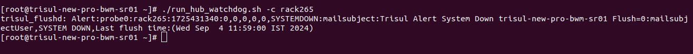

import Tabs from '@theme/Tabs';
import TabItem from '@theme/TabItem';

# Watchdog


The Trisul System context monitoring component is designed to detect the status of multiple contexts within the system. Unlike the `hub_flusher_watchdog.sh` script, which focuses on monitoring the overall system status and sending alerts for system downtime, this feature provides a more granular view by tracking the status of individual contexts. If any context is found to be non-running, the system automatically sends alerts to the syslog, ensuring prompt notification of potential issues. Notably, this monitoring functionality relies on the `run_hub_watchdog.sh` script, highlighting the interconnected nature of the system's monitoring and alerting capabilities.

## Modes

The script supports three distinct modes of operation, allowing for flexible execution and tailored functionality.

   1) **IPDR Mode** : Enable IPDR mode to monitor and verify the number of flows flushed in IPDR.
   2) **IPDR with Radius Mode** : In this mode, along with IPDR it verifies whether the Radius logs are processed properly

   3) **Analytics Mode**: 
Checks the number of FlowGens or any countergroup flushed by activating the Counter Groups.

     > Requires the Countergroup key to be provided.

:::tip
Configure mail in trisul to receive alert
:bell:
:::


## Requirements
- Run this script as root
- Configure email in Trisul (if email alerts are required).

## Options

| Option             | Default value   | Description                           | Usage            |
| -------------------| ----------------| ------------------------------------- | -----------------|
| -c CONTEXT-NAME    | context0        | Name of the Context                         | -c all [prints the flusher for all contexts]   |
| -e CONTEXT-NAME    |     -           | Ignores a particular context for checking           | -e netflow -e headoffice                                    |
| -s HOST-NAME       | hostname        | Host name                             | -s Trisul-Server                                            |
| -i INTERVAL        |     2           | Check the flushed item count for the last n intervals | -i 4                                                  |
| -g COUNTER_GROUP   |     -           | Check this counter group in the log. Repeat `-g` to monitor more than one counter group. | -g `{2314BB8E-2BCC-4B86-8AA2-677E5554C0FE}`                 |
| -f CHECK_FLOW_COUNT|     -           | Check flushed flow count              | -f                                                          |
| -v VERBOSE         |     -           | Print information like flushed flows  | -v                                                          |
| -m MATCH_ANY_ENGINE|    1           | Check if any n engines are flushed      | -m 2                                                          |
| -r RESTART         |     -           | Restart the Hub and Probe if nothing was flushed | -r                                                          |
| -a filepath        |     -          | Checks the radius pattern in the file path | -a /home/trisul/radius.txt | 
| -j interval        |      3600        | AAA file processing interval, in seconds | -j 11800 |

>**The file contains sample output such as:  
radius_0  
radius_1  
radius_2**


## How to Run this Script

### IPDR Mode

In IPDR Mode, flows are a crucial component. The `-f` option is used to flush flows, which are then verified against a specific context `-c` within a defined interval `-i`. So if the flows are flushed during the specified interval it prevents alerts from being generated for that interval.

#### IPDR Mode Example

   ```bash
   /usr/local/share/trisul-hub/run_hub_watchdog.sh -c context0 -f -i 2

   ```
### IPDR with Radius mode

In IPDR with radius mode the radius logs are checked against a particular context `-c` for a particular duration `-j`. In the example if the flowgens are flushed for one hour (3600) the alerts will not be generated.

#### IPDR Mode with Radius Example

   ```bash
   /usr/local/share/trisul-hub/run_hub_watchdog.sh -c context0 -f -i 2 -a /home/trisul/radius.txt -j 3600

   ```

### Analytics mode
In Analytics Mode, flushed FlowGens and other counter groups `-g` are verified against a specific context `-c`.

#### Analytics mode Example

   ```bash
   /usr/local/share/trisul-hub/run_hub_watchdog.sh -c context0 -g {2314BB8E-2BCC-4B86-8AA2-677E5554C0FE} -v
   ```

#### Execution Options
The script can be executed with or without the -v argument, which controls the verbosity of the output.  

**Verbose Mode `-v`**  
When executed with the -v argument, the script operates in verbose mode. In this mode, the script prints all values to the terminal, providing detailed information about the context status.  

**Non-Verbose Mode (No `-v`)**  
When executed without the -v argument, the script only prints values to the terminal if the context is not running. This mode provides a more concise output, only alerting the user to contexts that are not running.

### How alerts are generated when the conditions are not met

#### Alert Generation
The script generates alerts to the syslog based on the flush value. If the flush value is 0, it indicates that the context is not running, and an alert is generated.
#### Alert Format
The alert format is the same in flow mode and in counter group mode. Flow mode (`-f`) checks the flushed flow count; IPDR mode uses it. Counter group mode (`-g`) checks the counter groups you name; the other product modes use it. The script sends a standard alert message to the syslog saying that the context is not running.

>**Note: The alert message doesn't say whether flow mode or counter group mode found the problem.**


**Example:**

```bash
   /usr/local/share/trisul-hub/run_hub_watchdog.sh -c rack265
```


## Cron Tab

The Trisul AAAing tool (`trisul_aaaing`) processes AAA records. You dump the AAA records as CSV files into a folder. `trisul_aaaing` picks up each new CSV file and stores the data in the matching slice directory under the meters directory. You can then correlate AAA user IDs and broadband service IDs with IPDR logs.

To schedule a script to run every half hour, add the following cron job to your crontab. This will allow the script to continuously run in the background, periodically checking for flows.

**Analytics Mode**  

Enables Counter Groups to verify the number of FlowGens flushed automatically in the background.

`*/30 * * * *  /usr/local/share/trisul-hub/run_hub_watchdog.sh -c context0 -g {2314BB8E-2BCC-4B86-8AA2-677E5554C0FE}`

**IPDR Mode**   
Verifies the number of flows flushed in IPDR automatically in the background.

`*/30 * * * *  /usr/local/share/trisul-hub/run_hub_watchdog.sh -c context0`                     

**IPDR Mode with Radius**

Verifies IPDR along with radius logs automatically in the background.

`*/30 * * * *  /usr/local/share/trisul-hub/run_hub_watchdog.sh -c context0 -f -i 2 -a /home/trisul/radius.txt -j 3600`
