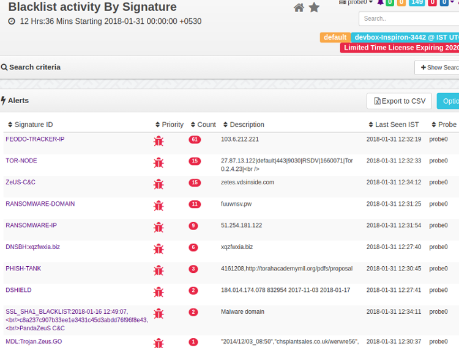

# Badfellas Plugin

The Badfellas plugin checks your network traffic against millions of indicators to detect malicious activity.



*Figure: Blacklist Alerts*

The following objects in your network traffic are scrutinized.

**IP address**

Matches IPs against blacklisted IPs

**Domain**

Matches blacklisted domain names, even if no response was received, or hidden in DNS records

**HTTPHost**

Checks if an HTTP host is blacklisted. Useful for flagging shared hosts like badun.blogspot.com

**SSLHost**

The Server Name Indicator (SNI) is inspected  

**URL**
Checks HTTP GETs/POSTs of your network against well known evil ones

**SSLCertificate**

Checks SHA1 fingerprint

## Feeds

Feeds are sources of threat intelligence from which Trisul downloads updated threat indicators. Upon installation of badfellas plugin a “Feed” is automatically added to the Trisul-Hub node. The hub node then downloads the updates as per rules and pushes them to the probes.

The feed directory is located on the Trisul-Hub node at  

```bash
 cd /usr/local/var/lib/trisul-config/domain0/allcontexts/feeds
```

Inside this directory you can see `feed_xx` sub-directories representing plugins requesting feed updates. For example : GeoIP updates. The Badfellas feed is located in the subdirectory  

```bash
cd feed-2F3CCCA3-38D4-4773-97AB-3ED732F82533
```


Inside the feed directory , there is a file called `rules.xml` This contains the feed configuration.

### Removing a Feed

Locate the `rules.xml` file as described above. Then remove the feeds you want to disable. For example if you wish to disable the ALIENVAULT feed.

Remove the following lines

```xml
<Source>
    <URL>http://reputation.alienvault.com/reputation.generic.gz</URL>
    <Target>reputation.generic.gz</Target>
</Source>
```

The feed will be skipped at the next download. See `Frequency` parameter in the rules.xml file.

## Included Blacklist Feeds

The Badfellas package installs stub copies of the following blacklists. These feeds are updated to the latest versions at the next scheduled update time. Within 24 hrs.

| Feed file | Source | Contents |
| --- | --- | --- |
| `dns-blackhole.txt` | [malwaredomains.lehigh.edu](http://sbc.io/hosts/hosts) | Domains known to spread malware and spyware |
| `dshield.txt` | [DShield.org](https://www.dshield.org/) | Malicious and scanner IPs |
| `feodotracker-ips.txt` | [Feodo Tracker](https://feodotracker.abuse.ch/blocklist/) | IPv4 addresses used as command-and-control servers by the Feodo Trojan |
| `phish-tank.txt` | [PhishTank](https://www.phishtank.com/) | User-submitted phishing domains |
| `reputation.generic` | AlienVault IP Reputation | IPs with a poor reputation, including scanners |
| `sslblacklist.csv` | [SSLBL](https://sslbl.abuse.ch/) | SHA1 fingerprints of malicious SSL certificates |
| `tornodes.txt` | [TOR node list](https://www.dan.me.uk/torlist/?full) | TOR nodes, to flag hosts that use TOR |
| `urlhaus-active.csv` | [URLhaus](https://urlhaus.abuse.ch/) | Active malware distribution URLs |

## Feed Updates

The plugin will automatically download a fresh database at a set schedule. You can control when and how frequently this database is updated by modifying the `Frequency` parameter in the rules.xml file. The default setting is 1 update every day. All feeds are updated at the same frequency.

```xml
<Run>
    <RunAt>0200</RunAt>
    <Frequency>86400</Frequency>
</Run>
```

### Viewing Status of Feed Updates

To view the status of feed updates, whether the downloads were successful or not.

:::info navigation

:point_right: Log in as `admin`, then select Web Admin &rarr; Manage &rarr; Plugin Data Updates

:::

This shows the feed status.

## Installation

This plugin is distributed as an RPM package and a DEB package. The file names include the version number, which changes with each release. The commands below use version 8.1.3011 as an example.

```bash
# on RHEL / Oracle Linux 8
rpm -Uvh trisul-badfellas-8.1.3011-1.el8.x86_64.rpm
# on Ubuntu 26.04
dpkg -i trisul-badfellas_8.1.3011-resolute_amd64.deb
```

### Upgrading

Uninstall the old package and install the new package.

### A Sample Install

When you install you should get an output like the following.

```bash
[root@localhost share]# rpm -Uvh trisul_badfellas-1.0.153-0.el5.x86_64.rpm
Preparing...                ########################################### [100%]
   1:trisul_badfellas       ########################################### [100%]
Creating temp staging area..
Creating consolidated Bad Fellas Tokyo Cab ..
Processing File /tmp/temp_trisul_badfellas_staging/usr/local/share/BadFellas/dns-blackhole.txt..25270 entries
Processing File /tmp/temp_trisul_badfellas_staging/usr/local/share/BadFellas/malware-domain-list.txt.......134498 entries
[root@localhost share]#
```

### Uninstallation

Stop Trisul and uninstall the RPM/DEB

```bash
# on RHEL / Oracle Linux
rpm -e trisul-badfellas
# on Ubuntu
dpkg -r trisul-badfellas
```

### Starting

The plugin takes effect after you restart the context: run `trisulctl_probe restart context <context_name>@<probe_name>`, or stop and start the Probe from **Context: default → Admin Tasks → Start/Stop Tasks**.

## Adding Custom Indicators

### Step 1: Create a tab-separated indicator file

Using external mechanism place your custom feed in a Tab Separated file with the following format `<FEEDNAME><TAB><IP/DOMAIN/URL><TAB><DESCRIPTION>`

### Step 2: Add your file as a source feed for Badfellas automatic updates

Locate the feed `rules.xml` file [as described in feeds](#feeds)

Find the local feed section

```xml
<!-- ***************************************************************** -->
<!--    Local feed                                                     -->
<!--     Any file named badfellas-local-*.tsv  will be processed       -->
<!--     The file is a TAB separated file with the following fields    -->
<!--     INTELSOURCE<TAB>KEY<TAB><DESCRIPTION>                         -->
<!--     KEY = IP Address, Domain Name, URL                            -->
<!-- ***************************************************************** -->
<Source>
    <URL>file:///usr/local/share/trisul/plugins/badfellas-local.tsv</URL>
    <Target>badfellas-local-0.tsv</Target>
</Source>
```

In the above snippet – the URL `file://.... badfellas-local.tsv` represents the source feed. Change it to your file or URL if you are hosting it on a website. The feed will be automatically refreshed like the other sources.

> **Restart Trisul or wait for about 30 minutes for the feed to be picked up**

## Configuration Parameters

The rules.xml allows you to customize

**ReloadListSeconds**

How frequently Trisul server reloads the threat intel information. This is separate from the per-feed download Frequency

**CheckICMP**

Scan ICMP traffic like PINGs for connection attempts

**CheckDNS**

Parse DNS records

**CheckHTTPHost**

Check HTTP Host header in addition to DNS

**CheckTCPFlows**

Check each flow

**CheckURL**

Check all URLs seen

**FatTailRank**

In the Top-1 million URL list, URLs ranked below this value are treated as the fat tail. The parameter is still supported, but you don't need to set it.

Locate the [rules.xml file](#feeds)

```xml
<TrisulPluginConfiguration>
        <description>Controls how the Trisul Badfellas plugin works </description>
        <ReloadListSeconds>900</ReloadListSeconds>
        <CheckICMP>TRUE</CheckICMP>
        <CheckDNS>TRUE</CheckDNS>
        <CheckHTTPHost>TRUE</CheckHTTPHost>
        <CheckTCPFlows>TRUE</CheckTCPFlows>
        <CheckURL>TRUE</CheckURL>
```

## Also Read

See the [Badfellas Malware alerts section](/docs/guide/ug/alerts/mw) in the User Guide
