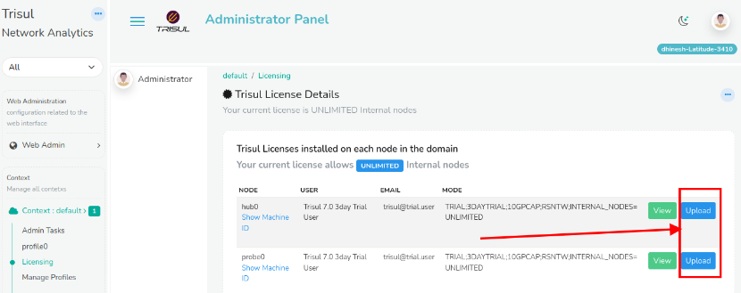
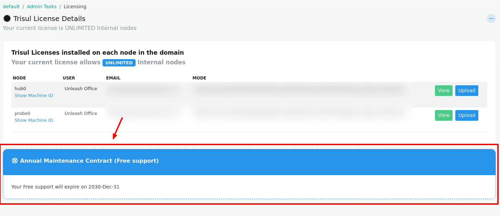

# Installing a License File

This section helps you apply a new license to your Trisul system so it can run with the correct features and limits.

## Understanding the License File

When a new license is issued, you’ll receive a file named in this format:  
 `License.{emailid/username}.txt`

The license would look something like this: 

```
----------------------------------------------------------------
User:      Tim HoprXXXX
Email:     test@xx
Ver:       8.1
Type:      PRODUCTION
Muuid:     4087ACCD-4B0B-DE11-833A-00248CB93BDE
Due:       0 (Upgrade at will)
Maint:     1824768000 (Oct 29 2027)
Product:   NETFLOW
Host:      SELF
LimitType: INTERNAL_HOSTS
Limit:     3000
----------------------------------------------------------------
WPpVAkrqtTXXXXXXXXGxxVBeJ54jlMaPIrgAbCcSmDq/VGpBuYc4whDE6tXdEgId
ARn0tnWcxqv7Fdapo7RvCQ==
----------------------------------------------------------------
```

| Field | Meaning |
|---|---|
| User, Email | Who the license is issued to |
| Ver | License format, `8.1` for Trisul 8 |
| Type | `PRODUCTION`, `TIMETRIAL` (extended trial) or `TRIAL` |
| Muuid | The [Machine ID](/docs/guide/starthere/setuptrisul/license/intro#machine-id) the license is locked to |
| Due | Date the license stops working, `0` means never |
| Maint | Date the [Annual Maintenance Contract](#annual-maintenance-contract-amc) ends |
| Product, Host, LimitType, Limit | What you are licensed for, see [Product, Limit Type and Limit](/docs/guide/starthere/setuptrisul/license/intro#product-limit-type-and-limit) |

The lines between the last two `----` lines are the signature. Do not edit the license file; any change to it makes the license invalid.

:::danger one license file per machine
A new license file is required for every machine because it is locked to a MachineID. For most customers on a single machine you only need a single license file
:::


## Install Using Web Interface

For most deployments, the web interface is the simplest and safest way to install a license.

:::info navigation

:point_right: Login as Admin → **Context : default** → **Licensing**

:::

On the Licensing page you can click on the **Upload** Button shown in the image below to select the new License file and upload it.

  
*Figure: Showing the Upload button used to install new license files*  

## Install New Licenses Using the Command Line

This alternative method installs the license file directly in the correct directories. It’s useful when the web interface isn’t accessible or when you’re setting up automated or scripted deployments.

### Install License on Trisul Probe Node

1. Put the new license file in `/usr/local/etc/trisul-probe`.
2. Either rename the new file to `LicenseKey.txt`, or edit the `LicenseFile` parameter in [trisulProbeConfig.xml](/docs/guide/ref/trisulconfig#app) to point to the new file.


Repeat the same for the Hub (even if on the same machine)

### Install License on Trisul Hub Node

1. Put the new license file in `/usr/local/etc/trisul-hub`.
2. Either rename the new file to `LicenseKey.txt`, or edit the `LicenseFile` parameter in [trisulHubConfig.xml](/docs/guide/ref/trisulconfig#app) to point to the new file.

### Restart Trisul Hub and Probe Node

:::info
Restart both the hub and probe nodes for the new license to take effect. See [Start and Stop Trisul](/docs/guide/ag/admintasks/startstop).
:::


## View the License File in Effect

:::info navigation

:point_right: Login as Admin → **Context : default** → **Licensing**

:::

The active license details are displayed on this page, including the enabled mode and limits.

## Moving an Existing License to New Hardware

If you move any Trisul node (Probe or Hub) to a new machine or VM, send us the new machine id and we will reissue the License.

## Annual Maintenance Contract (AMC)

  
*Figure: Showing the AMC details*  

The **Annual Maintenance Contract (AMC)** section displays the support contract details associated with your production license. It shows the current AMC validity period, allowing administrators to verify whether the system is covered under an active maintenance and support agreement.

:::info Note

The AMC section is available only for production licenses. It is not displayed for trial licenses.
:::

