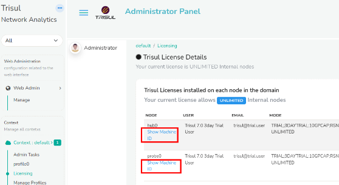
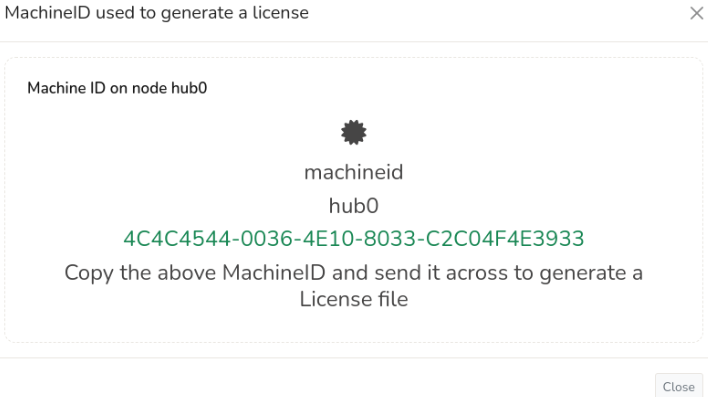
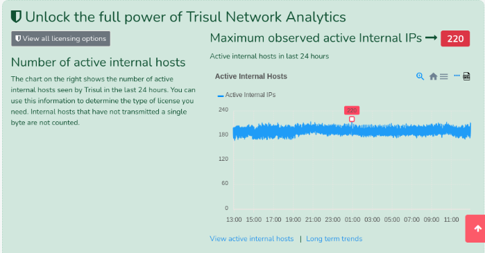

# Introduction 

Trisul Network Analytics licenses are :

1. Perpetual
2. Need one license per physical node
3. Tied to a machine ID (except the built-in trial license)

License types are :

1. **3-Day Trial License** : Every new install comes with this license. It includes all real-time analytics and the most recent 3 days of historical analysis. It is not tied to a machine ID.
2. **Extended Trial License** : A time-limited trial for a longer evaluation. Request it from the **Licensing** page. It is tied to a machine ID and stops on its due date.
3. **Production License** : Licensed for one **Product**, with one **Limit Type** and **Limit**, as explained below.

For more information, see the [Trisul pricing page](https://trisul.org/pricing).

## Product, Limit Type and Limit

Every Trisul 8 license names a Product, says what is counted against the license (the Limit Type) and how much is allowed (the Limit). You can see these in the license file :

```
Product:   NETFLOW
Host:      SELF
LimitType: INTERNAL_HOSTS
Limit:     3000
```

The same details are shown as cards on the **Licensing** page.

### Product

| Product | Use |
|---|---|
| NETFLOW | Traffic and flow analytics from NetFlow, IPFIX and sFlow exports |
| IPDR | IP Detail Record logging : store and search every flow record at very high speed, for compliance |
| ISP | Analytics for Internet Service Providers |
| NSM | Network Security Monitoring from packet capture |

**Host** says where Trisul runs : `SELF` on your own servers or VMs, `CLOUD` for a Trisul cloud deployment.

### Limit Type

The Limit Type is what Trisul counts against your license. A license has one Limit Type. If the license file has no Limit Type, there is no limit.

| Limit Type | What is counted | Products |
|---|---|---|
| INTERNAL_HOSTS | Simultaneously active IP addresses in your [Home Network](/docs/guide/learntrisul/homenetwork_concepts). **This is the default.** | All |
| INTERFACES | Active router interfaces seen in flow exports | All |
| DEVICES | Active devices (routers, switches, firewalls) exporting flows to Trisul | All |
| CONTEXTS | Number of [contexts](/docs/guide/learntrisul/concepts/contexts) on the Trisul hub | All |
| BANDWIDTH | Traffic rate, in bits per second | IPDR only |
| FLOWRECORDSPERDAY | Flow records stored per day | IPDR only |
| INGESTVOLUME | Volume of data ingested per day, in bytes | IPDR only |

### Limit

The Limit is a number, or `UNLIMITED` meaning as many as your hardware can support. Large numbers are written with a suffix :

| Suffix | Means | Example |
|---|---|---|
| K | thousand | `Limit: 500K` |
| M | million | `Limit: 5000M` flow records per day |
| G | billion | `Limit: 10G` bandwidth is 10 Gbps |
| T | trillion | `Limit: 2T` ingest volume is 2 TB per day |

Common Internal Hosts sizes are :

1. Small Business : 500 simultaneously active Internal IPs
2. Medium : 3000 simultaneously active Internal IPs
3. Unlimited : As many as your hardware can support

Limits are counted per context. If the active count goes over your Limit, the **Licensing** page shows a warning.

:::note Trisul 7 licenses

Trisul 7 licenses were always sized by Internal Hosts, shown as `INTERNAL_NODES=` in the `Mode:` line. Trisul 8 needs a Trisul 8 license, see [Installing a License File](/docs/guide/starthere/setuptrisul/license/install).

:::

## Machine ID

Once you have decided which license type suits you, you need to get the Trisul Machine ID that uniquely identifies the server or VM on which you are running Trisul.

### Getting the Machine ID

:::info navigation

:point_right: Login as Admin → **Context : default** → **Licensing**

:::

  
*Figure: Getting the machine-id from the Admin UI*  

Click **Show Machine ID** against each node to get the Machine ID, as shown below.

  
*Figure: Showing a sample of Machine ID*


### Alternate Method: Get Machine ID Using Command Line

Run the following command and send us its output.

 ```BASH
sudo trisul --machineid

4087ACCD-4B0B-DE11-833A-00248CB93BDE
```

That number 4087ACCD-4B0B-DE11-833A-00248CB93BDE is called the MachineID.


## Finding Out What Size License You Need

Before choosing a license size, you need to know your peak usage for the Limit Type you plan to license. Trisul tracks this automatically for you.

To view this information:

:::info navigation

:point_right: Login as Admin → **Context : default** → **Licensing**

:::

  
*Figure: The chart shows the active internal hosts in the past 24 hours*

The chart shows the number of active items of your license's Limit Type over the past 24 hours : internal hosts, interfaces or devices. Use the maximum value in the chart for license sizing. For CONTEXTS, the **Active Contexts** card shows the number of contexts.

Click **Long term trends** to see a longer time window.

**Next:** when you receive your license file, see [Installing a License File](/docs/guide/starthere/setuptrisul/license/install).
