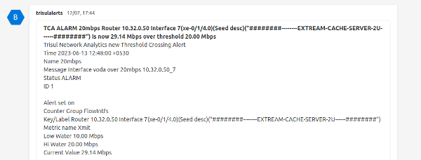

# Microsoft Teams delivery

Trisul can send alerts to a Microsoft Teams channel through a Teams Workflows webhook URL.  

A sample of the alert is shown here.

  
*Figure: Alert Sample*

## Create a Workflows Webhook URL {#setting-up-incoming-webhook-url}

Microsoft is retiring Office 365 Connectors, so Trisul now uses a Teams Workflows webhook instead of a Connectors Incoming Webhook.

1. In Teams, create a channel for Trisul alerts, or pick an existing one.
2. Next to the channel name, click **More options (…)** and select **Workflows**.
3. Select the **Send webhook alerts to a channel** template.
4. Enter a name for the workflow and click **Next**.
5. Check the team and channel, then click **Add workflow**.
6. Copy the webhook URL that Teams shows, then click **Done**.

<!-- TODO(verify): new screenshots of the Workflows steps; first WebTrisul release with Workflows support (03b-Q21-FU) -->

## Add to App Settings

To activate the Webhook and send alerts to Teams. Login as `admin` and,

:::info navigation

:point_right: Go to [App Settings](/docs/guide/ag/webadmin/web_options)&rarr; API Keys&rarr; Microsoft Teams Webhook URL

:::

Enter the Workflows webhook URL that you copied in the previous step.

Ensure that the Email Notification Service is running. This service reads the alerts from syslog and sends them out. Email is the default delivery. When the Teams webhook URL is set, each alert goes to email and to Teams.
