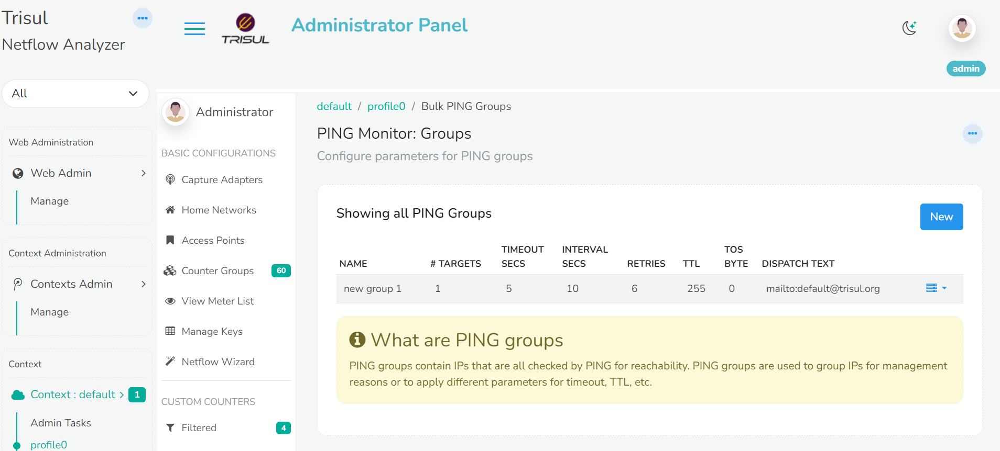
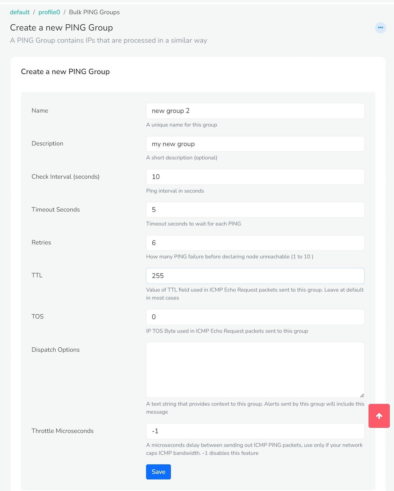
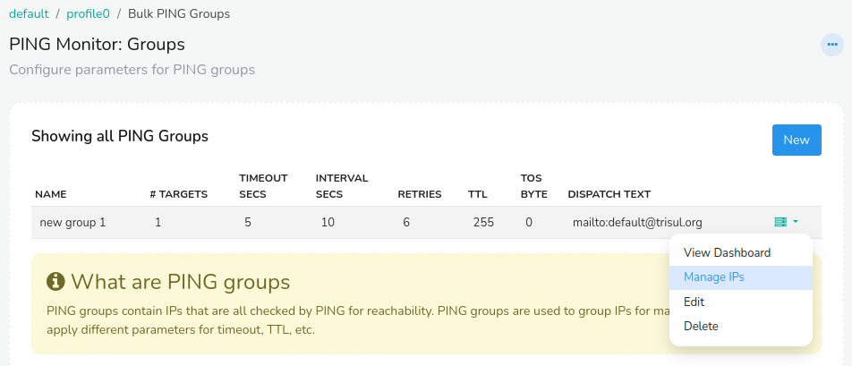
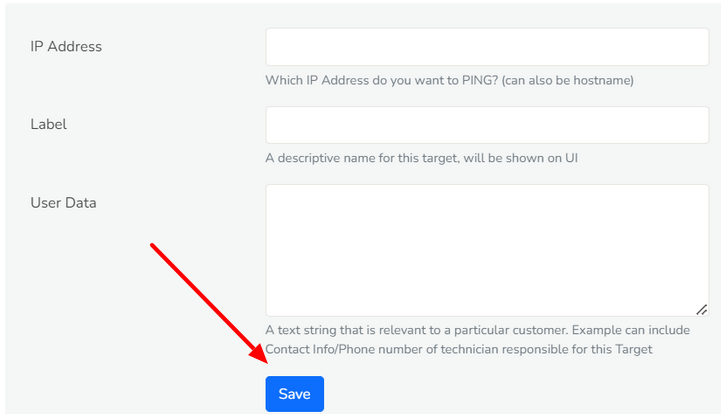
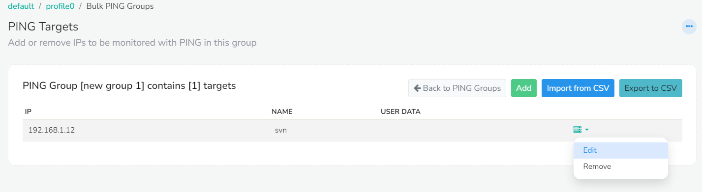
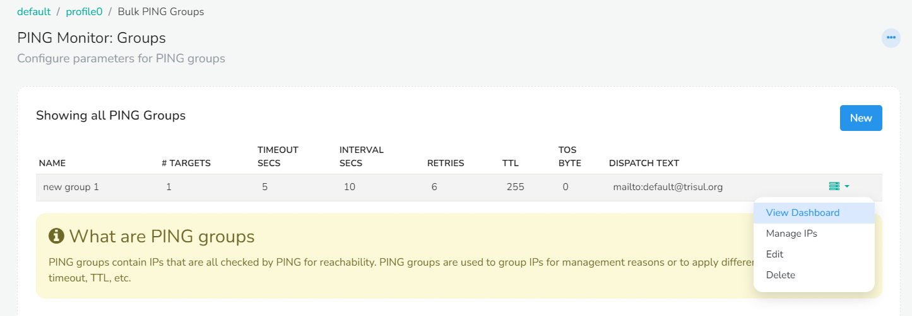
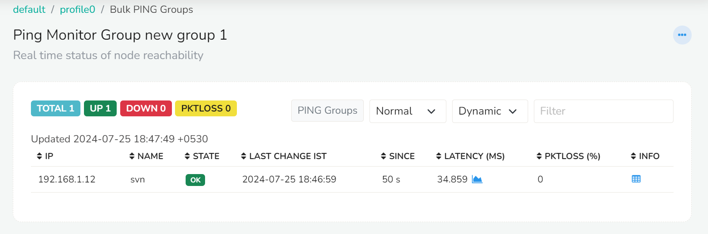

# PING Monitor

PING Monitor allows ISP to monitor a select number of devices for the following 
 - reachability
 - packet drops
 - latency

Using this feature ISPs typically keep track of the health of their key infrastructure elements like routers, mux, servers etc. 

Ping Monitor works in every product mode. It is most useful for ISPs.

To use this feature create PING Groups, these are groups of device IP addresses that represent some part of their network such as customers, infra, servers, etc.  Once these groups are created you view the PING monitor dashboards and see which devices are down, having poor latency, etc.

## Create PING Groups

 Ping groups are collections of IP addresses that are grouped together for monitoring purposes. These groups are organized and managed to monitor multiple devices or hosts based on various criteria, such as their function, location, or importance.

To create PING groups:

:::note Navigation
Log in as admin and go to **Context: default → profile0 → Bulk PING Groups**.
:::

You have now landed on the *PING Monitor: Groups* window where you can add, edit and manage PING groups. 

To add a new PING Group,
Click on the *New* button on the right side of the module.
*Create a new PING Group* module will appear with the following fields,

| Fields                   | Description                                                                                                                          |
| ------------------------ | ------------------------------------------------------------------------------------------------------------------------------------ |
| Name                     | Provide a name for your PING group                                                                                                   |
| Description              | Enter a short description                                                                                                            |
| Check interval (seconds) | By default ping interval in seconds is set to 10. Change if necessary.                                                               |
| Timeout seconds          | By default timeout seconds to wait for each PING is set to 5. Change if necessary.                                                   |
| Retries                  | The number of Ping failure before declaring a node unreachable is set to 6 by default. Change if necessary.                          |
| TTL                      | By default the value of TTL field used in ICMP Echo Request packets sent to this group is set to 255. Leave at default in most cases |
| TOS                      | Enter the IP TOS byte used in ICMP Echo Request packets sent to this group                                                           |
| Dispatch Options         | Enter the mail id to which alert has to be sent. For example: mailto:noc@example.com                                     |
| Throttle Microseconds    | A microseconds delay between sending out ICMP PING packets, use only if your network caps ICMP bandwidth. -1 disables this feature.  |

Once providing all the fields, Click *Save*.

The new group appears in the **PING Monitor: Groups** list, where you can edit it.

## Add IPs to the PING Group

Once you have added the Ping groups to the Ping Monitor module you can add the IPs to be monitored on that Ping group.

To manage IPs on the PING groups,
Click on the dropdown option button on the right side against the PING group you would like to manage. From the list of dropdown options click *Manage IPs*.

Click on the *Add* button to add or remove IPs to be monitored with PING in this group. The *Add Ping Target to group* module will appear with the following fields.

| Fields     | Description                                                                                      |
| ---------- | ------------------------------------------------------------------------------------------------ |
| IP Address | Enter the IP address or host name you want to ping                                               |
| Label      | Provide a label name for the IP address                                                          |
| User Data  | You can provide user data like contact info/ phone number responsible for this target IP address |

Once you have provided the required fields, click Save.

Trisul now monitors the IP address.

The newly added IP can be edited or removed using the dropdown option button on the right side against the IP address listed.

You can export the list of IPs by clicking on the *Export to CSV* button on the top right corner. You can also import the data by clicking on the *Import from CSV* button right next to the Export button.

## View Dashboard

Once the IP addresses are added to the Ping groups you can check for the state of the IPs in the dashboard.

On the *Ping Monitor:Groups* module, Click on the drop down option button on the right side against Ping group you would like to monitor. From the list of drop down options click *View Dashboard*. 

This will take you to the *Ping Monitor Group default* window where you can see the real time status of node reachability.

On the Dashboard module you can see the Total number of IPs, Number of IPs in Up state, Number of IPs in Down state, and number of packet losses at the top left of the module. You can change the view to Normal, Compact, Dynamic and Fixed using the dropdown buttons on the top right of the module.
The Dashboard module contains the following details.

| Fields          | Information                                                                                |
| --------------- | ------------------------------------------------------------------------------------------ |
| IP              | The added IP address                                                                       |
| Name            | The label name of the IP address                                                           |
| State           | The state of the IP address indicating Up/Down/Packetloss                                  |
| Last change IST | The last changed time of the IP address state                                              |
| Since           | The time since when the IP address has been in that state                                  |
| Pktloss         | The percentage of packet loss, if any                                                |
| Info            | Click on the info button against the IP address you would like to view the ping history of |

## Start and Stop the Ping Server {#ping}

Trisul pings the IP addresses in your PING Groups while the ping server runs. Start and stop it from the web interface.

:::note Navigation
Log in as admin and go to **Context: default → Admin Tasks → Start/Stop Tasks**.
:::

1. Find the Probe node, for example **probe0**.
2. Open its **Tools** menu and click **Start Ping Server**.

To stop the ping server, click **Stop Ping Server** in the same menu.

To see the equivalent command line, click **How to start ping server?** in the same menu.
