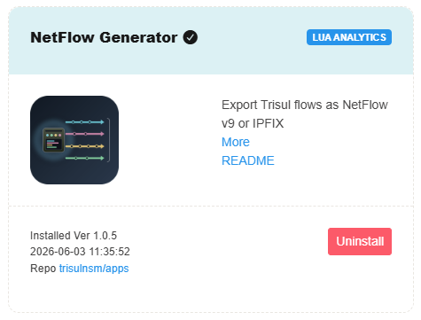

# NFGen Flow Conversion

NBAD includes **NetFlow Generator** (NFGen), an app that exports the flows Trisul builds from captured packets as NetFlow v5, NetFlow v9 or IPFIX records. Use it to send Trisul's flows to a collector that expects NetFlow. NFGen does not convert other flow formats.

## Enabling NFGen

To access Trisul Apps, Login as admin user

:::info Navigation
:point_right: Go to **Web Admin &rarr; Manage &rarr; Apps**
:::



**NetFlow Generator** is available as a Trisul App. To enable flow format conversion, install the NetFlow Generator app from the Trisul Apps repository and configure the desired export format

## Configuring NFGen

The NFGen configuration file is located at:

```
/usr/local/var/lib/trisul-probe/domain0/probe0/context0/config/trisulnsm_nfgen.lua
```

Set these keys in the configuration file, then restart the Probe:

| Key | Default | Description |
| --- | --- | --- |
| `enabled` | `true` | Turns export on or off. |
| `netflow_version` | `'v10'` | Export format: `v5`, `v9` or `v10` (IPFIX). |
| `collector_ip` | `'127.0.0.1'` | IP address of the collector. |
| `collector_port` | `2055` | Port of the collector. |
| `export_only_terminated` | `false` | Export only flows that have ended. |
| `max_records_per_packet` | `24` | Maximum flow records in one export packet. |
| `template_refresh_seconds` | `15` | Seconds between template resends (v9 and IPFIX). |
| `template_refresh_packets` | `10` | Packets between template resends (v9 and IPFIX). |


## Supported Export Formats

NFGen currently supports exporting flow records in the following formats:

* NetFlow v5
* NetFlow v9
* IPFIX (v10)

